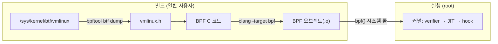

# 00. 실습 환경

> **핵심 요약**
> 1. eBPF 실습에는 **5.8 이상 커널 + BTF(`/sys/kernel/btf/vmlinux`)**, 그리고 clang·bpftool·bpftrace가 있으면 충분하다.
> 2. BPF 프로그램을 **로드하는 일은 root(또는 CAP_BPF 등)가 필요**하다. 이 저장소는 "빌드는 일반 사용자, 실행만 root"로 나눈다.
> 3. `make check`(root 불필요)와 `sudo make -C chapters/00-setup/code run`으로 내 환경이 준비됐는지 확인한다.

## 1. 개념

### 무엇이 필요한가



| 구성 요소 | 왜 필요한가 | 확인 방법 |
|---|---|---|
| 커널 5.8+ | ring buffer, CAP_BPF 등 이 저장소 예제가 쓰는 기능의 하한선 | `uname -r` |
| BTF(BPF Type Format) | 커널 구조체 정보. `vmlinux.h` 생성과 CO-RE(한 번 컴파일해 여러 커널에서 실행)에 필요 | `ls /sys/kernel/btf/vmlinux` |
| clang/LLVM | C를 eBPF 바이트코드로 컴파일(`-target bpf`) | `clang --version` |
| bpftool | 로드·attach·조회·BTF 덤프 등 BPF의 "스위스 칼" | `bpftool version` |
| bpftrace | 한 줄짜리 추적 스크립트 언어(02장) | `bpftrace --version` |
| Go 1.25+ | 07장 cilium/ebpf 실습 | `go version` |

### 권한

일반 사용자가 BPF를 로드하지 못하게 막는 설정이 `kernel.unprivileged_bpf_disabled`다. 최근 배포판의 기본값은 `2`(비특권 BPF 금지, 관리자가 다시 열 수는 없음)이다. 그래서:

- **root로 실행**하는 것이 가장 간단하다. 이 저장소의 `make run`은 내부에서 `sudo`를 붙인다.
- 운영 환경에서는 root 대신 **`CAP_BPF` + `CAP_PERFMON`**(tracing) 또는 **`CAP_BPF` + `CAP_NET_ADMIN`**(네트워크)만 주는 방식을 쓴다(5.8+).
- 컨테이너 안에서 실습한다면 위 capability와 `/sys/kernel/btf`, `/sys/fs/bpf`, `/sys/kernel/tracing` 마운트가 필요하다.

> **빌드는 일반 사용자로 하자.** `sudo make build`처럼 root로 빌드하면 `bin/`, `*.o`, Go 캐시가 root 소유가 되어 이후 빌드가 꼬인다. 이 저장소의 `run` 타깃은 미리 빌드된 결과물만 실행한다.

### lockdown과 LSM

- **lockdown**(커널 잠금): Secure Boot가 켜진 일부 배포판은 `integrity`나 `confidentiality` 모드로 부팅된다. `confidentiality`면 `bpf_probe_read_*` 같은 커널 메모리 읽기가 막혀 추적 예제 대부분이 실패한다. `cat /sys/kernel/security/lockdown`으로 확인한다.
- **LSM-BPF**는 커널이 `CONFIG_BPF_LSM=y`로 빌드됐더라도 부팅 인자 `lsm=` 목록에 `bpf`가 있어야 켜진다. 12장에서만 필요하다.

## 2. 예제

| 파일 | 내용 | root |
|---|---|---|
| [`code/check-env.sh`](code/check-env.sh) | 커널 버전, BTF, 커널 설정(`CONFIG_*`), 런타임 설정, 도구 버전 점검 | 불필요 |
| [`code/root-check.sh`](code/root-check.sh) | bpftrace로 최소 프로그램 실행, `bpftool feature probe`로 지원 기능 확인 | 필요 |
| [`code/Makefile`](code/Makefile) | `check` / `build`(vmlinux.h 생성) / `run` | |

### 설치 (Ubuntu 24.04 기준)

```bash
sudo apt install -y clang llvm make bpftrace linux-tools-common linux-tools-$(uname -r)
```

- `bpftool`은 `linux-tools-$(uname -r)` 패키지에 들어 있다.
- `libbpf-dev`는 **필요 없다.** 이 저장소는 libbpf 헤더 사본을 [`include/bpf/`](../../include/)에 두었다.
- Go는 Ubuntu 패키지(`golang-go`)가 1.22라서 cilium/ebpf v0.22가 요구하는 1.25보다 낮다. [go.dev/dl](https://go.dev/dl/)의 공식 배포판을 쓰거나, 1.21 이상이 있다면 `GOTOOLCHAIN=auto`(기본값)로 필요한 버전을 자동으로 받게 둔다.

> 이 머신에는 도구가 이미 설치되어 있어서, 위 설치 명령 자체는 이 문서를 쓰면서 다시 실행해 보지 않았다(패키지 이름은 `apt-cache policy`로 확인).

### 실행

```bash
make check                                  # = make -C chapters/00-setup/code check
make vmlinux                                # include/vmlinux.h 생성 (다른 챕터가 사용)
sudo make -C chapters/00-setup/code run     # root 점검, 결과: code/out/run.log
```

### 실행 결과 (Linux 6.17 x86_64)

`make check` (root 불필요):

```
== 커널
  버전: 6.17.0-35-generic (x86_64)
  [OK]   5.8 이상 (ring buffer, CAP_BPF 사용 가능)
== BTF
  [OK]   /sys/kernel/btf/vmlinux (6917319 bytes) — CO-RE 사용 가능
== 커널 설정 (/boot/config-6.17.0-35-generic)
  [OK]   CONFIG_BPF=y
  [OK]   CONFIG_BPF_SYSCALL=y
  [OK]   CONFIG_BPF_JIT=y
  [OK]   CONFIG_DEBUG_INFO_BTF=y
  [OK]   CONFIG_KPROBES=y
  … (생략)
  [OK]   CONFIG_BPF_LSM=y
== 런타임 설정
  [OK]   unprivileged_bpf_disabled=2: BPF 로드에 root(또는 CAP_BPF) 필요 — 정상
  [OK]   bpf_jit_enable=1 (JIT 사용)
  [OK]   bpffs 마운트됨: /sys/fs/bpf
  [OK]   tracefs 마운트됨
  [OK]   lockdown=none
  [WARN] 활성 LSM에 bpf 없음(lockdown,capability,landlock,yama,apparmor,ima,evm) — 12장(LSM-BPF) 실습 시 부팅 인자 변경 필요
== 도구
  [OK]   clang: Ubuntu clang version 18.1.3 (1ubuntu1)
  [OK]   llc: Ubuntu LLVM version 18.1.3
  [OK]   bpftool: bpftool v7.7.0
  [OK]   bpftrace: bpftrace v0.20.2
  [OK]   go: go version go1.26.0 linux/amd64
  [OK]   make: GNU Make 4.3
  [OK]   llvm-objdump: Ubuntu LLVM version 18.1.3

결과: 필수 항목 통과
```

`sudo make -C chapters/00-setup/code run`:

```
== 1) bpftrace로 최소 프로그램 실행
Attaching 1 probe...
hello from bpftrace (pid 2500451)

== 2) bpftool feature probe — 주요 항목만 발췌
  	- bpf_loop
  	- bpf_ringbuf_reserve
  	- bpf_ringbuf_reserve_dynptr
  eBPF map_type array is available
  eBPF map_type hash is available
  eBPF map_type lpm_trie is available
  eBPF map_type lru_hash is available
  eBPF map_type percpu_array is available
  eBPF map_type ringbuf is available
  eBPF program_type kprobe is available
  eBPF program_type lsm is available
  eBPF program_type sched_cls is available
  eBPF program_type tracepoint is available
  eBPF program_type tracing is available
  eBPF program_type xdp is available
  JIT compiler is enabled
== 3) 현재 로드된 BPF 프로그램 수
  33 개 (systemd 등이 이미 쓰고 있을 수 있다)
```

마지막 줄처럼, 아무것도 하지 않은 시스템에도 BPF 프로그램이 이미 수십 개 올라가 있다. systemd(cgroup 장치 제어, 소켓 필터 등)가 쓰는 것들이다. `sudo bpftool prog show`로 직접 확인해 보자.

### 코드 해설

- `check-env.sh`의 커널 설정은 `/boot/config-$(uname -r)` 또는 `/proc/config.gz`에서 읽는다. 둘 다 없는 환경(일부 클라우드 이미지)에서는 `[WARN]`으로 표시된다.
- `bpf_jit_enable`은 `CONFIG_BPF_JIT_ALWAYS_ON=y` 커널에서 root만 읽을 수 있어서, 읽지 못하면 커널 설정으로 대신 판단한다.
- `root-check.sh`의 `bpftool feature probe kernel`은 커널이 지원하는 프로그램 타입·map 타입·helper를 실제로 시험 로드해 보고 알려 준다. 전체 출력은 수백 줄이니 한 번은 그대로 읽어 보자.

## 3. VM으로 실습하기 (macOS·Windows·오래된 커널)

호스트 커널이 오래됐거나 macOS를 쓴다면 최신 Ubuntu VM을 띄우는 것이 가장 빠르다. **이 절의 VM 구성은 이 저장소에서 검증하지 않았다**(검증 환경은 Ubuntu 호스트). 방향만 안내한다.

- [Lima](https://lima-vm.io/): macOS에서 Ubuntu VM을 쉽게 띄운다. Apple Silicon에서는 arm64 VM이 되므로 uprobe 경로 등 아키텍처별 부분(02장 09번)만 바꾸면 된다.
- [Multipass](https://canonical.com/multipass): Canonical의 Ubuntu VM 도구. macOS·Windows·Linux 지원.
- 어떤 VM이든 VM 안에서 위 "설치" 절을 실행하고 `make check`가 통과하면 된다. Ubuntu 24.04의 HWE 커널(6.8+)이면 모든 기본 예제가 동작할 것이다.

## 4. 직접 해보기

1. `make check`를 실행하고 `[WARN]`/`[FAIL]` 항목의 의미를 이 문서에서 찾아 설명해 보자.
2. `sudo bpftool feature probe kernel | grep -c "is available"`로 지원 기능 개수를 세어 보자.
3. `sudo bpftool prog show`로 이미 로드된 프로그램을 보고, `type` 열에 어떤 프로그램 타입들이 있는지 정리해 보자.
4. `ls -lh include/vmlinux.h`로 크기를 보고, `grep -n "^struct task_struct {" include/vmlinux.h`로 프로세스 구조체 정의를 찾아보자.

## 5. 자주 하는 실수

- **`sudo make build`로 빌드** — 산출물과 Go 캐시가 root 소유가 된다. `make clean`도 실패하면 `sudo chown -R $USER .`로 되돌린다.
- **`! sudo …`(비대화형 셸)에서 비밀번호 입력 불가** — sudo는 비밀번호를 터미널에서만 읽는다. 별도 터미널에서 실행하자.
- **`/sys/kernel/btf/vmlinux` 없음** — `CONFIG_DEBUG_INFO_BTF=y`가 아닌 커널이다. 배포판 커널을 최신으로 올리거나 VM을 쓰자. (BTFHub처럼 외부 BTF를 쓰는 방법도 있지만 이 저장소 범위 밖이다.)
- **bpftrace "ERROR: bpftrace currently only supports running as the root user"** — 정상이다. `sudo`로 실행한다.
- **`Operation not permitted` / `EPERM`으로 로드 실패** — root가 아니거나, 컨테이너에 capability가 없거나, lockdown 상태다. 오래된 커널(5.11 미만)에서는 `RLIMIT_MEMLOCK` 한도 때문일 수도 있다(07장의 `rlimit.RemoveMemlock()` 참고).

## 6. 더 읽을거리

| 자료 | 라이선스 | 이 챕터에서의 사용 |
|---|---|---|
| [bpftool 소스·문서](https://github.com/libbpf/bpftool) | GPL-2.0 OR BSD-2-Clause | 명령 사용법 참고 |
| [커널 문서: BPF](https://docs.kernel.org/bpf/) | GPL-2.0 | 개념 참고(재서술) |
| [ebpf.io: What is eBPF?](https://ebpf.io/what-is-ebpf/) | CC BY 4.0 | 개념 참고(재서술) |
| [bpftrace INSTALL](https://github.com/bpftrace/bpftrace/blob/master/INSTALL.md) | Apache-2.0 | 설치 참고 |
| [`capabilities(7)` CAP_BPF 항목](https://man7.org/linux/man-pages/man7/capabilities.7.html) | man-pages 라이선스 | 권한 설명 참고(재서술) |
