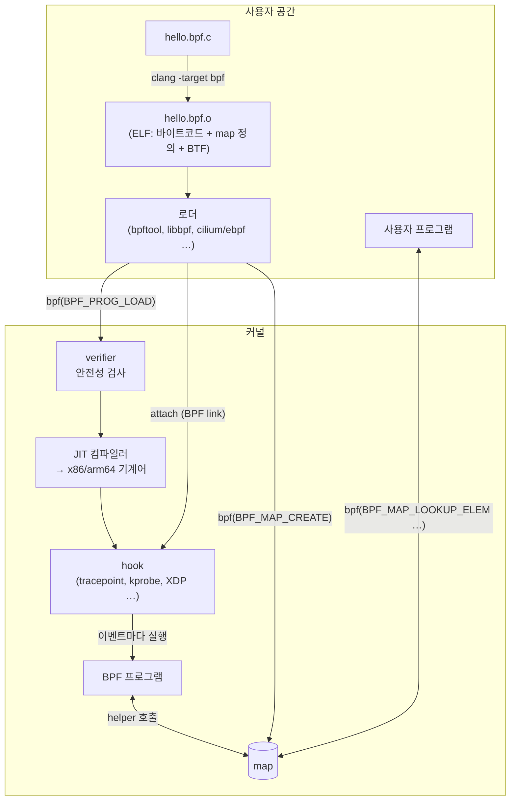
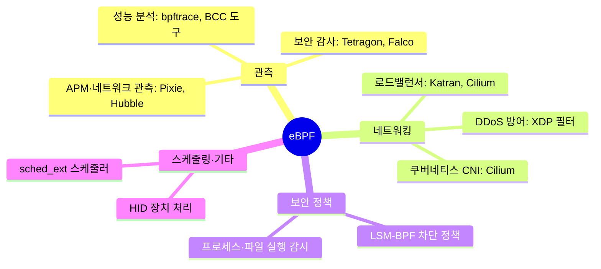

# 01. eBPF 큰 그림

> **핵심 요약**
> 1. eBPF는 **커널 안에서, 검증된 작은 프로그램을, 이벤트가 생길 때마다 실행**하는 기술이다. 커널을 고치거나 모듈을 올리지 않고도 커널 동작을 관찰하고 바꿀 수 있다.
> 2. 흐름은 **C 코드 → clang → 바이트코드 → (bpf 시스템 콜) → verifier → JIT → hook에 attach**이고, 결과는 **map**을 통해 사용자 공간과 주고받는다.
> 3. 이 장의 예제 하나로 이 단계를 `llvm-objdump`와 `bpftool`로 **눈으로 하나씩 확인**한다.

## 1. 개념

### 1.1 왜 eBPF인가

커널에 기능을 넣는 전통적인 방법은 두 가지였다. 커널 소스를 고쳐 업스트림에 넣거나(수년이 걸림), 커널 모듈을 만드는 것(버그 하나가 시스템 전체를 멈출 수 있음)이다.
eBPF는 세 번째 길이다. **커널이 미리 정해 둔 지점(hook)** 에 **커널이 안전하다고 검증한 프로그램만** 붙여 실행한다. 그래서:

- **안전하다**: verifier(검증기)가 로드 시점에 무한 루프, 잘못된 메모리 접근, 초기화 안 된 값 사용 등을 거부한다.
- **빠르다**: JIT(Just-In-Time) 컴파일러가 바이트코드를 기계어로 바꿔 커널 함수처럼 실행된다.
- **바로 적용된다**: 재부팅이나 재컴파일 없이 실행 중인 커널에 붙였다 뗄 수 있다.

### 1.2 전체 흐름



| 단계 | 하는 일 | 이 장에서 확인하는 방법 |
|---|---|---|
| 컴파일 | C → eBPF 바이트코드(64비트 레지스터 `r0`~`r10`, 명령어 8바이트) | `llvm-objdump -d hello.bpf.o` |
| 로드 | 로더가 ELF를 읽어 map을 만들고, map 참조를 실제 map으로 고쳐 쓴 뒤(재배치) `bpf()` 시스템 콜로 프로그램을 넘긴다 | `bpftool prog loadall` |
| 검증 | verifier가 모든 실행 경로를 따라가며 안전성 검사. 통과 못 하면 로드 실패 | 로드 성공 여부, `xlated` 덤프 |
| JIT | 검증된 바이트코드를 CPU 기계어로 번역 | `bpftool prog dump jited` |
| attach | hook에 연결. 이후 이벤트마다 실행 | `bpftool link show` |
| 데이터 교환 | 프로그램은 helper로 map에 쓰고, 사용자 공간은 시스템 콜로 읽는다 | `bpftool map dump` |

### 1.3 구성 요소 다섯 가지

- **프로그램 타입(program type)**: 어디에 붙고, 어떤 컨텍스트(ctx)를 받으며, 어떤 helper를 쓸 수 있는지를 정한다. 이 예제는 `tracepoint` 타입이다.
- **hook**: 프로그램이 실행되는 지점. 크게 *관측용*(kprobe, tracepoint, uprobe, perf 이벤트 …)과 *제어용*(XDP, TC, cgroup, LSM …)으로 나뉜다. → 03장, 09~12장
- **map**: 커널과 사용자 공간이 공유하는 키-값 저장소. 프로그램끼리 상태를 공유할 때도 쓴다. → 04장
- **helper 함수**: 프로그램이 호출할 수 있는 커널 함수 목록(`bpf_map_lookup_elem`, `bpf_get_current_pid_tgid` 등). 아무 커널 함수나 부를 수는 없다.
- **BTF(BPF Type Format)**: 타입 정보. 커널 구조체를 이해하고(CO-RE), 덤프를 사람이 읽을 수 있게 해 준다. → 06장

### 1.4 쓰임새 지도



"관측(무엇이 일어나는지 본다)"과 "제어(패킷·시스템 콜을 통과·차단·변경한다)"의 두 축으로 기억하면 된다. 이 저장소는 01~08장에서 관측을, 09~12장에서 제어를 다룬다.

## 2. 예제: execve를 세는 프로그램을 단계별로 해부하기

| 파일 | 내용 |
|---|---|
| [`code/hello.bpf.c`](code/hello.bpf.c) | `execve` 시스템 콜 tracepoint에 붙어 UID별 횟수를 hash map에 세고, `bpf_printk`로 로그를 남긴다 |
| [`code/run.sh`](code/run.sh) | bpftool로 로드·attach → 정보·xlated·JIT 덤프 → 부하 발생 → map·로그 확인 → 정리 (root) |
| [`code/Makefile`](code/Makefile) | `build`(컴파일 + objdump, 비root) / `run`(root) |

```c
struct {
	__uint(type, BPF_MAP_TYPE_HASH);
	__uint(max_entries, 1024);
	__type(key, u32);   // uid
	__type(value, u64); // execve 호출 횟수
} exec_count SEC(".maps");

SEC("tracepoint/syscalls/sys_enter_execve")
int count_execve(struct trace_event_raw_sys_enter *ctx)
{
	u32 uid = (u32)bpf_get_current_uid_gid();
	u64 one = 1, *cnt;
	char comm[16];

	cnt = bpf_map_lookup_elem(&exec_count, &uid);
	if (cnt)
		__sync_fetch_and_add(cnt, 1);
	else
		bpf_map_update_elem(&exec_count, &uid, &one, BPF_NOEXIST);

	bpf_get_current_comm(comm, sizeof(comm));
	bpf_printk("execve by uid=%d comm=%s", uid, comm);
	return 0;
}

char LICENSE[] SEC("license") = "Dual MIT/GPL";
```

### 실행

```bash
cd chapters/01-big-picture/code
make build       # root 불필요: hello.bpf.o + out/sections.txt + out/bytecode.txt
make run         # 내부에서 sudo로 실행(비밀번호 입력). 결과는 out/run.log
```

### 실행 결과 ① 컴파일 결과물 들여다보기 (root 불필요)

`llvm-objdump -h hello.bpf.o` — ELF 섹션 (발췌):

```
Idx Name                                     Size     VMA              Type
  3 tracepoint/syscalls/sys_enter_execve     00000108 0000000000000000 TEXT
  4 .reltracepoint/syscalls/sys_enter_execve 00000030 0000000000000000
  5 .maps                                    00000020 0000000000000000 DATA
  6 .rodata                                  00000019 0000000000000000 DATA
  7 license                                  0000000d 0000000000000000 DATA
 17 .BTF                                     000005ef 0000000000000000
 19 .BTF.ext                                 000000f0 0000000000000000
```

- 프로그램은 `SEC("…")`에 쓴 이름의 섹션에 들어간다. **로더는 이 섹션 이름을 보고 프로그램 타입과 attach 지점을 추론한다.**
- `.maps`는 map 정의, `.rodata`는 `bpf_printk`의 형식 문자열, `license`는 라이선스 문자열이다. GPL 호환 라이선스가 아니면 GPL 전용 helper(`bpf_printk` 등)를 쓸 수 없다.
- `.rel…` 섹션은 "여기 map 주소를 채워 넣어라"라는 재배치 정보다.

`llvm-objdump -d hello.bpf.o` — eBPF 바이트코드 (전체 33개 명령어 중 앞부분):

```
0000000000000000 <count_execve>:
       0:	call 0xf                       ; helper 15 = bpf_get_current_uid_gid
       1:	*(u32 *)(r10 - 0x4) = r0       ; 반환값(r0)을 스택(r10=프레임 포인터)에 저장 → uid
       2:	r6 = 0x1
       3:	*(u64 *)(r10 - 0x10) = r6      ; one = 1
       4:	r2 = r10
       5:	r2 += -0x4                     ; r2 = &uid  (두 번째 인자)
       6:	r1 = 0x0 ll                    ; r1 = &exec_count (첫 번째 인자) ← 로드 시 실제 map으로 재배치
       8:	call 0x1                       ; helper 1 = bpf_map_lookup_elem
       9:	if r0 == 0x0 goto +0x2 <LBB0_2>   ; NULL이면 update 쪽으로
      10:	lock *(u64 *)(r0 + 0x0) += r6     ; __sync_fetch_and_add → 원자적 덧셈
```

(주석 `;` 부분은 설명을 위해 덧붙였다.) 몇 가지가 눈에 띈다.

- 인자는 `r1`~`r5`, 반환값은 `r0`, 스택 포인터는 읽기 전용 `r10`이다. 스택은 512바이트로 제한된다.
- helper는 번호로 호출된다(`call 0x1`). 6번 줄의 `r1 = 0x0 ll`은 아직 map이 없어서 0으로 비워 둔 자리다.
- `if r0 == 0x0` — `bpf_map_lookup_elem`이 NULL을 돌려줄 수 있으므로 **NULL 검사가 없으면 verifier가 로드를 거부한다.** C 코드의 `if (cnt)`가 그 역할이다.

### 실행 결과 ② 커널에 올려 보기 (root)

`make run` (발췌):

```
== 1) 로드 + 자동 attach (verifier 통과 시에만 성공)
  count_execve
== 2) 커널에 올라간 프로그램 정보
647818: tracepoint  name count_execve  tag b58ff3a7e0136a30  gpl
	loaded_at 2026-10-26T09:54:12+0900  uid 0
	xlated 280B  jited 169B  memlock 4096B  map_ids 1932,1934
	btf_id 431
```

- `647818`은 프로그램 ID, `tag`는 명령어 해시다. 같은 코드면 tag가 같다.
- `xlated 280B`(바이트코드 35개 × 8바이트)가 `jited 169B` x86 기계어가 되었다.
- `map_ids`가 **두 개**다. `exec_count`, 그리고 `bpf_printk`의 형식 문자열이 들어 있는 `.rodata`가 내부 map(이름이 `….rodata`로 끝난다)으로 만들어졌다. 전역 변수·상수도 map으로 구현된다.

```
== 3) verifier가 고쳐 쓴 뒤의 명령어(xlated) — 앞부분
int count_execve(struct trace_event_raw_sys_enter * ctx):
; u32 uid = (u32)bpf_get_current_uid_gid();
   0: (85) call bpf_get_current_uid_gid#299216
; u32 uid = (u32)bpf_get_current_uid_gid();
   1: (63) *(u32 *)(r10 -4) = r0
   2: (b7) r6 = 1
; u64 one = 1, *cnt;
   3: (7b) *(u64 *)(r10 -16) = r6
   4: (bf) r2 = r10
; u32 uid = (u32)bpf_get_current_uid_gid();
   5: (07) r2 += -4
; cnt = bpf_map_lookup_elem(&exec_count, &uid);
```

컴파일러 출력(`call 0xf`)과 달리 helper 이름과 커널 내부 주소(`#299216`)로 바뀌었고, BTF 덕분에 C 소스 줄이 주석으로 함께 나온다. **로드가 끝난 프로그램을 디버깅할 때 보는 것은 이 xlated 덤프다.**

```
== 4) JIT 결과
  (이 bpftool은 JIT 역어셈블을 지원하지 않는다) 크기만 확인:
  xlated 280B  jited 169B
```

Ubuntu 패키지의 bpftool은 LLVM/libbfd 역어셈블러 없이 빌드되어 있어 `bpftool prog dump jited`가 `Error: No JIT disassembly support`로 실패한다. 기계어를 보고 싶다면 [bpftool 소스](https://github.com/libbpf/bpftool)를 LLVM과 함께 직접 빌드한다. JIT 자체는 정상 동작하고 있다(`jited 169B`).

```
== 5) 이벤트 발생: nobody 사용자로 명령 실행
== 6) map 내용 (key=uid, value=횟수) — 시스템 전체 execve가 집계된다
[{
        "key": 1000,
        "value": 778
    },{
        "key": 65534,
        "value": 3
    },{
        "key": 0,
        "value": 34
    }
]
```

부하로 실행한 `nobody`(UID 65534)의 execve 3회(`su`가 띄운 `sh`, 그 `sh`가 실행한 `/bin/true` 2회)가 정확히 잡혔다. 나머지는 같은 3초 동안 **시스템의 다른 사용자**가 실행한 것이다. tracepoint는 특정 프로세스가 아니라 시스템 전체에 붙는다는 점을 기억하자. map 덤프가 이렇게 키·값 이름이 붙은 JSON 형태로 나오는 것은 map에 BTF 타입 정보가 있기 때문이다.

```
== 7) bpf_printk 출력 (trace_pipe) — 이 예제가 남긴 줄만
<...>-2883822 [006] ...21 11916450.377492: bpf_trace_printk: execve by uid=65534 comm=su
sh-2883823 [014] ...21 11916450.378453: bpf_trace_printk: execve by uid=65534 comm=sh
<...>-2883824 [014] ...21 11916450.379305: bpf_trace_printk: execve by uid=65534 comm=sh
```

`태스크-PID [CPU] 플래그 타임스탬프: 메시지` 형식이다. `comm`이 `su`/`sh`인 것은 execve를 **호출한** 쪽의 이름이기 때문이다(아직 새 프로그램으로 바뀌기 전).

```
== 8) 정리: 핀 파일을 지우면 link가 해제되고 프로그램도 내려간다
647952: tracepoint  name count_execve  tag b58ff3a7e0136a30  gpl
	…
```

핀을 지운 **직후**에는 프로그램이 아직 보인다. 마지막 참조가 사라진 뒤 커널이 RCU 유예 기간이 지나고 **비동기로** 해제하기 때문이다. 잠시 뒤 `sudo bpftool prog show name count_execve`를 다시 실행하면 사라져 있다.

```
== 9) 일부러 실패시키기 ① NULL 검사 제거 (bad-null.bpf.o)
7: (b7) r1 = 1                        ; R1_w=1
8: (db) lock *(u64 *)(r0 +0) += r1
R0 invalid mem access 'map_value_or_null'
== 10) 일부러 실패시키기 ② GPL이 아닌 라이선스 (bad-license.bpf.o)
cannot call GPL-restricted function from non-GPL compatible program
```

`make build`는 `hello.bpf.c`를 `sed`로 고쳐 일부러 틀린 변형 두 개를 만든다.

- ① `if (cnt)`를 `if (1)`로 바꿨다. verifier는 `bpf_map_lookup_elem`의 반환값(`r0`)을 "map 값 **또는 NULL**"(`map_value_or_null`) 타입으로 추적한다. 검사 없이 역참조하면 그 자리(명령어 8)에서 거부한다.
- ② 라이선스를 `"Proprietary"`로 바꿨다. `bpf_printk`(내부적으로 `bpf_trace_printk`)가 GPL 전용 helper라서 거부된다.

전체 verifier 로그는 `out/bad-null.log`에 남는다. 이런 메시지를 읽는 법은 05장에서 다룬다.

### 코드 해설

- `#include "vmlinux.h"`: 실행 중인 커널의 모든 타입 정의. `struct trace_event_raw_sys_enter`(tracepoint 컨텍스트)도 여기서 온다. `make vmlinux`로 생성한다.
- `SEC("tracepoint/syscalls/sys_enter_execve")`: 프로그램 타입(`tracepoint`)과 attach 지점(`syscalls:sys_enter_execve`)을 동시에 알려 준다. 가능한 tracepoint 목록은 `sudo ls /sys/kernel/tracing/events/syscalls/`.
- `bpf_get_current_uid_gid()`: 하위 32비트가 UID, 상위 32비트가 GID다.
- **lookup → 있으면 원자 증가, 없으면 `BPF_NOEXIST`로 삽입**은 카운터 map의 정석 패턴이다. 여러 CPU에서 동시에 실행되므로 `__sync_fetch_and_add`(원자 연산)가 필요하다. 동시에 두 CPU가 "없음"을 보고 둘 다 삽입하면 하나가 `-EEXIST`로 실패해 1회가 빠질 수 있다. 예제는 단순함을 위해 반환값을 무시했다. 정확해야 한다면 삽입 실패 시 다시 lookup해서 더하거나, per-CPU map을 쓴다(04장, 07장).
- `bpf_printk`: 디버깅용 출력. `/sys/kernel/tracing/trace_pipe`에 쌓이고 **시스템 전체가 공유**하므로 운영 코드에서는 쓰지 않는다(14장).

## 3. 직접 해보기

1. `out/bad-null.log`의 verifier 로그 전체를 읽고, 명령어마다 레지스터 상태(`R0=…`)가 어떻게 바뀌는지 따라가 보자. `r0`의 타입이 `map_value_or_null`에서 `map_value`로 바뀌는 지점은 어디일까(원래 `hello.bpf.o`로)? → 05장에서 자세히 다룬다.
2. `bad-license.bpf.c`에서 `bpf_printk` 줄을 지우면 `"Proprietary"`로도 로드될까? 이유를 생각해 보고 확인하자.
3. map 키를 UID 대신 `comm`(프로세스 이름, `char[16]`)으로 바꿔 "어떤 프로그램이 execve를 많이 하나"를 세어 보자. `__type(key, char[16])`.
4. `run.sh`를 참고해 프로그램을 로드한 채로 두고(`bpftool prog loadall hello.bpf.o /sys/fs/bpf/ch01 autoattach`), 다른 터미널에서 `sudo bpftool map dump name exec_count`를 반복 실행해 값이 바뀌는지 보자. 끝나면 `sudo rm -r /sys/fs/bpf/ch01`.

## 4. 자주 하는 실수

- **`bpf_map_lookup_elem` 결과를 NULL 검사 없이 사용** — verifier 거부. 항상 `if (!val) return 0;`.
- **라이선스 섹션 누락** — `bpf_printk`, `bpf_probe_read_*` 등 GPL 전용 helper를 쓰면 `cannot call GPL-restricted function` 오류.
- **`bpftool prog load`만 하고 attach하지 않음** — 로드만 하면 이벤트가 와도 실행되지 않는다. `autoattach`를 붙이거나 `bpftool link`/로더 라이브러리로 attach해야 한다.
- **핀을 지우지 않고 종료** — `/sys/fs/bpf`에 핀이 남아 있으면 프로그램이 계속 실행된다. `sudo bpftool prog show`로 확인하고 핀을 지우자.
- **`trace_pipe`를 두 곳에서 동시에 읽음** — 읽는 쪽이 줄을 "소비"하므로 출력이 나뉘어 보인다.
- **verifier가 바이트코드를 고쳐 쓴다는 사실을 모름** — `xlated` 덤프는 컴파일러 출력과 다르다(map 주소·helper 주소 채움, 일부 명령어 치환). 디버깅할 때는 `xlated`를 본다.

## 5. 더 읽을거리

| 자료 | 라이선스 | 이 챕터에서의 사용 |
|---|---|---|
| [ebpf.io: What is eBPF?](https://ebpf.io/what-is-ebpf/) | CC BY 4.0 | 전체 흐름·구성 요소 설명을 참고해 재서술 |
| [커널 문서: eBPF Instruction Set](https://docs.kernel.org/bpf/standardization/instruction-set.html) | GPL-2.0 (RFC 9669로도 발행) | 레지스터·명령어 형식 참고(재서술) |
| [커널 문서: eBPF verifier](https://docs.kernel.org/bpf/verifier.html) | GPL-2.0 | 개념 참고(재서술) |
| [`bpf-helpers(7)`](https://man7.org/linux/man-pages/man7/bpf-helpers.7.html) | GPL-2.0 | helper 번호·의미 확인 |
| [bpftool-prog(8)](https://github.com/libbpf/bpftool/blob/main/docs/bpftool-prog.rst) | GPL-2.0 OR BSD-2-Clause | `loadall`, `dump xlated/jited` 사용법 |
| [Brendan Gregg, *BPF Performance Tools* (2019)](https://www.brendangregg.com/bpf-performance-tools-book.html) | 저작권 도서 | 배경 참고(인용·번역 없음) |
