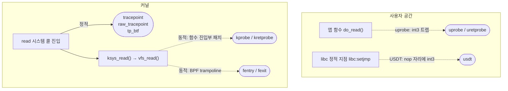
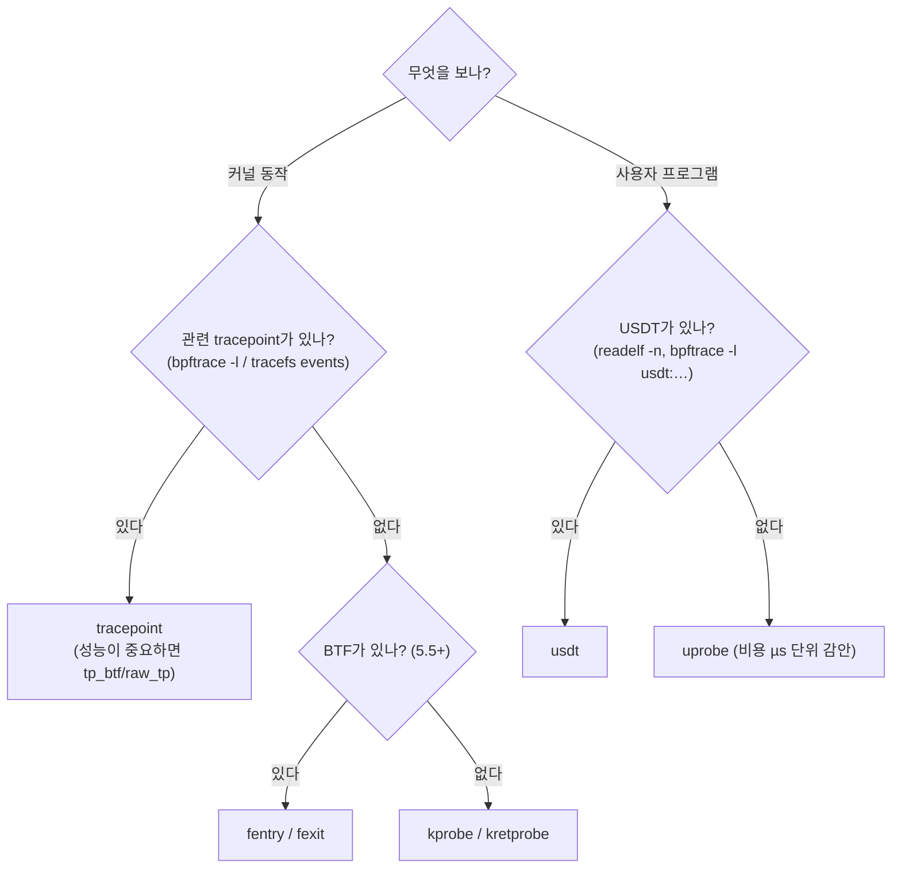

# 03. 프로그램 타입과 tracing hook

> **핵심 요약**
> 1. 관측(tracing)용 hook은 크게 **동적 커널**(kprobe·fentry), **정적 커널**(tracepoint·raw_tp·tp_btf), **사용자 공간**(uprobe·USDT) 세 갈래다. 고르는 기준은 **안정성, 볼 수 있는 정보, 비용**이다.
> 2. 이 머신에서 잰 이벤트 한 번의 추가 비용(중앙값)은 대략 **fentry 130ns < tracepoint 계열·fexit·kprobe 200~245ns < kretprobe 570ns ≪ uprobe 2.1µs < uretprobe 3.1µs**였다.
> 3. 기본 선택 순서: **tracepoint가 있으면 tracepoint → 없으면 fentry/fexit(BTF 필요) → 그래도 안 되면 kprobe**. 사용자 공간은 USDT가 있으면 USDT, 없으면 uprobe를 쓰되 비용(µs 단위)을 감안한다.

## 1. 개념

### 1.1 프로그램 타입 전체 지도

"프로그램 타입(program type)"은 BPF 프로그램이 **어디에 붙고, 어떤 컨텍스트를 받고, 어떤 helper를 쓸 수 있는지**를 정한다. 이 저장소에서 다루는 것만 추려도 이 정도다.

| 분류 | 프로그램 타입 (`SEC` 이름) | 붙는 곳 | 다루는 장 |
|---|---|---|---|
| 관측: 동적 커널 | `kprobe`, `kretprobe`, `kprobe.multi` | 거의 모든 커널 함수 | **03** |
| | `fentry`, `fexit`, `fmod_ret` (타입: tracing) | BTF가 있는 커널 함수 | **03** |
| 관측: 정적 커널 | `tracepoint` | 미리 심어 둔 tracepoint | 01, 02, **03** |
| | `raw_tracepoint`, `tp_btf` | 같은 tracepoint, 가공 전 인자 | **03** |
| 관측: 사용자 공간 | `uprobe`, `uretprobe`, `usdt` | 사용자 프로그램·라이브러리 함수, 정적 지점 | 02, **03** |
| 관측: 기타 | `perf_event` | CPU 샘플링·하드웨어 카운터 | 02, 14 |
| | `iter` | 커널 객체 순회(태스크, 소켓 …) | 13 |
| 네트워크 | `xdp` | NIC 드라이버 수신 직후 | 09, 10 |
| | `tc` / `tcx` (sched_cls) | 트래픽 제어 ingress·egress | 09, 11 |
| | `cgroup_skb`, `cgroup/connect4` 등 (cgroup_sock_addr) | cgroup 단위 패킷·소켓 시스템 콜 | 11 |
| | `sk_msg`, `sk_skb`, `sockops` | 소켓 계층 | 11 |
| 보안 | `lsm` | LSM hook(파일 열기, 실행 …) | 12 |
| 기타 | `struct_ops` | 커널 구조체의 함수 포인터 구현(TCP 혼잡 제어, sched_ext …) | 15 |

`sudo bpftool feature probe kernel | grep program_type`으로 내 커널이 지원하는 타입 전체를 볼 수 있다.

### 1.2 tracing hook 세 갈래



| hook | 동작 방식 | 안정성 | 인자 접근 | 필요 조건 |
|---|---|---|---|---|
| **kprobe** | 함수 진입부를 ftrace 호출(또는 int3)로 바꿔 끼움 | 낮음: 함수가 인라인되거나 이름·인자가 바뀌면 깨짐 | 레지스터(`pt_regs`)에서 꺼냄. 포인터는 `bpf_probe_read_kernel`/CO-RE | 어디든(금지 목록 제외) |
| **kretprobe** | 반환 주소를 가로채는 trampoline | 낮음 | **반환값만**. 인자를 보려면 진입에서 map에 저장 | |
| **fentry / fexit** | 함수 진입부의 ftrace 자리에서 BPF trampoline으로 직접 호출 | 낮음(kprobe와 같은 함수 대상) | **타입 그대로**(`struct file *file`), 포인터 바로 역참조. fexit는 인자와 반환값 둘 다 | BTF, 5.5+ (x86) |
| **tracepoint** | 커널 소스에 심어 둔 정적 지점 | **비교적 높음**: 함수 hook보다 덜 바뀐다. 단 **안정 ABI로 보장되지는 않는다** | tracefs `format`에 정의된 구조체 | 해당 tracepoint가 있어야 |
| **raw_tracepoint** | 같은 지점, 인자를 구조체로 가공하지 않고 원본 그대로 | 중간(원본 인자가 바뀔 수 있음) | `ctx->args[i]` (원본 포인터 등) | 4.17+ |
| **tp_btf** | raw tracepoint + BTF 타입 정보 | 중간 | 타입 그대로 | BTF, 5.5+ |
| **uprobe / uretprobe** | 사용자 코드에 int3를 써 넣고 트랩이 나면 커널로 진입 | 바이너리마다 다름(심볼이 있어야) | 레지스터 + `bpf_probe_read_user` | 심볼(또는 오프셋) |
| **USDT** | 개발자가 심어 둔 nop 자리를 uprobe로 사용. 인자 위치는 ELF note에 기록 | 비교적 높음(개발자가 의도적으로 노출한 지점) | 인자 번호로 | 바이너리가 USDT를 갖고 빌드돼야 |

### 1.3 고르는 법



- **"함수가 안 보여요"** — 커널 함수는 컴파일러가 인라인하면 심볼이 없어져 kprobe·fentry를 붙일 수 없다. `/sys/kernel/tracing/available_filter_functions`에 있어야 fentry·ftrace 기반 kprobe가 가능하다.
- **kprobe 금지 목록** — 재귀나 데드락 위험이 있는 함수는 `/sys/kernel/debug/kprobes/blacklist`에 있다(이 커널은 784개).
- **시스템 콜 함수 이름** — x86_64에서 `read` 시스템 콜의 커널 진입점은 `__x64_sys_read`이고 인자가 `pt_regs` 안에 한 번 더 감싸여 있다. libbpf의 `SEC("ksyscall/read")`와 `BPF_KSYSCALL` 매크로가 이 차이를 숨겨 준다. 그냥 tracepoint `syscalls:sys_enter_read`를 쓰는 편이 쉽다.

## 2. 예제: 같은 read() 하나를 9가지 hook으로 관측하고 비용 재기

| 파일 | 내용 |
|---|---|
| [`code/hooks.bpf.c`](code/hooks.bpf.c) | 9개 프로그램. 모두 bench 프로세스만 세고(`target_tgid`), 진입 hook은 요청 바이트 수를, 반환 hook은 돌려준 바이트 수를 더한다 |
| [`code/hookbench/main.go`](code/hookbench/main.go) | bench를 띄워 PID를 상수로 주입 → 로드 → **hook 하나만** attach → bench 시작 → 결과와 카운터 수집. 라운드마다 순서를 섞어 기준값과 짝지어 재고 중앙값을 낸다 |
| [`../../tools/bench/bench.c`](../../tools/bench/bench.c) | `read(/dev/zero, 1바이트)`를 N번 하고 평균 ns를 출력. `cpu=N` 환경 변수로 CPU 고정. uprobe 대상 함수 `do_read()`는 `noinline` |
| [`code/run.sh`](code/run.sh) | attach 가능 여부 확인 → hook 비교 → USDT 확인 (root) |

hook별로 BPF 쪽 코드가 어떻게 달라지는지가 이 장의 핵심이다.

```c
SEC("kprobe/vfs_read")                          // 레지스터에서 인자를 꺼내 주는 매크로
int BPF_KPROBE(kprobe_vfs_read, struct file *file, char *buf, size_t count)

SEC("kretprobe/vfs_read")                       // 반환값만
int BPF_KRETPROBE(kretprobe_vfs_read, ssize_t ret)

SEC("fentry/vfs_read")                          // BTF: 원래 함수 시그니처 그대로
int BPF_PROG(fentry_vfs_read, struct file *file, char *buf, size_t count, loff_t *pos)

SEC("fexit/vfs_read")                           // 인자 + 반환값
int BPF_PROG(fexit_vfs_read, struct file *file, char *buf, size_t count, loff_t *pos, ssize_t ret)

SEC("tracepoint/syscalls/sys_enter_read")       // tracefs format의 구조체
int tp_sys_enter_read(struct trace_event_raw_sys_enter *ctx)        // ctx->args[2] = count

SEC("raw_tracepoint/sys_enter")                 // 모든 시스템 콜에서 불림 → id로 거른다
int raw_tp_sys_enter(struct bpf_raw_tracepoint_args *ctx)           // args[0]=pt_regs*, args[1]=id

SEC("tp_btf/sys_enter")                         // 같은 지점, 인자를 타입 그대로
int BPF_PROG(tp_btf_sys_enter, struct pt_regs *regs, long id)

SEC("uprobe")                                   // 대상(바이너리:함수)은 로더가 정한다
int BPF_UPROBE(uprobe_do_read, int fd, char *buf, size_t n)

SEC("uretprobe")
int BPF_URETPROBE(uretprobe_do_read, long ret)
```

### 실행

```bash
cd chapters/03-tracing-hooks/code
make build    # root 불필요: bench(C) + bpf2go + hookbench
make run      # 내부에서 sudo, 결과: out/run.log

sudo ./bin/hookbench -hook fentry,kprobe -n 1000000 -r 9   # 원하는 것만
```

### 실행 결과 (Linux 6.17 x86_64, 16 CPU)

**① attach 가능 여부 확인**

```
  vfs_read가 ftrace 대상 함수인가(=kprobe·fentry 가능): 1개
  kprobe 금지 목록(blacklist) 크기: 784개
  syscalls:sys_enter_read 형식 (tracepoint 컨텍스트):
    format:
    	field:unsigned short common_type;	offset:0;	size:2;	signed:0;
    	field:unsigned char common_flags;	offset:2;	size:1;	signed:0;
    	field:unsigned char common_preempt_count;	offset:3;	size:1;	signed:0;
    	field:int common_pid;	offset:4;	size:4;	signed:1;

    	field:int __syscall_nr;	offset:8;	size:4;	signed:1;
    	field:unsigned int fd;	offset:16;	size:8;	signed:0;
    	field:char * buf;	offset:24;	size:8;	signed:0;
    	field:size_t count;	offset:32;	size:8;	signed:0;
```

tracepoint 컨텍스트는 이 `format`대로 배치된 메모리다. 공통 헤더 8바이트 뒤에 `__syscall_nr`, 그리고 offset 16부터 8바이트씩 인자가 온다. `vmlinux.h`의 `struct trace_event_raw_sys_enter { …; long id; unsigned long args[6]; }`가 이 배치와 맞기 때문에 `ctx->args[2]`가 `count`가 된다.

**② hook별 비교**

bench를 CPU 2에 고정하고, 5라운드 동안 라운드마다 hook 순서를 섞어 **"hook 없이 한 번 → hook을 붙이고 한 번"을 짝지어** 쟀다. 표의 값은 5번의 중앙값이고, 마지막 열은 5번 중 최솟값~최댓값이다.

```
bench: read(/dev/zero,1) 500000회, CPU 2 고정, 5라운드(라운드마다 무작위 순서), 값은 중앙값

HOOK           EVENTS      기준 ns    hook ns   +ns/event      +ns/event 범위
kprobe         500000      650.8      869.7       243.6    187.4 ~  281.6
kretprobe      500000      604.4     1167.9       572.1    516.4 ~  653.3
fentry         500000      639.4      764.6       129.3     90.5 ~  183.4
fexit          500000      597.1      868.8       221.1    209.6 ~  304.3
tracepoint     500000      613.8      849.4       242.1    207.9 ~  254.6
raw_tp         500000      609.2      808.0       202.5    139.7 ~  242.7
tp_btf         500000      622.7      866.6       243.9    205.1 ~  254.6
uprobe         500000      609.8     2687.4      2077.6   1997.5 ~ 2161.2
uretprobe      500000      597.5     3714.4      3090.5   3003.1 ~ 3353.6
```

- **EVENTS**: 모든 hook이 정확히 50만 번 불렸다(read 한 번에 이벤트 한 번).
- **+ns/event** = (hook ns − 같은 라운드의 기준 ns) ÷ 이벤트 수. 즉 **hook 자체의 비용 + 이 예제 프로그램이 하는 일(PID 비교, per-CPU map 갱신)** 이다. 범위 열에서 보듯 같은 설정도 수십 ns씩 흔들린다. CPU, 커널 설정(보안 완화 기능), 다른 부하에 따라 절댓값은 달라지니 **순서와 자릿수**만 기억하자. 이전에 다른 측정 방식으로 돌렸을 때도 순서와 자릿수는 같았다.
- **fentry가 kprobe보다 빠르다**(약 130 vs 240ns). kprobe는 진입 시 `pt_regs`를 저장하고 kprobe 관리 코드를 거치지만, fentry는 BPF trampoline이 프로그램을 거의 직접 호출한다.
- **kretprobe는 kprobe의 두 배 이상**(약 570ns). 함수 진입에서 반환 주소를 바꿔 치는 작업도 하므로 실제로는 "진입 + 반환" 두 번의 비용이다. **fexit**(약 220ns)는 그 절반 이하다. 반환값이 필요하면 fexit를 먼저 생각하자.
- **tracepoint 계열 세 가지는 200~245ns로 비슷하다.** 이론상 raw_tp·tp_btf가 인자 가공을 건너뛰어 더 가볍지만, 이 예제처럼 프로그램이 작으면 차이가 측정 범위 안에 묻힌다. raw_tp·tp_btf는 **모든 시스템 콜**에서 불리므로, 다른 시스템 콜이 많은 프로세스에서는 오히려 손해일 수 있다.
- **uprobe는 µs 단위**(약 2.1µs, uretprobe 3.1µs). 사용자 코드에 심은 int3가 트랩을 일으켜 **커널로 진입했다 돌아오는** 비용이다. 호출이 잦은 사용자 함수(예: `malloc`)에 uprobe를 붙이면 대상 프로그램이 눈에 띄게 느려진다.

**③④ USDT**

```
usdt:/usr/lib/x86_64-linux-gnu/libc.so.6:libc:cond_broadcast
usdt:/usr/lib/x86_64-linux-gnu/libc.so.6:libc:cond_destroy
…
usdt:/usr/lib/x86_64-linux-gnu/libc.so.6:libc:longjmp

=== 4) USDT 비용: setjmp() 100만 번 (libc:setjmp 지점)
  probe 없음: 8.0 ns/call
  USDT 사용: 1149.2 ns/call, @hits: 1000001
```

glibc는 `setjmp`, `longjmp`, 뮤텍스·조건 변수 대기 등에 USDT를 심어 두었다. 붙이지 않았을 때는 **nop 한 개**라 비용이 없다(`setjmp` 8ns). 붙이면 그 자리가 int3로 바뀌어 uprobe와 같은 트랩 비용(~1µs)이 생긴다. 루프의 100만 번 외에 1회가 더 잡혔다(`comm == "bench"` 필터에 걸린 다른 호출). USDT 목록은 root 없이도 `readelf -n /usr/lib/x86_64-linux-gnu/libc.so.6 | grep -A3 stapsdt`로 볼 수 있다.

### 코드 해설

- **attach 지점은 Go 쪽 `link.*` 호출이 정한다.** `SEC("uprobe")`처럼 대상이 없는 섹션 이름도 그래서 가능하다. libbpf(06장)는 `SEC("uprobe//usr/bin/bash:readline")`처럼 섹션 이름에 대상을 적어 자동 attach하기도 한다.

  | hook | cilium/ebpf attach |
  |---|---|
  | kprobe / kretprobe | `link.Kprobe("vfs_read", prog, nil)` / `link.Kretprobe(…)` |
  | fentry / fexit / tp_btf | `link.AttachTracing(link.TracingOptions{Program: prog})` — 대상은 **로드할 때** `SEC` 이름에서 결정된다 |
  | tracepoint | `link.Tracepoint("syscalls", "sys_enter_read", prog, nil)` |
  | raw_tp | `link.AttachRawTracepoint(link.RawTracepointOptions{Name: "sys_enter", Program: prog})` |
  | uprobe / uretprobe | `ex, _ := link.OpenExecutable(path)` → `ex.Uprobe("do_read", prog, nil)` |
  | USDT | cilium/ebpf v0.22에는 없다. bpftrace, libbpf(`bpf_program__attach_usdt`)를 쓴다 |

- **fentry/fexit은 로드 시점에 대상 함수가 정해진다.** 프로그램을 로드할 때 커널 BTF에서 `vfs_read`의 타입을 찾아 인자 타입을 검사하기 때문이다. 그래서 같은 오브젝트를 다른 함수에 붙이려면 다시 로드해야 한다.
- **`PT_REGS_PARM3_CORE_SYSCALL(regs)`**: raw_tp/tp_btf의 `sys_enter`는 사용자 공간 레지스터(`pt_regs`)를 받는다. 시스템 콜 인자 레지스터는 일반 함수와 다르므로(x86_64는 4번째 인자가 `r10`) 전용 매크로를 쓴다.
- **`target_tgid` 필터는 모든 hook의 첫 줄**에 있다. hook은 시스템 전체에서 불리므로, 원하는 대상을 최대한 일찍 걸러 내는 것이 비용을 줄이는 기본이다.

## 3. 직접 해보기

1. `hookbench -hook kprobe`를 `vfs_read` 대신 `ksys_read`에 붙이도록 바꿔 보자(BPF `SEC`와 Go `link.Kprobe` 둘 다). 이벤트 수는 같을까?
2. `bpftrace -l 'kprobe:*' | wc -l`과 `bpftrace -l 'fentry:*' | wc -l`을 비교해 보자. 차이는 왜 날까? (힌트: 모듈, BTF, ftrace 대상 여부)
3. `fexit_vfs_read`에서 `file->f_path.dentry->d_name.name`을 읽어 어떤 파일을 읽었는지 기록해 보자. fentry/fexit에서는 `BPF_CORE_READ` 없이 바로 역참조할 수 있다(마지막 문자열은 `bpf_probe_read_kernel_str`로 복사). kprobe에서 같은 일을 하려면 무엇이 필요할까?
4. `bpftrace -e 'usdt:/usr/lib/x86_64-linux-gnu/libc.so.6:libc:lll_lock_wait { @[comm] = count(); }'`를 몇 초 실행해, 어떤 프로세스가 libc 내부 락 경합을 겪는지 보자.
5. `hookbench -cpu -1`(CPU 고정 안 함)과 `-cpu 2`의 범위 열을 비교해 보자. `-n 50000`처럼 짧게 재면 어떻게 되는가? 마이크로벤치마크의 오차를 몸으로 느껴 보는 것이 목적이다.

## 4. 자주 하는 실수

- **kprobe 대상 함수가 다른 커널에선 없음** — 인라인되거나 이름이 바뀌었다(`.isra.0`, `.constprop.0` 같은 접미사가 붙기도 한다). 배포 대상 커널마다 `available_filter_functions`를 확인하거나, tracepoint를 쓴다.
- **kretprobe에서 인자를 읽으려 함** — 반환 시점에는 인자 레지스터가 이미 덮어써졌다. 진입에서 `tid`를 키로 map에 저장하거나 fexit를 쓴다.
- **kretprobe 유실** — 동시에 실행 중인 호출이 많으면 반환 추적 슬롯(`maxactive`)이 모자라 일부 반환을 놓친다. 오래 블록되는 함수(예: `accept`)에서 잘 생긴다. fexit에는 이런 제한이 없다.
- **raw_tp `sys_enter`에서 id를 거르지 않음** — 모든 시스템 콜에서 불린다. `id` 비교를 가장 먼저 하자. 시스템 콜 번호는 아키텍처마다 다르다(x86_64의 `read`는 0, arm64는 63).
- **uprobe를 Go 바이너리 함수에 붙였더니 이상함** — Go는 자체 호출 규약과 스택 이동을 써서 uretprobe가 프로그램을 망가뜨릴 수 있다. Go 함수에는 uretprobe를 쓰지 말고, 반환 지점(`RET` 명령) 오프셋에 uprobe를 붙이는 방법을 쓴다.
- **uprobe 대상 경로가 심볼릭 링크** — `/lib/x86_64-linux-gnu/libc.so.6`은 `/usr/lib/…`의 링크다. bpftrace는 실제 경로로 바꿔 보여 준다(위 출력). `readlink -f`로 실제 경로를 쓰자.
- **"hook 비용 = 성능 영향"으로 착각** — 이벤트당 비용 × 초당 이벤트 수가 실제 영향이다. 200ns짜리 hook도 초당 100만 번이면 CPU 0.2개를 쓴다.

## 5. 더 읽을거리

| 자료 | 라이선스 | 이 챕터에서의 사용 |
|---|---|---|
| [커널 문서: Kernel Probes (Kprobes)](https://docs.kernel.org/trace/kprobes.html) | GPL-2.0 | kprobe/kretprobe 동작·maxactive 참고(재서술) |
| [커널 문서: Event Tracing](https://docs.kernel.org/trace/events.html) | GPL-2.0 | tracepoint format 참고 |
| [커널 문서: Uprobe-tracer](https://docs.kernel.org/trace/uprobetracer.html) | GPL-2.0 | uprobe 동작 참고 |
| [libbpf 문서: Program Types and ELF Sections](https://docs.kernel.org/bpf/libbpf/program_types.html) | GPL-2.0 (libbpf 문서는 LGPL-2.1 OR BSD-2-Clause) | 프로그램 타입·`SEC` 이름 표 참고 |
| [ebpf-go.dev: Program types / link 패키지](https://pkg.go.dev/github.com/cilium/ebpf/link) | MIT | attach API |
| [Brendan Gregg, Linux uprobe: User-Level Dynamic Tracing](https://www.brendangregg.com/blog/2015-06-28/linux-ftrace-uprobe.html) | 저작권 블로그 | uprobe 비용 배경(인용·번역 없음) |
| [SystemTap: Adding User Space Probing to an Application (heapsort example)](https://sourceware.org/systemtap/wiki/AddingUserSpaceProbingToApps) | GPL | USDT 개념 참고 |
