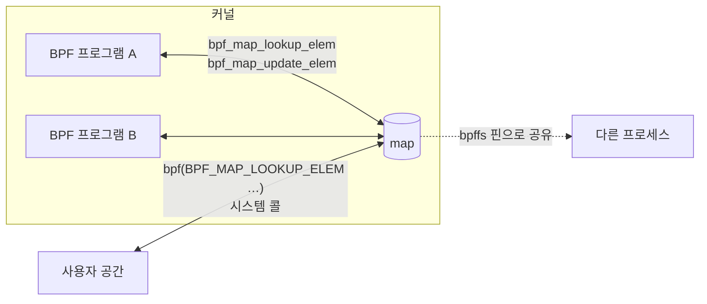
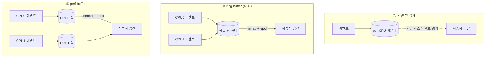

# 04. Map과 데이터 전달

> **핵심 요약**
> 1. map은 **BPF 프로그램의 상태 저장소이자 사용자 공간과의 통로**다. 종류마다 의미가 다르다: hash(가변 키), array(고정 인덱스, 삭제 불가), per-CPU(경합 없는 카운터), LRU(가득 차면 오래된 것부터 축출), LPM trie(가장 긴 prefix 일치).
> 2. 데이터를 넘기는 방법은 **커널 안 집계 ≪ ring buffer < perf buffer** 순으로 비싸다. 이 머신에서 이벤트 하나를 사용자 공간으로 넘기는 데 hook 없는 상태 대비 ring buffer는 약 1.2µs, perf buffer는 약 2.5µs가 더 들었다(집계만 하면 0.3µs 안팎).
> 3. **유실은 반드시 생긴다고 가정하고 센다.** 버퍼 크기보다 "생산 속도 대 소비 속도"가 유실을 결정한다. 할 수 있으면 커널 안에서 집계해 이벤트 수 자체를 줄이자.

## 1. 개념

### 1.1 map은 어디에 있나



- map은 **커널 메모리**에 있고 fd로 가리킨다. BPF 프로그램은 helper로 **직접**(빠름), 사용자 공간은 **시스템 콜로**(느림, 호출당 µs 단위) 접근한다.
- 그래서 "이벤트마다 사용자 공간이 map을 조회"하는 설계는 느리다. **커널에서 갱신하고 사용자 공간은 가끔(예: 1초마다) 읽는 것**이 기본 패턴이다(07장 counter).
- 전역 변수(`.data`, `.bss`, `.rodata`)도 내부적으로는 원소 하나짜리 array map이다(01장의 `map_ids`가 두 개였던 이유).

### 1.2 자주 쓰는 map 종류

| 종류 | 키 | 특징 | 쓰임 |
|---|---|---|---|
| `HASH` | 임의 바이트열 | 가득 차면 삽입 실패(`E2BIG`) | PID별·연결별 상태 |
| `ARRAY` | `u32` 인덱스 0..N-1 | **미리 할당·0으로 초기화**, 삭제 불가, 조회가 가장 빠름 | 설정값, 고정 개수 카운터 |
| `PERCPU_HASH` / `PERCPU_ARRAY` | 위와 같음 | **CPU마다 값이 따로** 있음. 원자 연산 없이 갱신, 읽을 때 합산 | 고빈도 카운터, 큰 작업 버퍼(05장 08번) |
| `LRU_HASH` | 임의 | 가득 차면 **오래 안 쓴 원소를 축출**하고 삽입 | 연결 추적처럼 끝없이 늘어나는 키 |
| `LPM_TRIE` | prefix 길이 + 주소 | **가장 긴 prefix 일치** 조회 | IP 대역 정책, 라우팅 |
| `RINGBUF` | — | 모든 CPU가 공유하는 이벤트 큐(5.8+) | 이벤트 스트림 |
| `PERF_EVENT_ARRAY` | CPU 번호 | CPU별 이벤트 버퍼(옛 방식) | 5.8 미만 커널의 이벤트 스트림 |
| `PROG_ARRAY` | 인덱스 | 다른 BPF 프로그램으로 점프(tail call) | 큰 프로그램 쪼개기 |
| `HASH_OF_MAPS` / `ARRAY_OF_MAPS` | — | 값이 다른 map | 정책 교체(원자적 스왑) |

### 1.3 이벤트 전달 세 가지



| | ring buffer | perf buffer |
|---|---|---|
| 버퍼 | **모든 CPU가 하나를 공유** | CPU마다 하나 |
| 순서 | 전역 순서 보장 | CPU 안에서만 보장 → 사용자 공간에서 정렬 필요 |
| 메모리 | 전체 부하에 맞춰 하나만 키우면 됨 | 가장 바쁜 CPU 기준으로 **모든 CPU 버퍼**를 키워야 함 |
| 쓰기 API | `bpf_ringbuf_reserve` → 직접 기록 → `submit`(복사 없음), 또는 `bpf_ringbuf_output`(복사) | `bpf_perf_event_output`(항상 복사) |
| 가변 길이 | `reserve`는 크기가 상수여야 함(`output`·dynptr는 가변 가능) | 가능 |
| 커널 버전 | 5.8+ | 4.4+ |

**새 코드는 ring buffer를 쓴다.** perf buffer는 5.8 미만 커널을 지원해야 할 때만 쓴다.

## 2. 예제

| 경로 | 내용 |
|---|---|
| [`code/maptour/main.go`](code/maptour/main.go) | BPF 프로그램 없이 사용자 공간에서 map 5종을 만들어 동작 차이 확인 |
| [`code/transfer/transfer.bpf.c`](code/transfer/transfer.bpf.c) | bench의 read마다 64바이트 이벤트를 4가지 방식(집계 / ringbuf reserve / ringbuf output / perf)으로 처리 |
| [`code/transfer/main.go`](code/transfer/main.go) | 방식별로 bench를 여러 라운드 실행해(순서 섞기, 기준값과 짝짓기, 중앙값) 커널 이벤트 수·받은 수·유실·bench 속도·소비자 CPU 시간 비교. `-kb`(버퍼 크기), `-delay`(느린 소비자), `-r`, `-cpu` |
| [`code/run.sh`](code/run.sh) | maptour + transfer 3가지 조건 (root) |

### 실행

```bash
cd chapters/04-maps/code
make build    # root 불필요
make run      # 내부에서 sudo, 결과: out/run.log
sudo ./bin/transfer -kb 4 -delay 1us    # 조건 바꿔 보기
```

### 실행 결과 ① map 종류별 동작 (maptour)

```
=== HASH (max_entries=4)
  Put(1) → OK
  Put(2) → OK
  Put(3) → OK
  Put(4) → OK
  Put(5) → 에러: update: key too big for map: argument list too long
  Lookup(9) → ErrKeyNotExist
  Update(1, NoExist) → ErrKeyExist
  Delete(1) → OK, 이후 Put(5) → OK
```

hash는 `max_entries`가 **상한**이다. 가득 차면 `E2BIG`("argument list too long")로 실패한다. BPF 프로그램 안에서도 마찬가지라 `bpf_map_update_elem`의 반환값을 확인하지 않으면 **조용히 기록을 잃는다.** `BPF_NOEXIST`/`BPF_EXIST` 플래그로 "없을 때만 / 있을 때만" 쓸 수 있다.

```
=== ARRAY (max_entries=4)
  Lookup(2) (아무것도 안 넣음) → OK, 값=0
  Lookup(4) (범위 밖) → ErrKeyNotExist
  Delete(2) → 에러: delete: invalid argument
```

array는 만들 때 모든 칸이 **0으로 미리 할당**된다. 그래서 조회가 항상 성공하고(범위 안이라면) 삭제는 불가능하다(`EINVAL`). BPF 쪽에서도 array 조회는 NULL 검사가 필요하지만, 범위 안의 상수 인덱스면 실제로 NULL이 오지 않는다.

```
=== LRU_HASH (max_entries=4): 1~4를 넣고 1을 조회한 뒤 5, 6을 넣는다
  Put(5) → OK
  Put(6) → OK
  남은 키: 6 5 4 3
```

LRU는 가득 차도 삽입이 **성공**하고, 대신 오래된 원소(1, 2)가 사라졌다. 눈여겨볼 점은 **1을 조회했는데도 1이 축출됐다**는 것이다. 사용자 공간의 시스템 콜 조회는 "사용"으로 치지 않는다. 그래야 모니터링 도구가 map을 훑기만 해도 축출 순서가 흐트러지지 않는다. BPF 프로그램 안의 `bpf_map_lookup_elem`은 사용으로 친다. 또한 커널의 LRU는 CPU별 목록을 쓰는 **근사 LRU**라서, 아주 작은 map이나 여러 CPU가 동시에 쓰는 상황에서는 정확한 LRU 순서를 기대하면 안 된다.

```
=== LPM_TRIE: 가장 긴 prefix 일치
  10.1.2.3     → 10.1.2.0/24
  10.1.9.9     → 10.1.0.0/16
  10.200.0.1   → 10.0.0.0/8
  192.168.0.1  → 0.0.0.0/0
```

키는 `{prefix 길이(비트), 주소}`다. 조회할 때 prefix 길이를 32로 주면 가장 구체적인 대역을 찾는다. 방화벽·라우팅 정책의 기본 재료다(10·11장). LPM trie는 `BPF_F_NO_PREALLOC` 플래그가 반드시 필요하다.

```
=== PERCPU_ARRAY: 키 하나에 CPU 수(16)만큼 값이 있다
  Lookup(0) → 길이 16 슬라이스 [1 2 3 4 5 6 7 8 9 10 11 12 13 14 15 16], 합 136
```

사용자 공간에서는 per-CPU map의 값 하나가 **CPU 수만큼의 슬라이스**로 보인다. BPF 프로그램은 자기 CPU 칸만 보므로 원자 연산이 필요 없다. 합산은 읽는 쪽 책임이다.

### 실행 결과 ② 전달 방식 비교 (transfer)

64바이트 이벤트, bench의 read 50만 번. bench는 CPU 2에 고정했다. perf buffer는 CPU당 X, ring buffer는 X × CPU 수로 **전체 메모리를 같게** 맞췄다. 방식마다 5라운드를 돌렸고, 라운드마다 순서를 섞어 **"아무것도 안 붙인 bench"와 짝지어** 쟀다. 값은 중앙값이다. **+ns/event**는 짝지은 기준값 대비 이벤트 하나당 늘어난 시간, **소비자 CPU**는 이벤트를 받는 Go 프로세스가 쓴 CPU 시간이다.

```
##### 04-2 transfer: 기본 버퍼 (CPU당 64KB) — 조건마다 1~2분
CPU 16개, perf buffer 64KB×16, ring buffer 1024KB, 이벤트 64B, read 500000회, bench CPU 2 고정, 소비자 지연 0s
5라운드(라운드마다 무작위 순서, 매번 기준값과 짝지어 측정), 값은 중앙값

방식                   커널 이벤트       받은 수         유실    ns/read  +ns/event      소비자 CPU
집계(map)              500000          -          0      967.4      323.3          1ms
ringbuf reserve      500000     500000          0     1797.3     1149.2        588ms
ringbuf output       500000     500000          0     1833.8     1239.2        579ms
perf buffer          500000     500000          0     3152.4     2572.1       1.347s

##### 04-2 transfer: 작은 버퍼 (CPU당 4KB)
CPU 16개, perf buffer 4KB×16, ring buffer 64KB, 이벤트 64B, read 500000회, bench CPU 2 고정, 소비자 지연 0s
5라운드(라운드마다 무작위 순서, 매번 기준값과 짝지어 측정), 값은 중앙값

방식                   커널 이벤트       받은 수         유실    ns/read  +ns/event      소비자 CPU
집계(map)              500000          -          0      863.0      261.4          1ms
ringbuf reserve      500000     499296        704     1871.2     1185.0        602ms
ringbuf output       500000     499707        293     1794.8     1203.8        588ms
perf buffer          500000     492397       7603     3183.0     2555.1       1.338s

##### 04-2 transfer: 작은 버퍼 + 느린 소비자 (레코드당 2µs) — 유실이 생긴다
CPU 16개, perf buffer 4KB×16, ring buffer 64KB, 이벤트 64B, read 500000회, bench CPU 2 고정, 소비자 지연 2µs
5라운드(라운드마다 무작위 순서, 매번 기준값과 짝지어 측정), 값은 중앙값

방식                   커널 이벤트       받은 수         유실    ns/read  +ns/event      소비자 CPU
집계(map)              500000          -          0      897.6      230.5          1ms
ringbuf reserve      500000     214155     285845      957.6      360.2        483ms
ringbuf output       500000     235237     264763     1075.4      458.0        542ms
perf buffer          500000     498232       1768     2846.8     2243.5       1.422s
```

읽는 법:

- **집계가 압도적으로 싸다**(+230~320ns). 03장의 tracepoint 비용(약 240ns)과 같은 수준이다. 즉 hook이 불리는 비용이 거의 전부다. 사용자 공간으로 넘어간 데이터는 마지막에 한 번 읽은 카운터뿐이라 소비자 CPU도 1ms다.
- **ring buffer는 이벤트당 약 1.2µs, perf buffer는 약 2.5µs가 더 든다.** reserve와 output의 차이는 64바이트 이벤트에서는 측정 오차 수준이다(복사할 양이 작다). 이벤트가 수 KB로 커지면 복사가 없는 reserve가 유리해진다. 소비자 CPU도 perf 쪽이 두 배 이상이다.
- **작은 버퍼(CPU당 4KB)에서는 소비자가 지연 없이 읽어도 일부 유실**이 생겼다(ring 0.06~0.14%, perf 1.5%). perf buffer는 bench가 도는 CPU 하나의 4KB만 실제로 쓰이므로, 같은 전체 메모리라도 순간적인 몰림에 더 약하다. ring buffer는 모든 CPU가 64KB를 함께 쓴다.
- **느린 소비자(레코드당 2µs)에서는 ring buffer가 절반 넘게 유실**(57%, 53%)했고, perf buffer는 0.35%만 유실했다. perf가 더 튼튼해서가 아니다. perf 쪽 bench는 read 한 번에 2.8µs가 걸려서 **이벤트를 만드는 속도가 소비 속도보다 느렸고**, ring buffer 쪽은 생산(1µs 안팎)이 소비(2µs + 오버헤드)보다 빨라 버퍼가 금방 찼다.
- 이때 ring buffer의 +ns/event가 1.2µs에서 0.4µs 안팎으로 **줄어든 것**은 두 가지가 섞인 결과다. ① 절반이 넘는 이벤트에서 reserve/output이 실패해 기록·제출 작업을 건너뛰었고, ② 소비자가 계속 바빠 잠들지 않으니 깨우는(wakeup) 일이 줄었다. 이 실험만으로 둘 중 무엇이 얼마나 기여했는지는 가를 수 없다. 깨우기 비용만 보고 싶다면 아래 "직접 해보기" 1번처럼 `BPF_RB_NO_WAKEUP`을 써서 비교해야 한다.
- 결론: **유실 여부는 버퍼 크기보다 "생산 속도 대 소비 속도"가 결정한다.** 버퍼는 순간적인 몰림을 흡수할 뿐, 소비가 지속적으로 느리면 결국 유실한다. 그리고 유실 카운터가 없으면 이 표의 "유실" 열을 볼 방법이 없다.

### 코드 해설

```c
// mode 1: reserve → 직접 기록 → submit (복사 없음)
struct event *e = bpf_ringbuf_reserve(&rb, sizeof(*e), 0);
if (!e) { bump(1); return 0; }           // 가득 참 → 유실로 센다
fill(e, ctx->args[2]);
bpf_ringbuf_submit(e, 0);

// mode 2: 스택에서 만들고 복사
struct event e = {};
fill(&e, ctx->args[2]);
if (bpf_ringbuf_output(&rb, &e, sizeof(e), 0)) bump(1);

// mode 3: perf buffer (현재 CPU의 버퍼로)
if (bpf_perf_event_output(ctx, &pb, BPF_F_CURRENT_CPU, &e, sizeof(e))) bump(1);
```

```go
spec.Maps["rb"].MaxEntries = uint32(ringSize)   // 로드 전에 map 크기 조정
rd, _ := perf.NewReader(objs.Pb, perCPU)        // perf: CPU당 버퍼 크기는 사용자 공간이 정한다
```

- ring buffer 크기는 map 정의(`max_entries`)로, perf buffer 크기는 **reader를 만들 때** 정한다. cilium/ebpf는 로드 전에 `MapSpec`을 고쳐 ring buffer 크기를 바꿀 수 있다.
- 유실은 **BPF 쪽에서 셀 수 있다**(reserve/output이 실패를 알려 줌). perf buffer는 사용자 공간에서도 `Record.LostSamples`로 알 수 있다.
- 공정한 비교를 위해 소비자는 레코드를 **세기만** 하고 디코딩하지 않는다. 실제 프로그램은 디코딩·출력 비용이 더해지므로 유실이 더 쉽게 생긴다.

## 3. 직접 해보기

1. `transfer.bpf.c`의 `bpf_ringbuf_submit(e, 0)`을 `bpf_ringbuf_submit(e, BPF_RB_NO_WAKEUP)`로 바꾸고, 사용자 공간은 짧은 주기로 `rd.Flush()`를 불러 읽게 해 보자. +ns/event가 얼마나 줄어드는가? 이것이 깨우기 비용의 크기다. (힌트: 깨우기를 아예 안 하면 소비자가 잠든 채로 있을 수 있다. 몇 개마다 한 번 깨우는 "배치" 전략을 생각해 보자.)
2. 이벤트 크기를 64B에서 1KB로 키워(`pad[40]` → `pad[1000]`) reserve와 output의 차이를 다시 재 보자. 스택 512바이트 한도 때문에 output 쪽에서 무슨 일이 생기는지도 보자(05장 08번).
3. perf buffer reader를 `perf.NewReaderWithOptions(…, perf.ReaderOptions{Watermark: 4096})`로 만들어 깨우기 빈도를 줄여 보자.
4. maptour의 LRU 실험에서 키 1을 BPF 프로그램 안에서 조회하면 결과가 달라질까? (작은 tracepoint 프로그램을 붙여 확인)
5. LPM trie에 `10.1.2.3/32` 항목을 더 넣고 같은 조회를 해 보자.

## 4. 자주 하는 실수

- **hash map이 가득 찬 것을 모름** — `bpf_map_update_elem`의 반환값을 버리면 조용히 기록을 잃는다. 끝없이 늘어나는 키(연결, PID)는 LRU를 쓰거나 지우는 시점을 정하자.
- **per-CPU 값을 하나만 읽음** — 사용자 공간에서는 슬라이스로 받아 합산해야 한다.
- **ring buffer `max_entries`를 아무 값으로** — 페이지 크기의 2의 거듭제곱 배여야 한다(07장).
- **perf buffer를 "CPU당 크기 = 전체 크기"로 착각** — 실제 메모리는 CPU 수만큼 곱해진다. 128코어 서버에서 CPU당 1MB면 128MB다.
- **이벤트마다 사용자 공간에서 map 조회/삭제** — 시스템 콜 비용이 이벤트 비용보다 커진다. 배치 API(`BatchLookup`, `BatchDelete`)나 주기적 수집을 쓰자.
- **유실을 세지 않음** — 표에서 보듯 조건이 조금만 바뀌어도 수십 %가 사라진다. 유실 카운터는 필수다.

## 5. 더 읽을거리

| 자료 | 라이선스 | 이 챕터에서의 사용 |
|---|---|---|
| [커널 문서: BPF maps](https://docs.kernel.org/bpf/maps.html) | GPL-2.0 | map 종류별 동작 참고(재서술) |
| [커널 문서: BPF ring buffer](https://docs.kernel.org/bpf/ringbuf.html) | GPL-2.0 | ring buffer 설계·wakeup 참고(재서술) |
| [커널 문서: BPF_MAP_TYPE_LPM_TRIE](https://docs.kernel.org/bpf/map_lpm_trie.html) | GPL-2.0 | LPM 키 형식 |
| [커널 문서: BPF_MAP_TYPE_HASH (LRU 포함)](https://docs.kernel.org/bpf/map_hash.html) | GPL-2.0 | LRU 동작 |
| [커널 소스 `kernel/bpf/hashtab.c` v6.17](https://github.com/torvalds/linux/blob/v6.17/kernel/bpf/hashtab.c) (`htab_lru_map_lookup_elem_sys`) | GPL-2.0 | "시스템 콜 조회는 LRU 참조로 치지 않는다" 확인 |
| [Andrii Nakryiko, BPF ring buffer](https://nakryiko.com/posts/bpf-ringbuf/) | 저작권 블로그 | ring buffer vs perf buffer 배경(인용·번역 없음) |
| [cilium/ebpf ringbuf·perf 패키지](https://pkg.go.dev/github.com/cilium/ebpf/ringbuf) | MIT | reader API |
