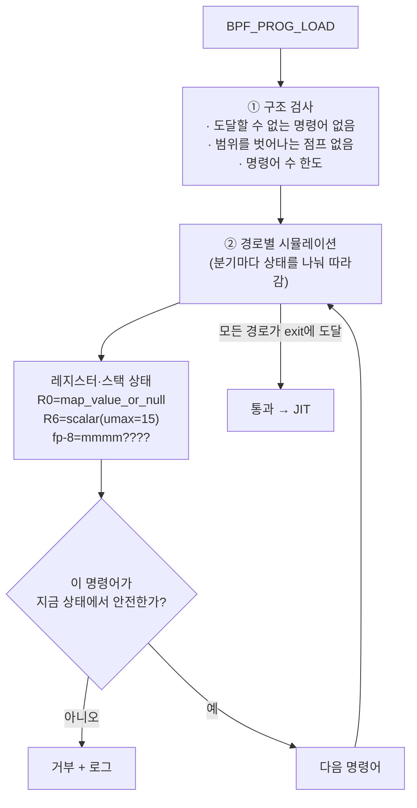

# 05. Verifier

> **핵심 요약**
> 1. verifier는 프로그램을 **실행하지 않고, 가능한 모든 경로를 따라가며 레지스터마다 "타입 + 값의 범위"를 추적**한다. 어느 경로에서든 안전하다고 증명하지 못하면 로드를 거부한다.
> 2. 거부 메시지는 **마지막 두 줄**을 보면 된다. "어느 명령어에서(`N: (op) …`)" + "무엇이 문제인지(`R0 invalid mem access 'map_value_or_null'`)". 대부분 **NULL 검사, 범위 검사, 초기화, 참조 해제, 루프 상한** 다섯 가지 중 하나다.
> 3. 이 장의 사례 8개를 "틀린 버전 → 실제 거부 메시지 → 고친 버전"으로 직접 확인한다. 한 사례는 **이 커널(6.17)에서는 거부되지 않는다**. verifier 규칙도 커널 버전에 따라 바뀐다는 증거다.

## 1. 개념

### 1.1 verifier가 하는 일



verifier가 추적하는 것:

| 대상 | 예 | 의미 |
|---|---|---|
| **레지스터 타입** | `ctx`, `map_ptr`, `map_value`, `map_value_or_null`, `fp`(스택), `scalar`, `ptr_<BTF 타입>` | 포인터인지, 무엇을 가리키는지. `scalar`는 "그냥 숫자"라 역참조 불가 |
| **값의 범위** | `scalar(umin=0, umax=15)`, `var_off=(0x0; 0xf)` | 숫자의 최솟값·최댓값·알려진 비트. 배열 인덱스로 쓸 수 있는지 판단 |
| **스택 상태** | `fp-8=mmmm????` | 바이트마다 `m`(기록됨), `0`(0), `?`(모름) |
| **참조** | `ringbuf_reserve`, 소켓 lookup이 돌려준 포인터 | 얻은 것은 모든 경로에서 반드시 돌려줘야(submit/discard/release) 한다 |

### 1.2 한도

| 한도 | 값 | 넘으면 |
|---|---|---|
| 검사하는 명령어 수(경로를 펼쳐서 센 값) | **100만**(특권 프로그램) | `BPF_PROGRAM is too large. Processed 1000001 insn` |
| 프로그램 크기(명령어 개수) | 100만(특권) / 4096(비특권) | 로드 실패 |
| 스택 | **512바이트**(함수 호출 깊이 합산) | clang이 먼저 거부 |
| tail call 깊이 | 33 | 런타임에 더 이상 점프 안 함 |
| 루프 | 상한을 verifier가 증명할 수 있어야(5.3+). 아니면 `bpf_loop`(5.17+)·open-coded iterator(6.4+) | `infinite loop detected` 또는 명령어 한도 초과 |

"100만 명령어"는 프로그램 길이가 아니라 **verifier가 시뮬레이션한 명령어 수**다. 분기가 많거나 루프를 펼치면 짧은 프로그램도 한도를 넘는다. verifier는 이미 본 상태와 같은 상태를 다시 만나면 그 경로를 건너뛰는데(state pruning), 이것이 잘 될수록 빨리 끝난다.

### 1.3 로그 읽는 법

```
; *v += 1; @ 01-null-check.bpf.c:23                          ← C 소스 줄 (BTF 덕분)
7: (85) call bpf_map_lookup_elem#1    ; R0=map_value_or_null(id=1,map=cnt,ks=4,vs=8)
8: (79) r1 = *(u64 *)(r0 +0)                                  ← 문제의 명령어
R0 invalid mem access 'map_value_or_null'                     ← 이유
processed 8 insns (limit 1000000) …                           ← 통계
```

1. 맨 아래에서 위로 읽는다. **이유 줄**을 먼저 보고, 바로 위의 **명령어 번호**를 본다.
2. 그 명령어가 쓰는 레지스터(`r0`)가 **어디서 그 상태가 됐는지** 위로 거슬러 올라간다(`7: call bpf_map_lookup_elem` → `map_value_or_null`).
3. `;` 오른쪽의 상태 표시가 그 명령어 실행 **후**의 레지스터 상태다.
4. `; … @ 파일:줄`로 C 소스 위치를 찾는다. 이 줄이 없으면 `clang -g`로 빌드했는지 확인하자.

## 2. 예제: 거부 사례 8개

| # | 사례 | 틀린 코드 | 고친 방법 |
|---|---|---|---|
| 01 | NULL 검사 누락 | `*v += 1` (`v` = lookup 결과) | `if (!v) return 0;` |
| 02 | 범위 검사 누락 | `s->v[idx]` (`idx` = 시스템 콜 인자) | `if (idx >= 16) return 0;` |
| 03 | 초기화 안 된 스택 | 패딩이 있는 구조체를 일부만 채워 helper에 전달 | `struct event e = {};` |
| 04 | 참조 미반환 | `bpf_ringbuf_reserve` 후 한 경로에서 그냥 `return` | `bpf_ringbuf_discard` |
| 05 | 상한 없는 루프 | `for (i = 0; i < n; i++)` (`n` = 사용자 입력) | 상한을 정하고 `bpf_loop(n, cb, …)` |
| 06 | 컨텍스트에 쓰기 | `ctx->args[2] = 4096` | 지역 변수에서 가공 |
| 07 | 커널 포인터 직접 역참조 | `t->real_parent->tgid` (`t` = `bpf_get_current_task()`) | `BPF_CORE_READ` 또는 `bpf_get_current_task_btf()` |
| 08 | 스택 512바이트 초과 | `char path[600]` 지역 변수 | per-CPU array를 작업 공간으로 |

각 사례는 [`code/cases/NN-이름.bpf.c`](code/cases/) 파일 하나에 `#ifdef FIX`로 두 버전이 들어 있다. `make build`가 `obj/NN.bad.o`와 `obj/NN.good.o`(`-DFIX`)를 만들고, `run.sh`가 bpftool로 로드해 **bad는 거부, good은 통과**하는지 확인한다. 이 커널에서 허용되는 것으로 확인된 03번만 예외로 두고, 다른 bad가 통과하면 실패로 처리한다.

### 실행

```bash
cd chapters/05-verifier/code
make build    # root 불필요. 08번 bad는 clang 단계에서 실패하는 것이 정상
make run      # 내부에서 sudo, 결과: out/run.log, 전체 verifier 로그: out/NN.bad.log

sudo bpftool prog load obj/02-bounds.bad.o /sys/fs/bpf/x   # 하나씩 직접
```

### 실행 결과 (Linux 6.17, 발췌·해설)

#### 01. NULL 검사 누락

```
7: (85) call bpf_map_lookup_elem#1    ; R0=map_value_or_null(id=1,map=cnt,ks=4,vs=8)
; *v += 1; @ 01-null-check.bpf.c:23
8: (79) r1 = *(u64 *)(r0 +0)
R0 invalid mem access 'map_value_or_null'
```
```
good: 통과 — processed 15 insns (limit 1000000) …
```

hash map 조회는 키가 없으면 NULL을 돌려주므로 결과 타입이 `map_value_or_null`이다. `if (!v)` 분기를 지나면 verifier는 그 뒤 경로에서 `r0`을 `map_value`로 바꿔 기록한다. 이것이 **분기로 타입을 좁히는** verifier의 기본 동작이다.

#### 02. 범위 검사 누락

```
7: (85) call bpf_map_lookup_elem#1    ; R0_w=map_value(map=hist,ks=4,vs=128)
8: (15) if r0 == 0x0 goto pc+5        ; R0_w=map_value(map=hist,ks=4,vs=128)
; s->v[idx] += 1; @ 02-bounds.bpf.c:30
9: (67) r6 <<= 3                      ; R6_w=scalar(smax=0x7ffffffffffffff8,umax=0xfffffffffffffff8,…)
10: (0f) r0 += r6
math between map_value pointer and register with unbounded min value is not allowed
```

`idx`(`r6`)는 시스템 콜 인자라 범위를 모른다(`umax`가 거의 2^64). 배열 원소 주소 = `map_value + idx*8`을 계산하려는 순간(명령어 10) 거부된다. `if (idx >= 16) return 0;`을 넣으면 그 뒤에서 `r6`이 `umax=15`가 되어 `0..120` 오프셋만 가능하다는 것을 verifier가 알고 통과시킨다.

> 참고: 이 사례에서 `r0`이 이미 `map_value`(NULL 아님)인 이유는, **ARRAY map을 상수 키로 조회**하면 verifier가 항상 성공함을 알기 때문이다. 그래도 `if (!s)`는 습관처럼 쓰자. 키가 상수가 아니면 NULL이 가능하다.

#### 03. 초기화 안 된 스택 — **이 커널에서는 통과**

```
=== 03-uninit-stack
  bad : 통과(!) — 이 커널은 이 코드를 허용한다
  good: 통과 — processed 15 insns (limit 1000000) …
```

`struct event { u32 pid; u64 ts; }`에는 `pid` 뒤에 4바이트 패딩이 생긴다. 이 패딩은 아무도 초기화하지 않았는데 `bpf_ringbuf_output`에 통째로 넘겼다. 6.2 이하 커널에서는 `invalid indirect read from stack`으로 거부되던 코드다. **6.3부터는 특권(root/CAP_PERFMON) 프로그램의 초기화 안 된 스택 읽기를 허용**한다. 그래도 `= {}`로 초기화하자. 다른 커널(특히 배포 대상의 오래된 커널)에서 거부될 수 있고, 무엇보다 **쓰레기 값이 사용자 공간으로 새어 나간다**(커널 스택 내용 유출). 이 사례는 "내 커널에서 통과했다"가 "어디서나 통과한다"는 뜻이 아님을 보여 준다.

#### 04. 참조 미반환

```
Unreleased reference id=2 alloc_insn=5
BPF_EXIT instruction in main prog would lead to reference leak
```

`bpf_ringbuf_reserve`가 돌려준 메모리는 "참조"다. `count == 0` 경로에서 submit도 discard도 하지 않고 반환하면 ring buffer의 그 자리가 영원히 잠긴다. verifier는 **모든 exit 경로에서 참조가 0개인지** 확인한다. `alloc_insn=5`는 그 참조를 만든 명령어 번호다. 소켓 lookup(`bpf_sk_lookup_tcp` → `bpf_sk_release`), 일부 kfunc도 같은 규칙을 따른다.

#### 05. 상한 없는 루프

```
8: (0f) r6 += r0                      ; … R6_w=scalar(smin=0,smax=umax=0x22e05fffdd1fa,…)
9: (07) r8 += 1                       ; R8_w=0x22e06
10: (2d) if r7 > r8 goto pc-6         ; R7=0x22e06 R8_w=0x22e06
BPF program is too large. Processed 1000001 insn
```
```
good: 통과 — processed 92 insns (limit 1000000) max_states_per_insn 3 total_states 8 peak_states 8 mark_read 2
```

루프 상한 `n`(`r7`)을 모르므로 verifier는 루프를 **한 바퀴씩 펼쳐 가며** "아직 안 끝날 수도 있다"는 경로를 계속 따라간다. 카운터 `r8`이 `0x22e06`(약 14만 3천) 바퀴에 이르렀을 때 시뮬레이션한 명령어가 100만 개를 넘어 포기했다. 고친 버전은 **`bpf_loop` helper**(5.17+)로 반복을 커널에 맡긴다. verifier는 콜백 함수 본문만 검사하면 되므로 **92개** 명령어로 끝난다. 단 `bpf_loop`의 횟수 인자는 `u32`이고 최대 `1<<23`(약 800만)이며, 넘으면 `-E2BIG`을 돌려준다. 그래서 고친 버전은 `n`을 미리 자르고 반환값을 확인한다.

```c
if (n > 1 << 20)
	n = 1 << 20;
if (bpf_loop(n, add_one, &sum, 0) < 0)
	return 0;
```
 상한이 작고 고정이면(`for (i = 0; i < 16 && i < n; i++)`) 일반 루프도 통과한다.

#### 06. 컨텍스트에 쓰기

```
3: (79) r3 = *(u64 *)(r1 +32)         ; R1=ctx() R3_w=scalar()
…
7: (7b) *(u64 *)(r1 +32) = r3
invalid bpf_context access off=32 size=8
```

tracepoint 컨텍스트(`ctx`)는 **읽기 전용**이다. offset 32는 03장의 `format`에서 본 `count` 필드 자리다. 관측용 hook으로 시스템 콜 인자를 바꿀 수는 없다. 컨텍스트의 어느 필드를 읽고 쓸 수 있는지는 프로그램 타입마다 다르다. 예를 들어 TC 프로그램은 `skb->mark`를 쓸 수 있다(11장).

#### 07. 커널 포인터 직접 역참조

```
2: (85) call bpf_get_current_task#35          ; R0_w=scalar()
; ppid = t->real_parent->tgid; @ 07-kernel-ptr.bpf.c:30
3: (79) r1 = *(u64 *)(r0 +2720)
R0 invalid mem access 'scalar'
```

`bpf_get_current_task()`는 주소를 **숫자(u64)** 로 돌려준다. C에서 포인터로 캐스팅해도 verifier에게 `r0`은 `scalar`일 뿐이라 역참조할 수 없다(+2720은 이 커널에서 `real_parent` 필드의 오프셋). 고치는 방법은 두 가지다.

- `BPF_CORE_READ(t, real_parent, tgid)`: `bpf_probe_read_kernel`로 안전하게 복사하고(잘못된 주소면 0), 필드 오프셋은 CO-RE로 맞춘다(06장).
- `bpf_get_current_task_btf()`(5.11+): **BTF 타입이 붙은 포인터**(`ptr_task_struct`)를 돌려준다. verifier가 타입을 알므로 `bt->real_parent->tgid`처럼 바로 역참조할 수 있다. fentry/tp_btf의 인자도 같은 종류의 포인터다(03장).

#### 08. 스택 512바이트 초과

```
cases/08-stack-limit.bpf.c:23:5: error: Looks like the BPF stack limit is exceeded. Please move large on stack variables into BPF per-cpu array map. For non-kernel uses, the stack can be increased using -mllvm -bpf-stack-size.
```
```
good: 통과 — processed 24 insns (limit 1000000) …
```

이 경우는 verifier까지 가지 않고 **clang이 먼저** 거부한다. 메시지가 해결책까지 알려 준다. 원소 하나짜리 `PERCPU_ARRAY`를 큰 작업 공간으로 빌려 쓰면 된다.

```c
long len = bpf_probe_read_user_str(b->path, sizeof(b->path), (const char *)ctx->args[1]);

if (len <= 0 || len > sizeof(b->path))
	return 0;
bpf_ringbuf_output(&rb, b->path, len, 0);   // 복사한 길이만 보낸다
```

작업 공간에는 **이전 실행이 남긴 내용**이 그대로 있다. 그래서 `sizeof(*b)`를 통째로 보내면 짧은 경로 뒤에 이전 경로의 꼬리가 붙어 나간다. 반환값(NUL 포함 길이)만큼만 보내고, 실패(음수)면 보내지 않는다. `len`의 상한 검사는 verifier가 helper의 크기 인자 범위를 알게 하는 역할도 한다. CPU마다 칸이 따로라 다른 CPU와는 겹치지 않는다. 다만 같은 CPU에서도 인터럽트나 선점으로 다른 BPF 프로그램이 끼어들 수 있으니, **한 번 실행하는 동안의 임시 공간으로만** 쓰고 다음 실행까지 값이 남아 있으리라 기대하지 않는다.

## 3. 직접 해보기

1. `out/05-loop.bad.log`의 앞부분을 보고, 루프 한 바퀴마다 `r8`이 어떻게 바뀌어 가는지 확인하자. 그다음 `for (u64 i = 0; i < 64 && i < n; i++)`로 고쳐 통과시키고, processed 명령어 수를 `bpf_loop` 버전과 비교해 보자.
2. 02번에서 `if (idx >= 16)` 대신 `idx &= 15;`로 고쳐도 통과할까? 의미는 어떻게 다른가?
3. 01번 good 버전의 전체 로그를 `sudo bpftool -d prog load obj/01-null-check.good.o /sys/fs/bpf/x`로 보고, `if (!v)` 분기 직후 `r0`의 타입 표시를 찾아보자. (끝나면 `sudo rm /sys/fs/bpf/x`)
4. 03번 bad 오브젝트를 비특권 환경(컨테이너에서 CAP_BPF만 준 상태 등)에서 로드하면 어떻게 될지 생각해 보자.
5. 07번을 kprobe 프로그램으로 바꿔서도 `bpf_get_current_task_btf()`가 동작하는지 확인하자. 프로그램 타입마다 쓸 수 있는 helper가 다르다는 점을 떠올리자.

## 4. 자주 하는 실수

- **로그의 첫 줄만 읽음** — 원인은 맨 아래에 있다. 위쪽은 거기까지 오는 경로다.
- **"C에서는 검사했는데요?"** — 컴파일러가 검사와 사용을 서로 다른 레지스터로 만들거나 순서를 바꾸면 verifier는 검사 사실을 모른다. `llvm-objdump -d`로 바이트코드를 보고, 필요하면 `barrier_var(x)` 매크로나 `volatile`로 최적화를 막는다.
- **부호 있는 인덱스** — `int idx`를 `if (idx < 16)`으로만 검사하면 음수가 남아 거부된다. unsigned를 쓰거나 하한도 검사하자.
- **루프 안의 복잡한 분기** — 짧은 루프도 안쪽 분기 수가 곱해져 100만 한도를 넘는다. `bpf_loop`이나 상태를 줄이는 쪽으로 다시 쓰자.
- **내 커널에서만 시험** — 03번처럼 verifier 규칙은 버전마다 다르다. 배포 대상의 가장 오래된 커널에서도 로드해 보자(VM이나 CI에 여러 커널 이미지를 두는 방법이 흔하다).
- **로그가 잘림** — 아주 큰 프로그램은 로그 버퍼가 모자랄 수 있다. 6.4+ 커널은 기본적으로 로그 끝부분(원인 쪽)을 남기지만, 로더의 로그 버퍼 크기 옵션(cilium/ebpf `ProgramOptions.LogSizeStart` 등)을 확인하자.

## 5. 더 읽을거리

| 자료 | 라이선스 | 이 챕터에서의 사용 |
|---|---|---|
| [커널 문서: eBPF verifier](https://docs.kernel.org/bpf/verifier.html) | GPL-2.0 | 레지스터 상태·로그 형식 참고(재서술) |
| [커널 문서: BPF Design Q&A](https://docs.kernel.org/bpf/bpf_design_QA.html) | GPL-2.0 | 한도(명령어 수·스택) 참고 |
| [커널 문서: bpf_loop 등 helper (`bpf-helpers(7)`)](https://man7.org/linux/man-pages/man7/bpf-helpers.7.html) | GPL-2.0 | `bpf_loop`·`bpf_get_current_task_btf` 버전 확인 |
| [ebpf-docs: Verifier](https://docs.ebpf.io/linux/concepts/verifier/) | BSD-2-Clause (저장소 [isovalent/ebpf-docs](https://github.com/isovalent/ebpf-docs) 기준) | 개념 참고(재서술) |
| [병합 커밋 "bpf: Allow reads from uninit stack" (6.3)](https://github.com/torvalds/linux/commit/bf9bec4cb3a4) | GPL-2.0 | 03번 결과의 근거 |
