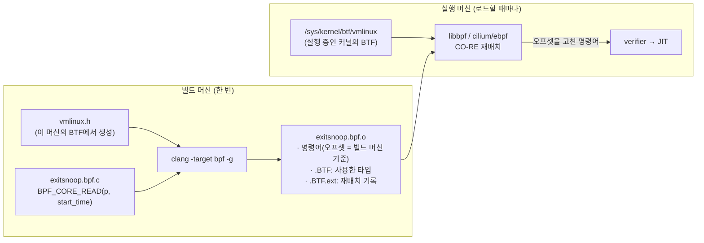
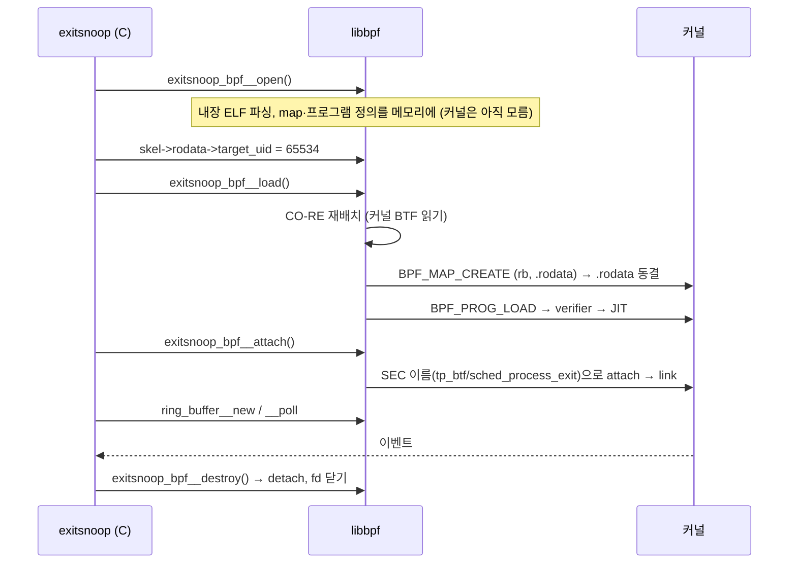

# 06. libbpf + CO-RE/BTF

> **핵심 요약**
> 1. **libbpf**는 커널 트리에서 함께 관리되는 C 언어용 공식 BPF 로더 라이브러리다. `bpftool gen skeleton`이 BPF 오브젝트를 품은 헤더(skeleton)를 만들어 주므로, 로더는 **open → (상수 설정) → load → attach** 네 단계로 짧게 쓸 수 있다.
> 2. **CO-RE**(Compile Once – Run Everywhere)는 BPF 오브젝트에 "어느 구조체의 어느 필드를 읽는지"를 BTF로 기록해 두고, **로드할 때** 실행 중인 커널의 BTF를 보고 오프셋을 다시 계산하는 방식이다. 커널마다 다시 컴파일하지 않아도 된다.
> 3. 필드 이름이 바뀐 경우(예: 5.14의 `task_struct.state` → `__state`)에는 `bpf_core_field_exists()`와 **flavor 구조체**(`struct task_struct___pre514`)로 두 모양을 모두 다룬다. 실제로 무엇을 고쳐 쓰는지는 libbpf 디버그 로그로 확인한다.

## 1. 개념

### 1.1 왜 CO-RE가 필요한가

BPF 프로그램은 커널 구조체를 자주 읽는다. 그런데 구조체 안에서 필드가 어디에 있는지(오프셋)는 커널 버전, 빌드 설정(`CONFIG_*`), 아키텍처에 따라 다르다. 이 장의 예제가 읽는 `task_struct`만 해도 이 머신(6.17)에서는 `start_time`이 3048바이트 위치에 있지만, 다른 커널에서는 다른 위치에 있다.

이 문제를 풀어 온 방식은 크게 세 가지다.

| 방식 | 하는 일 | 단점 |
|---|---|---|
| 대상 머신에서 컴파일 (BCC) | 실행할 때마다 그 머신의 커널 헤더로 clang을 돌린다 | 운영 서버에 clang·커널 헤더가 필요하고, 시작이 느리고 메모리를 많이 쓴다 |
| 커널별로 미리 빌드 | 지원할 커널마다 오브젝트를 하나씩 만든다 | 지원 커널 수만큼 빌드·배포가 늘어난다 |
| **CO-RE** | 한 번 빌드하고, 로드할 때 로더가 오프셋을 고쳐 쓴다 | 커널에 BTF가 있어야 한다(대부분의 최신 배포판은 `CONFIG_DEBUG_INFO_BTF=y`) |

### 1.2 CO-RE의 세 구성 요소



1. **컴파일러(clang)**: `BPF_CORE_READ()` 등이 쓰는 `__builtin_preserve_access_index`를 만나면, 그 필드 접근을 `.BTF.ext` 섹션에 **재배치(relocation) 기록**으로 남긴다. "명령어 #21이 `struct task_struct`의 `start_time` 오프셋을 쓴다"처럼 기록된다.
2. **커널 BTF**: 실행 중인 커널의 모든 타입 정보가 `/sys/kernel/btf/vmlinux`에 있다(00장에서 확인).
3. **로더(libbpf, cilium/ebpf 등)**: 로드할 때 두 BTF를 비교해 **이름으로** 필드를 찾고 명령어의 오프셋을 고친 뒤 커널에 넘긴다. 커널은 이미 고쳐진 명령어만 받는다. CO-RE 처리는 커널 안이 아니라 **사용자 공간 로더에서** 일어난다.

### 1.3 자주 쓰는 CO-RE 도구

| 도구 | 하는 일 |
|---|---|
| `BPF_CORE_READ(p, a, b)` | `p->a->b`를 재배치 가능하게 읽는다. 포인터를 따라갈 때마다 `bpf_probe_read_kernel`을 끼워 넣는다 |
| `BPF_CORE_READ_STR_INTO(dst, p, comm)` | 문자열 필드를 읽는다 |
| `bpf_core_field_exists(p->f)` | 실행 중인 커널에 그 필드가 있으면 1, 없으면 0. **로드할 때 상수로 바뀐다** |
| `bpf_core_field_size(p->f)` | 필드 크기. 타입이 바뀐 경우(int → long 등)에 쓴다 |
| `bpf_core_type_exists(struct x)` | 타입 자체가 있는지 |
| `bpf_core_enum_value(enum e, VAL)` | enum 값이 커널마다 다를 때 |
| `struct 이름___아무거나` (flavor) | 옛 커널의 구조체 모양을 따로 선언한다. libbpf는 `___` 뒤를 떼고 **같은 구조체**로 보고 재배치한다 |

### 1.4 libbpf skeleton

`bpftool gen skeleton exitsnoop.bpf.o`는 다음을 담은 헤더 `exitsnoop.skel.h`를 만든다.

- BPF 오브젝트 파일 전체를 **바이트 배열로 내장**한다. 실행 파일 하나만 배포하면 된다(07장 bpf2go의 `go:embed`와 같은 역할).
- 프로그램·map·전역 변수에 **이름 붙은 필드**로 접근하는 구조체를 만든다.

```c
struct exitsnoop_bpf {
	struct bpf_object_skeleton *skeleton;
	struct bpf_object *obj;
	struct { struct bpf_map *rb; struct bpf_map *rodata; } maps;
	struct { struct bpf_program *handle_exit; } progs;
	struct { struct bpf_link *handle_exit; } links;
	struct exitsnoop_bpf__rodata {           /* const volatile 전역 변수 */
		unsigned long long min_duration_ns;
		int target_uid;
	} *rodata;
};
```

로더 코드의 흐름은 다음과 같다.



| 단계 | cilium/ebpf(07장)에서 대응하는 것 |
|---|---|
| `__open()` | `loadXxx()` → `*ebpf.CollectionSpec` |
| `skel->rodata->x = …` | `spec.Variables["x"].Set(…)` |
| `__load()` | `spec.LoadAndAssign(&objs, nil)` |
| `__attach()` | `link.Tracepoint(…)` 등을 직접 호출(자동 attach 없음) |
| `ring_buffer__poll` | `ringbuf.Reader.Read` |
| `__destroy()` | `link.Close()`, `objs.Close()` |

### 1.5 tp_btf: BTF로 타입이 붙은 tracepoint

이 장의 예제는 `SEC("tp_btf/sched_process_exit")`를 쓴다(03장의 BTF tracepoint). 03장의 `tracepoint/`는 인자를 포맷된 구조체(`trace_event_raw_*`)로 받지만, `tp_btf`는 tracepoint가 넘기는 **커널 원래 인자**를 타입 그대로 받는다. 여기서는 `struct task_struct *p`다. verifier가 `p`의 타입을 알기 때문에 `p->pid`처럼 바로 읽을 수도 있다. 다만 이 예제는 CO-RE 재배치를 보여 주려고 일부러 `BPF_CORE_READ`를 썼다.

> tracepoint의 인자 목록도 바뀔 수 있다. `sched_process_exit`는 6.16부터 `(struct task_struct *p, bool group_dead)`를 넘기고, 6.15까지는 `p`만 넘겼다. 이 예제는 첫 번째 인자만 쓰므로 양쪽 모두에서 문제가 없다.

## 2. 예제: exitsnoop (프로세스 종료 추적)

| 파일 | 내용 |
|---|---|
| [`code/exitsnoop.bpf.c`](code/exitsnoop.bpf.c) | `tp_btf/sched_process_exit`에서 종료한 프로세스의 PID·PPID·종료 코드·수명·상태를 ring buffer로 보낸다. `__state`/`state` 차이를 CO-RE로 처리 |
| [`code/exitsnoop.h`](code/exitsnoop.h) | 커널·사용자 공간이 함께 쓰는 `struct event` |
| [`code/exitsnoop.c`](code/exitsnoop.c) | skeleton을 쓰는 C 로더. `-d 초` `-m 최소ms` `-u uid` `-v`(libbpf 디버그 로그) |
| [`code/Makefile`](code/Makefile) | libbpf 정적 빌드 → BPF 컴파일 → DWARF 제거 → skeleton 생성 → 링크 |
| [`../../mk/libbpf.mk`](../../mk/libbpf.mk) | libbpf v1.7.0 소스를 받아(sha256 확인) `.local/`에 정적 빌드하는 공통 규칙 |
| [`code/run.sh`](code/run.sh) | ① CO-RE 재배치 로그 ② nobody 사용자의 종료 이벤트 ③ 수명 필터 |

### 실행

추가 패키지가 필요하다. libbpf가 ELF를 읽을 때 libelf를, 압축된 커널 BTF를 읽을 때 zlib을 쓴다.

```bash
sudo apt install -y libelf-dev zlib1g-dev   # Ubuntu
make build     # root 불필요. 처음엔 libbpf 소스를 받아 빌드한다(수십 초)
make run       # 내부에서 sudo. 결과: out/run.log
```

배포판의 `libbpf-dev` 패키지를 쓰지 않고 소스에서 빌드하는 이유는 **버전을 고정하기** 위해서다. skeleton을 만드는 bpftool과 로더가 링크하는 libbpf의 버전이 크게 어긋나면 skeleton 헤더가 컴파일되지 않거나 기능이 빠질 수 있다.

> 위 apt 설치 경로는 깨끗한 `ubuntu:24.04` 컨테이너에서 확인했다(libelf-dev 0.190, clang 18). 저장소 소스 그대로 `make build`가 되고, 결과 바이너리는 `libelf.so.1`·`libz.so.1`에 링크된다. 이 장의 실행 결과를 만든 호스트에는 libelf-dev가 없어서, 같은 버전의 헤더를 따로 받아 `make build LIBELF_CFLAGS=-I<헤더 경로> LIBELF_LIBS=/usr/lib/x86_64-linux-gnu/libelf.so.1`로 빌드했다. 헤더 위치가 표준과 다를 때 쓰는 변수다.

### 실행 결과 (Linux 6.17 x86_64)

#### ① CO-RE 재배치 로그 (`./exitsnoop -v`)

```
libbpf: sec 'tp_btf/sched_process_exit': found 8 CO-RE relocations
libbpf: CO-RE relocating [13] struct task_struct: found target candidate [70] struct task_struct in [vmlinux]
libbpf: prog 'handle_exit': relo #0: <byte_off> [13] struct task_struct.start_time (0:121 @ offset 3048)
libbpf: prog 'handle_exit': relo #0: matching candidate #0 <byte_off> [70] struct task_struct.start_time (0:121 @ offset 3048)
libbpf: prog 'handle_exit': relo #0: patched insn #21 (ALU/ALU64) imm 3048 -> 3048
libbpf: prog 'handle_exit': relo #1: <byte_off> [13] struct task_struct.real_parent (0:99 @ offset 2720)
…
libbpf: prog 'handle_exit': relo #4: <field_exists> [13] struct task_struct.__state (0:1 @ offset 24)
libbpf: prog 'handle_exit': relo #4: matching candidate #0 <field_exists> [70] struct task_struct.__state (0:1 @ offset 24)
libbpf: prog 'handle_exit': relo #4: patched insn #69 (ALU/ALU64) imm 1 -> 1
libbpf: prog 'handle_exit': relo #5: <byte_off> [13] struct task_struct.__state (0:1 @ offset 24)
libbpf: prog 'handle_exit': relo #5: patched insn #71 (ALU/ALU64) imm 24 -> 24
libbpf: CO-RE relocating [349] struct task_struct___pre514: found target candidate [70] struct task_struct in [vmlinux]
libbpf: prog 'handle_exit': relo #6: <byte_off> [349] struct task_struct___pre514.state (0:0 @ offset 0)
libbpf: prog 'handle_exit': relo #6: non-matching candidate #0 <byte_off> [70] struct task_struct (0 @ offset 0)
libbpf: prog 'handle_exit': relo #6: no matching targets found
libbpf: prog 'handle_exit': relo #6: substituting insn #80 w/ invalid insn
libbpf: prog 'handle_exit': relo #7: <byte_off> [13] struct task_struct.comm (0:131 @ offset 3248)
libbpf: prog 'handle_exit': relo #7: patched insn #90 (ALU/ALU64) imm 3248 -> 3248
```

읽는 법:

- `[13]`은 BPF 오브젝트 쪽 BTF의 타입 번호, `[70]`은 커널 BTF의 타입 번호다. **이름**(`struct task_struct`)으로 짝을 찾는다.
- `(0:121 @ offset 3048)`은 "`task_struct`의 121번째 필드, 오프셋 3048"이라는 뜻이다. `imm 3048 -> 3048`은 빌드한 머신과 실행한 머신이 같아서 값이 그대로라는 뜻이다. **다른 커널에서 실행하면 오른쪽 숫자가 달라진다.** 이 예제에서 CO-RE가 하는 일의 대부분이 이 오프셋 수정이다. 이 밖에 필드 존재 여부(relo #4), 필드 크기·부호, 타입·enum 값의 존재와 값도 같은 방식으로 재배치할 수 있다.
- relo #4: `bpf_core_field_exists(t->__state)`가 상수 `1`로 바뀌었다. 6.17에는 `__state`가 있기 때문이다.
- relo #6: 옛 모양(`task_struct___pre514.state`)은 이 커널에 없다. libbpf는 그 필드를 읽는 명령어를 **잘못된 명령어(invalid insn)로 바꿔 둔다.** 이 명령어는 `field_exists == 1`이라 실행되지 않는 분기 안에 있으므로 verifier가 죽은 코드로 보고 지운다. 만약 실행될 수 있는 경로에 있었다면 verifier가 로드를 거부한다. "없는 필드를 몰래 0으로 읽는" 일은 생기지 않는다.
- 옛 커널(5.14 미만)에서는 반대로 relo #4가 `0`이 되고, #5가 invalid로, #6이 `state`의 실제 오프셋으로 바뀐다. (이 머신에서는 옛 커널을 직접 띄워 확인하지 않았다. 동작 규칙은 libbpf 문서 기준이다.)

맨 앞의 `.reltp_btf/...` 줄 세 개는 CO-RE가 아니라 **map 재배치**다. 명령어가 참조하는 `rb`, `target_uid`(.rodata) 자리에 로드 후 생긴 map fd를 넣는 작업이다.

#### ② nobody 사용자의 종료 이벤트

`run.sh`가 `nobody`로 `sleep 0.3; exit 3`, `kill -TERM $$`(자기 자신에게 SIGTERM), `/bin/true`를 실행했다.

```
PID      PPID     COMM              EXIT  SIG   LIFE(ms) STATE
2179176  2179174  sleep                0    0      301.0 0
2179174  2179169  sh                   3    0      303.9 0
2179244  2179241  sh                   0   15        2.0 0
2179248  2179247  true                 0    0        0.6 0
2179247  2179245  sh                   0    0        2.7 0
```

- `exit 3` → `EXIT 3`, `kill -TERM $$` → `SIG 15`. 커널의 `task_struct.exit_code`는 `wait(2)`의 status와 같은 형식이다. 하위 7비트가 프로세스를 죽인 시그널 번호(0이면 정상 종료)이고, 그다음 1비트가 core dump 여부, 8~15비트가 `exit()`에 넘긴 값이다. 이 예제는 core dump 비트는 출력하지 않는다.
- `LIFE`는 `bpf_ktime_get_ns() - task->start_time`이다. 둘 다 부팅 이후 단조 시계(CLOCK_MONOTONIC)라 뺄 수 있다. `sleep 0.3`이 301.0ms로 나왔다.
- `STATE`가 모두 0(`TASK_RUNNING`)인 것은 정상이다. 6.17의 `do_exit()`는 `exit_code`를 기록한 직후 이 tracepoint를 부르고, 부모에게 알리는 `exit_notify()`와 `TASK_DEAD`를 설정하는 `do_task_dead()`는 그 뒤에 부른다. 그래서 이 시점의 프로세스는 아직 실행 중이다. 이 필드는 "버전마다 이름이 다른 필드를 읽는 법"을 보여 주려고 넣었다.
- `su` 자신은 출력에 없다. `su`는 root로 남아 있고 자식 셸만 nobody로 바뀌기 때문에 `-u 65534` 필터에 걸렸다(필터는 `bpf_get_current_uid_gid()`, 즉 종료하는 순간의 UID를 본다).

#### ③ `-m 200`: 200ms 이상 산 프로세스만

```
PID      PPID     COMM              EXIT  SIG   LIFE(ms) STATE
2179863  2179861  sleep                0    0      401.9 0
2179861  2179859  sh                   0    0      405.7 0
```

`sleep 0.1`은 커널 안에서 걸러져 ring buffer에 들어가지 않았다. `min_duration_ns`는 `const volatile` 상수라 0일 때(`-m` 미지정)는 verifier가 비교 자체를 지운다(07장의 `filter_uid`와 같은 원리).

### 코드 해설

#### 옛 커널 대응: flavor 구조체 + field_exists

```c
struct task_struct___pre514 {
	long state;
} __attribute__((preserve_access_index));

static __always_inline unsigned int task_state(struct task_struct *t)
{
	if (bpf_core_field_exists(t->__state))
		return BPF_CORE_READ(t, __state);
	return BPF_CORE_READ((struct task_struct___pre514 *)t, state);
}
```

- 이 머신의 `vmlinux.h`에는 `__state`만 있다. 그래서 옛 이름 `state`를 쓰려면 그 필드를 가진 구조체를 **따로 선언해야** 컴파일된다. 이름을 `task_struct___pre514`처럼 짓는 것이 flavor 규칙이다. libbpf는 `___` 이후를 무시하고 커널의 `task_struct`에서 `state`를 찾는다.
- `preserve_access_index` 속성이 붙은 구조체의 필드 접근은 전부 재배치 기록으로 남는다. `vmlinux.h`는 파일 전체에 이 속성이 걸려 있어서 따로 쓰지 않아도 된다.
- 필드 선언 순서나 다른 필드는 신경 쓰지 않아도 된다. **이름과 타입 종류**로만 맞춘다.
- `__state`로 바뀐 것은 5.14다([커밋 2f064a59a11f](https://github.com/torvalds/linux/commit/2f064a59a11ff9bc22e52e9678bc601404c7cb34)). 실수로 `state`를 직접 쓰는 코드를 잡으려고 이름을 바꿨고, 타입도 `long`에서 `unsigned int`로 바뀌었다.

#### 로드 전 상수 설정

```c
skel = exitsnoop_bpf__open();
skel->rodata->min_duration_ns = min_ms * 1000000ULL;
skel->rodata->target_uid = uid;
err = exitsnoop_bpf__load(skel);
```

`open`과 `load` 사이에만 쓸 수 있다. `load` 때 `.rodata` map이 만들어지고 **읽기 전용으로 동결**(`BPF_F_RDONLY_PROG` + freeze)되기 때문에 verifier가 값을 확정된 상수로 다룰 수 있다. `exitsnoop_bpf__open_and_load()`를 쓰면 이 틈이 없으니 상수를 쓸 땐 나눠 부른다.

#### 이벤트 소비와 종료

```c
while (!stop && (!seconds || time(NULL) < end)) {
	err = ring_buffer__poll(rb, 100 /* ms */);
	…
}
exitsnoop_bpf__detach(skel);  /* 먼저 detach: 더는 이벤트가 생기지 않는다 */
ring_buffer__consume(rb);     /* 버퍼에 남은 이벤트를 마저 읽기 */
…
exitsnoop_bpf__destroy(skel); /* map·prog fd 닫기 */
```

`ring_buffer__poll`은 epoll로 깨어날 때까지 최대 100ms 기다린 뒤 쌓인 이벤트마다 `handle_event`를 부른다. 반환값은 처리한 이벤트 수(양수) 또는 오류(음수)다. `-d` 시간이 끝나면 **먼저 detach하고** `consume`으로 남은 이벤트를 읽는다. 순서를 바꾸면 consume과 detach 사이에 생긴 이벤트를 놓친다. 07장 Go 예제가 `tp.Close()` 후 `rd.Flush()`를 부르는 것과 같은 이유다.

#### 빌드: DWARF를 떼고 skeleton 만들기

```make
exitsnoop.stripped.bpf.o: exitsnoop.bpf.o
	llvm-strip -g $< -o $@
exitsnoop.skel.h: exitsnoop.stripped.bpf.o
	$(BPFTOOL) gen skeleton $< name exitsnoop_bpf > $@.tmp
	mv $@.tmp $@
```

`-g`로 컴파일해야 BTF가 생긴다. 그런데 이때 DWARF 디버그 정보도 함께 생긴다. `task_struct`처럼 큰 타입을 쓰면 DWARF가 오브젝트의 대부분을 차지한다. 이 예제에서 `exitsnoop.bpf.o`는 941,936바이트였고, `llvm-strip -g`로 DWARF를 떼니 34,184바이트가 되었다. skeleton은 이 오브젝트를 바이트 배열로 품으므로 strip하지 않으면 헤더가 수 MB가 된다. 로드에 필요한 `.BTF`와 `.BTF.ext`는 strip 후에도 남는다.

## 3. 직접 해보기

1. `bpftool btf dump file /sys/kernel/btf/vmlinux | grep -A3 "STRUCT 'task_struct'"`로 커널 BTF의 `task_struct` 크기를 보자. 그다음 `bpftool btf dump file exitsnoop.stripped.bpf.o`로 BPF 오브젝트 쪽 BTF를 보자. `task_struct`의 멤버는 279개 그대로지만(로그의 `0:121` 같은 필드 번호가 그대로 맞는 이유다), 타입 수는 커널 BTF의 약 16만 5천 개에서 **프로그램이 참조한 433개**로 줄어 있다(`grep -c '^\['`로 세어 보자).
2. `task_state()`에서 `bpf_core_field_exists` 검사를 빼고 `BPF_CORE_READ((struct task_struct___pre514 *)t, state)`만 남겨 보자. 로드할 때 어떤 메시지가 나오는가? (힌트: invalid insn이 실행되는 경로에 놓인다)
3. flavor 구조체의 필드 이름을 `state`에서 `statex`로 바꾸면 relo #6 로그가 어떻게 바뀌는가? 실제로 없는 필드를 가리켜도 컴파일은 된다는 점에 주목하자.
4. 07장 execsnoop을 cilium/ebpf로 로드할 때도 같은 CO-RE 재배치가 일어난다. Go에는 libbpf 같은 디버그 로그가 없으니 `spec.Programs[...].Instructions`를 로드 전과 후에 비교하는 방법을 생각해 보자.
5. `-u` 없이 실행하면 시스템 전체의 프로세스 종료가 보인다. 셸에서 `(sleep 2 &)`처럼 고아가 된 프로세스의 PPID가 무엇으로 바뀌는지 확인해 보자.

## 4. 자주 하는 실수

- **`fatal error: 'libelf.h' file not found` / `gelf.h`** — `libelf-dev`가 없다. libbpf 빌드에 필요하다.
- **skeleton 헤더가 수 MB** — DWARF가 그대로 들어간 것이다. `llvm-strip -g` 후에 `gen skeleton`을 하자.
- **`open_and_load()` 뒤에 `skel->rodata->x = …`** — 이미 동결된 뒤라 프로그램에 반영되지 않는다(쓰기 자체가 메모리 오류가 될 수도 있다). 상수 설정은 `open`과 `load` 사이에서만 한다.
- **`p->field`를 직접 써서 CO-RE가 안 되는 줄 앎** — `vmlinux.h`의 타입은 `preserve_access_index`가 걸려 있어 `tp_btf`/`fentry`에서 `p->field`로 읽어도 재배치된다. 반대로 직접 정의한 구조체에는 속성을 붙이지 않으면 재배치되지 않고 빌드 머신의 오프셋이 박힌다.
- **`bpf_core_field_exists`만 쓰고 flavor 없이 옛 필드를 쓰려 함** — `vmlinux.h`에 없는 필드는 컴파일이 안 된다. 옛 모양은 flavor 구조체로 선언한다.
- **BTF 없는 커널** — `/sys/kernel/btf/vmlinux`가 없으면 CO-RE 재배치 대상이 없다. 오래된 배포판은 [BTFHub](https://github.com/aquasecurity/btfhub)처럼 커널별 BTF를 따로 받아 로더에 지정하는 방법(libbpf `btf_custom_path`)을 쓴다.
- **멀티스레드 프로세스의 종료를 잘못 셈** — 이 예제는 `pid == tid`(스레드 그룹 리더)인 경우만 프로세스 종료로 본다. 리더 스레드가 다른 스레드보다 먼저 `pthread_exit()`으로 끝나면 프로세스가 아직 살아 있는데도 종료로 찍히고, 실제로 마지막에 끝난 스레드의 종료는 빠진다. 6.16 이상에서는 tracepoint의 두 번째 인자 `group_dead`가 "이 스레드가 그룹의 마지막인가"를 알려 준다. 다만 그 인자를 쓰면 6.15 이하에서는 로드되지 않는다.
- **로드 실패 원인을 모름** — `libbpf_set_print`로 디버그 로그를 켜자(이 예제의 `-v`). CO-RE 실패와 verifier 실패가 모두 이 로그에 나온다.

## 5. 더 읽을거리

| 자료 | 라이선스 | 이 챕터에서의 사용 |
|---|---|---|
| [libbpf 문서: libbpf Overview / Program Types](https://libbpf.readthedocs.io/en/latest/) | LGPL-2.1 OR BSD-2-Clause (저장소 [libbpf/libbpf](https://github.com/libbpf/libbpf) 기준) | skeleton API, SEC 이름 규칙 참고(재서술) |
| [커널 문서: BPF CO-RE](https://docs.kernel.org/bpf/libbpf/libbpf_overview.html#bpf-co-re-compile-once-run-everywhere) | GPL-2.0 | CO-RE 구성 요소 설명 참고(재서술) |
| [Andrii Nakryiko, "BPF CO-RE reference guide"](https://nakryiko.com/posts/bpf-core-reference-guide/) | 별도 라이선스 표기 없음 — 내용은 옮기지 않고 링크만 | `bpf_core_*` 매크로와 flavor 규칙의 원 설명. 읽어 보길 권한다 |
| [libbpf/libbpf-bootstrap](https://github.com/libbpf/libbpf-bootstrap) | BSD-3-Clause | 예제 구조(skeleton + ring buffer 로더) 참고. 코드는 이 저장소에서 새로 작성 |
| [커밋 2f064a59a11f "sched: Change task_struct::state"](https://github.com/torvalds/linux/commit/2f064a59a11ff9bc22e52e9678bc601404c7cb34) | GPL-2.0 | `state` → `__state` 변경 버전(5.14) 근거 |
