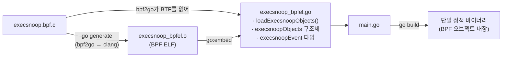
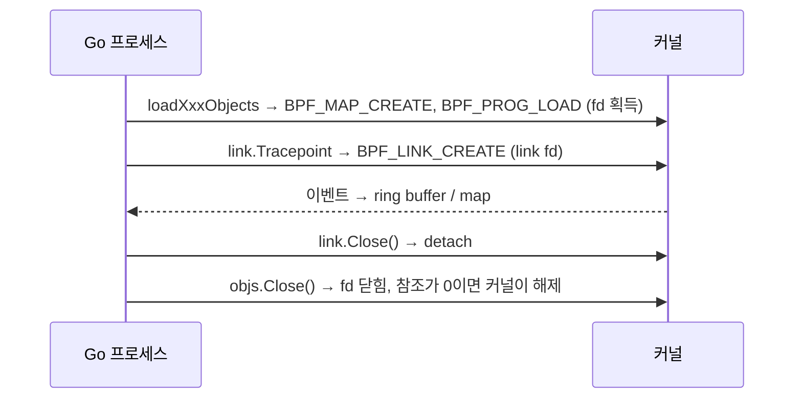

# 07. Go: cilium/ebpf

> **핵심 요약**
> 1. [cilium/ebpf](https://github.com/cilium/ebpf)는 **cgo 없이 순수 Go로** BPF 오브젝트를 읽고, 로드하고, attach하고, map·ring buffer를 다루는 라이브러리다. Cilium·Tetragon·Inspektor Gadget 등이 쓴다.
> 2. 개발 흐름은 **BPF C 작성 → `bpf2go`가 컴파일 + Go 바인딩 생성 → Go에서 `loadXxxObjects` → `link.*`로 attach → map/ring buffer 읽기**다.
> 3. 예제 두 개로 익힌다: **07-1 counter**(kprobe + array map, 최소 골격)와 **07-2 execsnoop**(tracepoint + ring buffer + CO-RE + per-CPU 통계 + 로드 전 상수 주입).

## 1. 개념

### 1.1 bpf2go 개발 흐름



`//go:generate` 한 줄이 핵심이다.

```go
//go:generate go tool bpf2go -tags linux -target bpfel -type event execsnoop execsnoop.bpf.c -- -I../../../../include
```

| 인자 | 의미 |
|---|---|
| `go tool bpf2go` | `go.mod`의 `tool` 지시어로 고정한 버전의 bpf2go를 실행(Go 1.24+). 팀 전체가 같은 버전을 쓴다 |
| `-tags linux` | 생성 파일에 `linux` 빌드 태그를 붙인다 |
| `-target bpfel` | 리틀 엔디언용으로만 컴파일(amd64·arm64 모두 해당). 생략하면 `bpfel`·`bpfeb` 둘 다 만든다 |
| `-type event` | C의 `struct event`와 같은 배치의 Go 타입 `execsnoopEvent`를 생성 |
| `execsnoop` | 생성되는 식별자 접두어(`loadExecsnoopObjects`, `execsnoopObjects` …) |
| `-- -I…` | 이후는 clang에 그대로 전달 |

생성되는 Go 코드에는 프로그램·map·상수가 **이름 그대로 필드로** 들어 있다. 오타가 컴파일 오류로 잡히는 것이 손으로 `coll.Programs["…"]`를 쓰는 것보다 좋은 점이다.

```go
type execsnoopObjects struct {
	execsnoopPrograms   // TraceExecve *ebpf.Program
	execsnoopMaps       // Events, Stats *ebpf.Map
	execsnoopVariables  // FilterUid   *ebpf.Variable
}
```

### 1.2 주요 패키지

| 패키지 | 하는 일 | 예제에서 쓰는 것 |
|---|---|---|
| `github.com/cilium/ebpf` | ELF 파싱(`CollectionSpec`), 로드(`Collection`), `Program`, `Map`, `Variable` | `spec.LoadAndAssign`, `Map.Lookup` |
| `.../link` | attach. 결과는 `link.Link`이고 `Close()`하면 detach | `link.Kprobe`, `link.Tracepoint` |
| `.../ringbuf` | `BPF_MAP_TYPE_RINGBUF` 소비 | `ringbuf.NewReader`, `Read` |
| `.../perf` | `BPF_MAP_TYPE_PERF_EVENT_ARRAY` 소비(5.8 미만 커널용) | — |
| `.../rlimit` | 5.11 미만 커널의 `RLIMIT_MEMLOCK` 제한 해제 | `rlimit.RemoveMemlock` |
| `.../btf` | BTF 읽기, CO-RE 재배치 | (로드 시 자동) |

### 1.3 객체 수명: 누가 닫아야 하나



커널 객체는 **fd(또는 bpffs 핀)가 하나라도 남아 있는 동안 살아 있다.** 프로세스가 죽으면 fd가 닫히므로 attach도 자동으로 풀린다. 01장처럼 핀을 쓰지 않는 한 "남겨진 프로그램"이 생기지 않는 이유다. 그래도 `defer x.Close()`를 습관으로 들이자.

### 1.4 07장에 필요한 CO-RE 최소 지식 (자세한 건 06장)

커널 구조체의 필드 위치(오프셋)는 커널 버전과 설정마다 다르다. 이 머신에서 만든 `vmlinux.h`의 오프셋을 그대로 박아 넣으면 다른 커널에서는 엉뚱한 값을 읽는다.

```c
e->ppid = BPF_CORE_READ(task, real_parent, tgid);   // task->real_parent->tgid
```

`BPF_CORE_READ`는 컴파일러에게 "이 필드 접근을 기록해 두라"고 지시한다(`.BTF.ext`의 재배치 정보). 로드할 때 cilium/ebpf가 **실행 중인 커널의 BTF**(`/sys/kernel/btf/vmlinux`)를 보고 실제 오프셋으로 고쳐 쓴다. 그래서 **한 번 빌드한 바이너리가 다른 커널에서도 동작한다**(Compile Once – Run Everywhere). 포인터를 두 번 따라가는 읽기도 `bpf_probe_read_kernel`을 알아서 끼워 넣어 준다.

### 1.5 로드 전 상수: `const volatile`

```c
const volatile u32 filter_uid = (u32)-1;   // BPF 쪽
```
```go
spec.Variables["filter_uid"].Set(uint32(*uid)) // Go 쪽: 로드 "전에" 값 설정
```

전역 `const volatile` 변수는 `.rodata`에 들어가고, 사용자 공간이 로드 직전에 값을 바꿀 수 있다. 로드 후에는 커널에서 읽기 전용이 되므로 **verifier가 그 값을 상수로 알고, 쓰이지 않는 분기를 아예 지운다.** 명령행 옵션으로 BPF 동작을 바꾸면서도 비용이 들지 않는 표준 패턴이다(`volatile`은 컴파일러가 기본값 `-1`로 미리 계산해 버리지 않게 막는다).

## 2. 예제

| 경로 | 내용 |
|---|---|
| [`code/counter/counter.bpf.c`](code/counter/counter.bpf.c) | `kprobe/vfs_read`에서 array map 칸 하나를 원자적으로 증가 |
| [`code/counter/main.go`](code/counter/main.go) | 로드 → `link.Kprobe` → 1초마다 `Map.Lookup` |
| [`code/execsnoop/execsnoop.bpf.c`](code/execsnoop/execsnoop.bpf.c) | `execve` tracepoint → ring buffer로 이벤트 전송, CO-RE로 부모 PID, per-CPU 통계, UID 필터 상수 |
| [`code/execsnoop/main.go`](code/execsnoop/main.go) | 상수 주입 후 로드 → `link.Tracepoint` → `ringbuf.Reader` → 디코딩·출력 → 종료 시 통계 합산 |
| [`code/run.sh`](code/run.sh) | 두 예제를 정해진 시간만큼 실행하고 부하(`nobody` 사용자로 명령 실행)를 만든다 |

> **2022년 개인 예제에서 가져와 갱신한 것**: 07-2는 필자의 이전 저장소 [`Y-JaeHyun/eBPF_example`](https://github.com/Y-JaeHyun/eBPF_example)의 `exec_scrape`(execve tracepoint → perf buffer)를 출발점으로 다시 썼다.
>
> | 2022년 버전 | 이 장 |
> |---|---|
> | cilium/ebpf v0.9, `go run …/bpf2go` | v0.22, `go.mod`의 `tool` 지시어 + `go tool bpf2go` |
> | perf event array + `perf.NewReader` | ring buffer + `ringbuf.NewReader` (CPU 간 순서 보장, 메모리 공유) |
> | tracepoint 인자 구조체를 손으로 정의 | `vmlinux.h`의 `trace_event_raw_sys_enter` |
> | Go 구조체를 손으로 맞춤 | `bpf2go -type event`로 생성 |
> | 에러 무시(`loadGen_execveObjects(&objs, nil)`) | 모든 에러 처리, `defer Close()` |
> | 무한 루프, 종료 처리 없음 | `-d` 실행 시간, 시그널 처리, 유실 통계 |
> | `bpf_printk` 남김 | 제거(운영 코드에 쓰지 않음) |

### 실행

```bash
cd chapters/07-go-cilium-ebpf/code
make build      # root 불필요: go generate(bpf2go) + go build → bin/counter, bin/execsnoop
make run        # 내부에서 sudo로 실행(비밀번호 입력). 결과는 out/run.log

# 직접 실행
sudo ./bin/counter -n 5
sudo ./bin/execsnoop                 # Ctrl-C로 종료
sudo ./bin/execsnoop -uid 1000 -d 10s
```

`make build`가 하는 일:

```
go generate ./...        # → counter/counter_bpfel.{go,o}, execsnoop/execsnoop_bpfel.{go,o}
go build -o bin/ ./...
```

생성물(`*_bpfel.go`, `*_bpfel.o`)은 이 저장소에서는 커밋하지 않는다. 기술적으로는 CO-RE 덕분에 한 번 만든 오브젝트를 다른 커널에서도 그대로 쓸 수 있어서, 배포용 프로젝트는 오히려 생성물을 커밋해 `clang` 없이 `go build`만으로 빌드되게 하는 경우가 많다(cilium/ebpf examples도 그렇다). 여기서는 학습자가 bpf2go 단계를 직접 거치도록 원본만 둔다.

### 실행 결과 (Linux 6.17 x86_64, cilium/ebpf v0.22.0)

```
=== 07-1 counter: vfs_read 호출 수 (3초)
2026/10/26 10:18:05 vfs_read 누적 5908회 (+5908/s)
2026/10/26 10:18:06 vfs_read 누적 13614회 (+7706/s)
2026/10/26 10:18:07 vfs_read 누적 20153회 (+6539/s)

=== 07-2 execsnoop: 4초 동안 UID 65534(nobody)가 실행하는 프로그램 추적
PID      PPID     UID    COMM             FILENAME
3136227  3136223  65534  su               /bin/sh
3136228  3136227  65534  sh               /usr/bin/ls
3136229  3136227  65534  sh               /usr/bin/uname
3136230  3136227  65534  sh               /bin/echo
전송: 4 (CPU 16개 합산)
버림(ring buffer 가득 참): 0 (CPU 16개 합산)
```

- counter: 아무것도 안 하는 것 같은 시스템에서도 `vfs_read`는 초당 수천 번 불린다. 이렇게 자주 불리는 함수에 붙일 때는 오버헤드를 따져야 한다(측정 방법은 14장).
- execsnoop: `-uid 65534` 필터가 **커널 안에서** 적용되어 nobody의 execve 4건만 ring buffer로 넘어왔다(전송 4). 필터를 빼면 같은 4초 동안 시스템 전체의 execve가 수백~수천 건 쏟아진다.
- `PPID`를 보면 `su`(3136227)가 `/bin/sh`로 바뀌고, 그 `sh`가 `ls`·`uname`·`echo`를 실행한 프로세스 트리가 보인다. `task->real_parent->tgid`를 CO-RE로 읽은 값이다.

### 코드 해설: 07-1 counter

```go
var objs counterObjects
if err := loadCounterObjects(&objs, nil); err != nil { … }   // map 생성 + 프로그램 로드(verifier)
defer objs.Close()

kp, err := link.Kprobe("vfs_read", objs.CountVfsRead, nil)   // attach
defer kp.Close()

var total uint64
objs.Calls.Lookup(uint32(0), &total)                         // 사용자 공간에서 map 읽기
```

- `loadCounterObjects`가 실패하면 **verifier 로그가 에러에 담겨 온다.** `log.Fatalf("%+v", err)`로 찍으면 전체 로그를 볼 수 있다(`%v`는 마지막 몇 줄만).
- `Map.Lookup`의 키·값은 Go 값을 그대로 넘긴다. 크기가 map 정의(`u32`, `u64`)와 다르면 에러가 난다.
- `link.Kprobe`가 만든 attach는 커널에 **perf_event 타입 BPF link**로 보인다. 실행 중에 `sudo bpftool link show`를 보면:
  ```
  100: perf_event  prog 648399
  	kprobe ffffffff895e72a0 vfs_read
  ```
  여러 함수에 한 번에 붙이고 싶다면 `link.KprobeMulti`(`kprobe_multi` link, 5.18+)를 쓴다.

### 코드 해설: 07-2 execsnoop

**BPF 쪽**

```c
e = bpf_ringbuf_reserve(&events, sizeof(*e), 0);   // ① 버퍼에 자리 예약
if (!e) { bump(1); return 0; }                      //   가득 찼으면 유실로 센다
…                                                   // ② 예약한 메모리에 바로 기록(복사 없음)
bpf_ringbuf_submit(e, 0);                           // ③ 제출 → 사용자 공간에서 보인다
```

- ring buffer는 **예약 → 기록 → 제출**의 3단계다. 예약한 뒤에는 반드시 `submit`이나 `discard` 중 하나를 해야 한다(verifier가 검사한다).
- `bpf_probe_read_user_str`: `filename`은 사용자 공간 포인터이므로 `_user_` 변형으로 읽는다. 커널 포인터는 `_kernel_`을 쓴다.
- `stats`는 `PERCPU_ARRAY`라서 각 CPU가 자기 칸만 건드린다. 원자 연산이 필요 없고 캐시 경합도 없다. 대신 읽을 때 CPU 수만큼의 값이 온다.
- `const struct event *unused_event __attribute__((unused));`는 `struct event`가 BTF에 남도록 하는 장치다. 지역 변수로만 쓰인 타입은 최적화 과정에서 BTF에서 빠질 수 있고, 그러면 `bpf2go -type event`가 `looking up type event: not found`로 실패한다.

**Go 쪽**

```go
spec, _ := loadExecsnoop()                               // ELF → CollectionSpec (아직 커널에 안 올림)
spec.Variables["filter_uid"].Set(uint32(*uid))           // 로드 전 상수 주입
spec.LoadAndAssign(&objs, nil)                           // 이제 로드

rd, _ := ringbuf.NewReader(objs.Events)
rec, err := rd.Read()                                    // 레코드가 올 때까지 블록
binary.Read(bytes.NewReader(rec.RawSample), binary.NativeEndian, &ev)

var perCPU []uint64
objs.Stats.Lookup(uint32(i), &perCPU)                    // per-CPU 값은 슬라이스로 받는다
```

- 종료 순서가 중요하다. 다른 고루틴에서 **① `tp.Close()`로 tracepoint를 먼저 떼고 ② `rd.Flush()`** 를 부른다. 그러면 `Read()`가 버퍼에 남은 레코드를 마저 돌려준 뒤 `ringbuf.ErrFlushed`를 반환한다. reader부터 닫으면 남은 이벤트를 버리게 되고, attach를 유지한 채 통계를 읽으면 출력한 줄 수와 "전송" 수가 어긋난다.
- `binary.Read`는 리플렉션을 쓰므로 초당 수십만 건이면 느리다. 그럴 때는 `unsafe`로 캐스팅하거나 필드를 직접 디코딩한다(14장).
- 생성된 `execsnoopEvent`에는 `_ structs.HostLayout` 필드가 있다. "이 구조체는 C와 같은 배치를 쓴다"는 Go 1.23+의 표시이고 크기는 0이다.

## 3. 직접 해보기

1. counter의 attach 대상을 `vfs_write`로 바꿔 보자. BPF C의 `SEC("kprobe/…")`와 Go의 `link.Kprobe("…")` 중 **실제로 attach 지점을 정하는 것은 어느 쪽일까?** (힌트: cilium/ebpf에서는 `link.*` 호출이 정한다. `SEC`는 프로그램 타입을 정한다.)
2. execsnoop에 `argv[1]`을 추가해 보자. `ctx->args[1]`은 `const char *const *`이다. 포인터를 먼저 `bpf_probe_read_user`로 읽고, 그 포인터가 가리키는 문자열을 `bpf_probe_read_user_str`로 읽어야 한다. Go 쪽은 `go generate`만 다시 하면 `execsnoopEvent`에 필드가 생긴다.
3. ring buffer 크기를 `4096`(1페이지)으로 줄이고 `for i in $(seq 2000); do /bin/true; done`를 실행해 보자. 종료 시 "버림" 통계가 0보다 커지는가?
4. `-uid` 필터를 커널이 아니라 Go에서 하도록 바꾸고, 차이를 생각해 보자(ring buffer로 넘어오는 이벤트 수, CPU 사용량).
5. counter를 실행한 채로 `sudo bpftool prog show`와 `sudo bpftool link show`를 보자. 프로그램 이름, map ID, link 타입을 확인하고, Ctrl-C 뒤에 사라지는 것도 확인하자.

## 4. 자주 하는 실수

- **`C source files not allowed when not using cgo`** — Go 패키지 디렉터리에 `.c` 파일이 있으면 go build가 cgo 소스로 본다. BPF C 파일 맨 위에 `//go:build ignore`를 넣는다.
- **`collect C types: looking up type event: not found`** — `-type`으로 지정한 타입이 BTF에 없다. 위의 `unused_event` 같은 전역 참조를 둔다.
- **`go generate`를 root로 실행** — 생성물·캐시가 root 소유가 된다. 빌드는 일반 사용자, 실행만 `sudo`.
- **C 구조체와 Go 구조체를 손으로 맞추다 패딩이 어긋남** — `-type`으로 생성하자. 손으로 맞출 때는 `u8`/`u32` 순서에 따른 패딩을 조심한다.
- **ring buffer `max_entries`를 아무 값으로 설정** — 페이지 크기(4096)의 2의 거듭제곱 배여야 한다. 아니면 map 생성이 `EINVAL`로 실패한다.
- **유실을 세지 않음** — reserve 실패는 조용히 일어난다. 항상 카운터를 두고 보여 주자.
- **`objs.Close()` 전에 프로세스가 `os.Exit`/`log.Fatal`** — defer가 실행되지 않는다. 다만 프로세스 종료 시 fd가 닫히므로 커널 객체는 해제된다(핀을 쓴 경우는 예외).

## 5. 더 읽을거리

| 자료 | 라이선스 | 이 챕터에서의 사용 |
|---|---|---|
| [cilium/ebpf 문서](https://ebpf-go.dev/) | MIT (저장소 [cilium/ebpf](https://github.com/cilium/ebpf)) | Getting Started·bpf2go 설명을 참고해 재서술 |
| [cilium/ebpf examples](https://github.com/cilium/ebpf/tree/main/examples) | MIT | kprobe·ringbuffer 예제 구조 참고(코드는 새로 작성) |
| [ebpf-go.dev: Global Variables](https://ebpf-go.dev/concepts/global-variables/) | MIT | `const volatile`·`Variables` 사용법 참고 |
| [커널 문서: BPF ring buffer](https://docs.kernel.org/bpf/ringbuf.html) | GPL-2.0 | reserve/submit 의미 참고(재서술) |
| [Andrii Nakryiko, BPF CO-RE reference guide](https://nakryiko.com/posts/bpf-core-reference-guide/) | 저작권 블로그 | CO-RE 개념 참고(인용·번역 없음) |
| [Y-JaeHyun/eBPF_example](https://github.com/Y-JaeHyun/eBPF_example) | 필자 저장소 | 07-2의 출발점(갱신해 재작성) |
