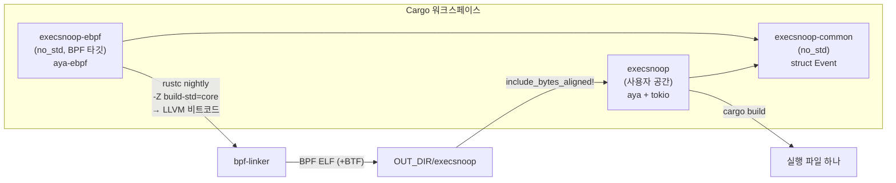
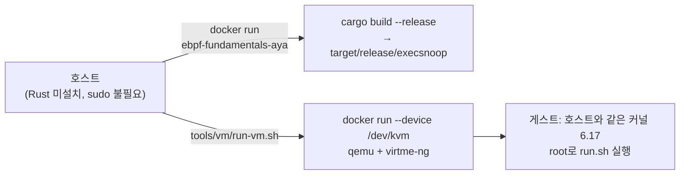

# 08. Rust: Aya 맛보기 *(선택)*

> **핵심 요약**
> 1. [Aya](https://github.com/aya-rs/aya)는 **BPF 프로그램과 로더를 모두 Rust로** 쓰는 라이브러리다. libbpf나 clang에 의존하지 않고, BPF 쪽은 rustc(nightly) + `bpf-linker`로 빌드한다.
> 2. 07장 execsnoop을 Aya로 그대로 옮겨 Go(cilium/ebpf)·C(libbpf)와 비교한다. 흐름(로드 → 상수 주입 → attach → ring buffer)은 같고, **커널·사용자 공간이 같은 Rust 타입을 공유**하는 점이 다르다.
> 3. 주의할 점: Rust로 쓴 BPF 코드에서는 커널 구조체 필드를 CO-RE로 읽는 수단이 아직 없다. 그리고 **관용적인 Rust 코드가 BPF 명령어를 크게 늘릴 수 있다**(이 장에서 180 → 74칸으로 줄인 사례).

이 장은 호스트에 Rust를 설치하지 않는다. **빌드는 Docker 이미지 안에서, 실행은 KVM VM 안에서** 한다(아래 "실습 환경").

## 1. 개념

### 1.1 Aya의 구성



| 크레이트 | 역할 | C/Go에서 대응하는 것 |
|---|---|---|
| `aya-ebpf` | BPF 프로그램 쪽 라이브러리. 프로그램 매크로(`#[tracepoint]`), map 타입, helper 래퍼 | `bpf_helpers.h`, `bpf_tracing.h` |
| `aya` | 사용자 공간 로더. ELF 파싱, 재배치, 로드, attach, map 접근 | libbpf, cilium/ebpf |
| `aya-build` | `build.rs`에서 BPF 크레이트를 nightly + `bpf-linker`로 빌드 | `bpf2go`, `bpftool gen skeleton` |
| `bpf-linker` | rustc가 만든 LLVM 비트코드를 BPF 오브젝트로 링크 | clang `-target bpf` |
| `*-common` | 양쪽이 함께 쓰는 타입(`no_std`) | 공용 `.h`, bpf2go `-type` |

BPF 프로그램 크레이트는 **nightly** Rust가 필요하다. BPF 타깃용 `core` 라이브러리를 소스에서 다시 빌드해야 하기 때문이다(`-Z build-std`). 사용자 공간 크레이트는 stable로 빌드한다.

### 1.2 세 로더 비교

| 단계 | C + libbpf (06장) | Go + cilium/ebpf (07장) | Rust + Aya (이 장) |
|---|---|---|---|
| BPF 코드 언어 | C | C | Rust (`no_std`) |
| BPF 컴파일러 | clang | clang (bpf2go가 호출) | rustc nightly + bpf-linker |
| 공용 타입 | `.h` 파일 | `bpf2go -type` → Go 구조체 생성 | `-common` 크레이트를 양쪽이 의존 |
| 오브젝트 내장 | skeleton 헤더(바이트 배열) | `go:embed` | `include_bytes_aligned!` |
| 로드 전 상수 | `skel->rodata->x = …` | `spec.Variables["x"].Set(…)` | `EbpfLoader::override_global("X", &v, true)` |
| attach | `__attach()` (SEC 이름으로 자동) | `link.Tracepoint(…)` | `program_mut("…")` → `load()` → `attach(…)` |
| ring buffer 읽기 | `ring_buffer__poll` | `ringbuf.Reader.Read` | `RingBuf::next` + `tokio::AsyncFd` |
| CO-RE (커널 구조체 필드) | `BPF_CORE_READ` | C 쪽 `BPF_CORE_READ` | **Rust BPF 코드에서는 수단 없음** (1.3 참고) |

### 1.3 CO-RE: 로더는 하지만, Rust BPF 코드에서는 아직

`aya`(정확히는 `aya-obj`)에는 CO-RE 재배치 코드가 있다(`aya-obj` 0.3.0의 `btf/relocation.rs`). 그래서 **C로 작성하고 clang으로 컴파일한 오브젝트**를 Aya로 로드하면 06장과 같은 재배치가 일어난다.

반면 **Rust로 쓴 BPF 코드**에는 C의 `BPF_CORE_READ`나 `__attribute__((preserve_access_index))`처럼 "이 필드 접근을 재배치 대상으로 기록하라"고 지시하는 수단이 없다. 이 장에서 쓴 `aya-ebpf` 0.2.1 소스에는 `bpf_core_*`류 API가 없다. 대안은 `aya-tool`로 커널 BTF에서 Rust 바인딩을 생성하는 것이다. 다만 그 바인딩의 오프셋은 **생성한 머신의 커널에 고정된다.**

그래서 07장의 Go 버전은 `task->real_parent->tgid`(PPID)를 CO-RE로 읽지만, 이 장의 Aya 버전에서는 PPID 필드를 뺐다. 커널 구조체를 읽지 않는 PID·UID·comm·filename은 helper와 tracepoint 인자만으로 얻는다.

## 2. 예제: execsnoop (07장과 같은 동작)

| 파일 | 내용 |
|---|---|
| [`code/Cargo.toml`](code/Cargo.toml) | 워크스페이스. 버전 고정: aya 0.14.0, aya-ebpf 0.2.1, aya-build 0.2.0 |
| [`code/execsnoop-common/src/lib.rs`](code/execsnoop-common/src/lib.rs) | `struct Event` (`#[repr(C)]`, 사용자 공간에서는 `aya::Pod`) |
| [`code/execsnoop-ebpf/src/main.rs`](code/execsnoop-ebpf/src/main.rs) | BPF 프로그램: `sys_enter_execve` tracepoint → ring buffer, UID 필터, per-CPU 통계 |
| [`code/execsnoop/build.rs`](code/execsnoop/build.rs) | `aya-build`로 BPF 크레이트 빌드 (nightly 버전은 `AYA_NIGHTLY`로 고정) |
| [`code/execsnoop/src/main.rs`](code/execsnoop/src/main.rs) | 로더: `override_global` → load → attach → tokio로 ring buffer 소비 |
| [`../../tools/aya/Dockerfile`](../../tools/aya/Dockerfile) | 빌드 환경: Rust 1.96 + nightly-2026-09-01 + bpf-linker v0.11.1 (sha256 확인) |
| [`../../tools/vm/run-vm.sh`](../../tools/vm/run-vm.sh) | 호스트 커널을 KVM VM으로 부팅해 명령을 root로 실행 (12장과 공용) |

워크스페이스 구조와 `build.rs`는 [aya-rs/aya-template](https://github.com/aya-rs/aya-template)(MIT OR Apache-2.0)을 따랐다.

### 실습 환경: Docker로 빌드, VM에서 실행



- **빌드**: Rust 툴체인이 든 이미지에서 `cargo build`를 한다. 크레이트 캐시는 저장소의 `.local/cargo`(커밋 안 됨)에 남는다.
- **실행**: BPF 프로그램 로드에는 root가 필요하다. `tools/vm/run-vm.sh`는 Docker 컨테이너 안에서 qemu(KVM)로 **호스트와 같은 커널 이미지**를 부팅하고 그 안에서 root로 실행한다([virtme-ng](https://github.com/arighi/virtme-ng)). 저장소는 게스트의 `/work`에 마운트된다. 호스트의 BPF 상태를 건드리지 않는다는 장점도 있다.
- 필요한 것: **x86_64 호스트**(이미지가 x86_64용 qemu·bpf-linker를 쓴다), Docker, `/dev/kvm`(CPU 가상화 지원). 호스트 사용자가 `/dev/kvm`에 직접 접근하지 못해도 Docker 데몬이 넘겨준다.

### 실행

```bash
make build    # Docker 이미지가 없으면 먼저 만든다(수 분). 결과: code/target/release/execsnoop
make run      # VM 부팅 → run.sh. 결과: out/run.log
```

### 실행 결과 (Linux 6.17 x86_64, VM)

```
=== Aya execsnoop: 4초 동안 UID 65534(nobody)가 실행하는 프로그램 추적
PID      UID    COMM             FILENAME
213      65534  setpriv          /bin/sh
214      65534  sh               /bin/ls
215      65534  sh               /bin/uname
216      65534  sh               /bin/echo
보낸 이벤트 4개, 유실 0개
```

07장과 같은 결과다. VM 안이라 PID가 작고, `su` 대신 `setpriv`로 UID를 바꿨다(VM의 루트 파일시스템은 최소 구성의 Ubuntu 이미지다).

### 코드 해설

#### BPF 쪽: 전역 상수와 ring buffer

```rust
#[unsafe(no_mangle)]
static FILTER_UID: u32 = u32::MAX;
...
let filter = unsafe { core::ptr::read_volatile(&FILTER_UID) };
if filter != u32::MAX && uid != filter {
    return Ok(());
}
```

C의 `const volatile u32 filter_uid`에 해당한다. `no_mangle`은 로더가 이름으로 찾을 수 있게 심볼 이름을 그대로 남긴다. `read_volatile`은 컴파일러가 "항상 `u32::MAX`"라고 상수 접기를 해서 비교문을 지워 버리는 것을 막는다. 로더는 로드 전에 `.rodata`의 이 값을 바꾼다.

```rust
let mut ebpf = EbpfLoader::new()
    .override_global("FILTER_UID", &uid, true)   // true: 이 이름이 없으면 오류
    .load(aya::include_bytes_aligned!(concat!(env!("OUT_DIR"), "/execsnoop")))?;
```

ring buffer는 `reserve::<Event>()`가 `MaybeUninit<Event>`를 돌려준다. **초기화되지 않은 메모리**라는 사실이 타입으로 드러난다. 여기서 Rust 특유의 함정이 있다. 초기화되지 않은 메모리의 필드에 `&mut` 참조를 만드는 것만으로도 Rust에서는 정의되지 않은 동작(UB)이다. 그래서 필드 주소는 `&raw mut`로 **원시 포인터만** 얻어 helper에 넘기고, 값도 포인터로 쓴다.

```rust
let e = entry.as_mut_ptr();
unsafe {
    (&raw mut (*e).pid).write((bpf_get_current_pid_tgid() >> 32) as u32);
    let comm = (&raw mut (*e).comm).cast::<u8>();
    if generated::bpf_get_current_comm(comm.cast(), TASK_COMM_LEN as u32) != 0 {
        comm.write(0);   // helper가 실패해도 빈 문자열이 되게
    }
    ...
}
entry.submit(0);
```

처음 작성한 버전은 `bpf_probe_read_user_str_bytes(ptr, &mut (*e).filename)`처럼 참조를 넘겼다. 실행 결과는 정상이었지만 코드 리뷰에서 UB로 지적받아 고쳤다. **verifier는 BPF 메모리 안전만 보고, Rust 언어 규칙 위반은 잡지 않는다.**

`RingBufEntry`에는 `#[must_use]`가 붙어 있어 `reserve` 결과를 아예 쓰지 않으면 경고가 난다. 하지만 변수에 받아 둔 뒤 `submit`/`discard` 없이 버리는 경우나 일부 필드만 채운 경우는 컴파일러가 잡지 못한다. 그런 실수는 05장 04번처럼 verifier가 "참조 미반환"으로 잡거나, 쓰레기 값이 사용자 공간으로 나가는 것으로 드러난다.

#### 관용적인 코드가 BPF 명령어를 늘린 사례

처음에는 안전한 래퍼를 썼다.

```rust
(*e).comm = bpf_get_current_comm().unwrap_or([0; 16]);   // Result<[u8; 16], _>를 값으로 받는다
if bpf_probe_read_user_str_bytes(ptr, &mut (*e).filename).is_err() { ... }
```

빌드된 오브젝트를 `llvm-objdump -d`로 보니 tracepoint 함수가 **0x5a0바이트(명령어 칸 180개)**였다. 16바이트 배열을 값으로 받아 스택에 두고 정렬 1로 한 바이트씩 옮기는 코드, `unwrap_or`의 0 초기화, `memset`을 부르는 BPF-to-BPF 호출 3개가 들어 있었다. 위의 원시 helper·원시 포인터 버전으로 바꾸자 **0x250바이트(74칸)**가 되었고 `memset` 호출도 사라졌다. 07장 C 버전의 `trace_execve`는 0x268바이트(77칸)다. C 버전은 CO-RE로 PPID까지 읽는다.

| 버전 | tracepoint 함수 크기 | BPF-to-BPF 호출 |
|---|---|---|
| Aya, 안전한 래퍼 (값 반환 + `unwrap_or`) | 0x5a0 B (180칸) | 3 (`memset`) |
| Aya, 원시 helper + 원시 포인터 (최종) | 0x250 B (74칸) | 0 |
| C (07장, PPID 포함) | 0x268 B (77칸) | 0 |

(칸 = 8바이트. 64비트 상수를 싣는 `ld_imm64`는 두 칸을 쓴다.) BPF는 명령어 수와 스택(512바이트)에 한도가 있다(05장). 이 사례의 직접 원인은 **배열을 값으로 돌려받아 복사하는 것**이었다. `Option`/`Result` 자체가 늘 비싸다는 뜻은 아니다. 또한 이 숫자는 이 장의 툴체인(nightly-2026-09-01, bpf-linker v0.11.1, release 빌드)에서 얻은 값이다. **Aya로 짠 프로그램은 `llvm-objdump -d`로 결과를 확인하는 습관**을 들이자.

#### 사용자 공간: tokio로 ring buffer 기다리기

```rust
let mut rb = unsafe { AsyncFd::register(rb) }.map_err(|e| e.into_parts().1)?;
...
guard = rb.readable_mut() => {
    let rb = guard.get_inner_mut();
    while let Some(item) = rb.next() { ... }
    guard.clear_ready();
}
```

`RingBuf`는 epoll로 기다릴 수 있는 fd를 갖고 있다. 그 fd를 tokio에 등록해 두면, 데이터가 들어왔을 때 깨어나 `next()`로 쌓인 레코드를 꺼낸다. 끝낼 때는 06·07장과 같은 순서를 따른다. 먼저 `detach`해 새 이벤트를 막고, 그다음 남은 레코드를 비운다.

## 3. 직접 해보기

1. `execsnoop-ebpf/src/main.rs`의 comm 읽기를 `(&raw mut (*e).comm).write(bpf_get_current_comm().unwrap_or([0; 16]))`로 바꾸고 `make build`하자. 그다음 `llvm-objdump -d -j tracepoint target/release/build/execsnoop-*/out/execsnoop`로 늘어난 명령어를 확인하자.
2. `read_volatile`을 빼고 그냥 `if FILTER_UID != u32::MAX`로 쓰면 어떻게 될까? `-uid 65534`를 줘도 필터가 동작하는지 확인하자.
3. 07장 Go 버전의 C 오브젝트(`execsnoop_bpfel.o`)를 Aya의 `Ebpf::load_file`로 읽어 attach해 보자. 이때는 CO-RE 재배치가 일어나 PPID도 읽힌다.
4. `Cargo.toml`의 `[profile.release.package.execsnoop-ebpf]`에서 `debug = 2`를 빼면 무엇이 달라질까? 힌트: bpf-linker는 DWARF 디버그 정보에서 BTF를 만든다.

## 4. 자주 하는 실수

- **`cargo install bpf-linker`가 실패** — 소스 빌드에는 맞는 버전의 LLVM 개발 패키지가 필요하다. bpf-linker README도 릴리스 바이너리(`cargo binstall`이나 tarball)를 권한다. 이 장의 Dockerfile은 tarball을 받아 sha256을 확인한다.
- **의존성이 "requires rustc 1.xx"로 실패** — Aya 생태계는 새 Rust 버전을 빠르게 따라간다. stable 버전을 올리거나 의존성 버전을 고정하자(이 장은 1.90에서 실패해 1.96으로 올렸다).
- **`nightly`가 바뀌어 어느 날 빌드가 깨짐** — `aya_build::Toolchain::Custom("nightly-YYYY-MM-DD")`로 날짜를 고정하자(이 장의 `build.rs` + `AYA_NIGHTLY`).
- **`#[map]` 이름과 `take_map("…")` 이름 불일치** — 컴파일 때는 잡히지 않고 실행 중에 `None`이 된다. bpf2go처럼 이름 붙은 필드를 생성해 주지 않는다.
- **`reserve` 후 일부 필드만 채움** — `MaybeUninit`이라 이전 레코드의 쓰레기 값이 그대로 나간다. 모든 필드를 쓰거나 `write_bytes`로 먼저 0을 채우자(명령어가 늘어나는 비용이 있다).
- **초기화 안 된 entry에 `&mut` 참조** — 실행은 잘 되는 것처럼 보여도 Rust의 UB다. `&raw mut`와 `ptr::write`를 쓰자.

## 5. 더 읽을거리

| 자료 | 라이선스 | 이 챕터에서의 사용 |
|---|---|---|
| [aya-rs/aya](https://github.com/aya-rs/aya) | MIT OR Apache-2.0 | API(`EbpfLoader::override_global`, `RingBuf`, `aya-obj` CO-RE 재배치) 소스 확인 |
| [aya-rs/aya-template](https://github.com/aya-rs/aya-template) | MIT OR Apache-2.0 (BPF 쪽 GPL-2.0 파일 포함) | 워크스페이스 구조와 `build.rs` 형태를 따름 |
| [Aya Book](https://aya-rs.dev/book/) | 본문 CC BY-SA 4.0, 코드 MIT + Apache-2.0 (저장소 [aya-rs/book](https://github.com/aya-rs/book) 기준) | 개념 참고(재서술) |
| [aya-rs/aya#349 "Add BTF relocation support in eBPF programs"](https://github.com/aya-rs/aya/issues/349) (2026-10 기준 열림) | — (이슈 링크) | Rust BPF 코드의 CO-RE 재배치가 미구현 상태임을 확인 |
| [aya-rs/bpf-linker](https://github.com/aya-rs/bpf-linker) | MIT OR Apache-2.0 | 설치 방법(릴리스 바이너리 권장) |
| [virtme-ng](https://github.com/arighi/virtme-ng) | GPL-2.0 | 실행용 VM (도구로만 사용) |
