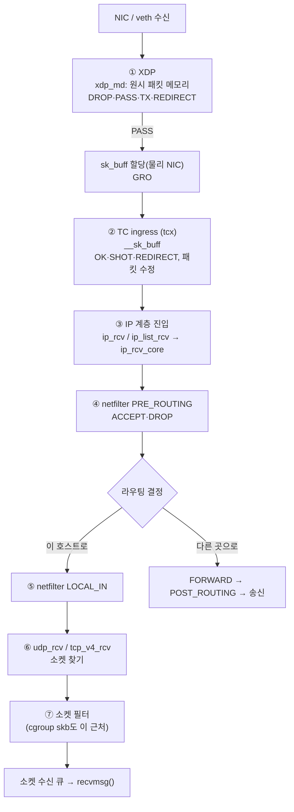

# 09. 커널 패킷 경로

> **핵심 요약**
> 1. 수신 패킷은 **XDP → TC(ingress) → IP 계층 → netfilter PRE_ROUTING → 라우팅 → netfilter LOCAL_IN → UDP/TCP → 소켓** 순서로 올라간다. 각 지점마다 BPF를 붙일 수 있고, **앞에서 버릴수록 뒤의 비용(sk_buff 할당, 라우팅, 소켓 조회)을 아낀다.**
> 2. 실험: netns 두 개를 veth로 잇고 UDP 패킷 10개를 보내, 7개 hook이 각 패킷을 본 시각을 기록했다. 어느 단계에서 버리느냐에 따라 **그 뒤 hook에는 패킷이 아예 나타나지 않는다.**
> 3. 커널 함수에 직접 붙이는 fentry는 **경로가 여러 갈래일 수 있다.** veth에 XDP를 붙이자 패킷이 `ip_rcv`가 아니라 `ip_list_rcv`로 들어와 `ip_rcv` hook이 한 번도 불리지 않았다. 공통 경로(`ip_rcv_core`)를 찾아 붙여야 한다.

## 1. 개념

### 1.1 수신 경로와 BPF hook



| 지점 | BPF 프로그램 타입 | 받는 것 | 할 수 있는 일 | 범위 |
|---|---|---|---|---|
| ① XDP | `BPF_PROG_TYPE_XDP` | `xdp_md`(패킷 바이트) | 버리기, 통과, 같은 NIC로 되돌려 보내기(TX), 다른 NIC·CPU·AF_XDP 소켓으로 보내기(REDIRECT) | 인터페이스 하나, **수신만** |
| ② TC | `BPF_PROG_TYPE_SCHED_CLS` (`tcx/ingress`, `tcx/egress`) | `__sk_buff` | 버리기, 수정, 리다이렉트, 표시(mark) | 인터페이스 하나, 수신·송신 |
| ③⑥ 커널 함수 | fentry/kprobe | 함수 인자 | **관측만** | 시스템 전체 |
| ④⑤ netfilter | `BPF_PROG_TYPE_NETFILTER` (6.4+) | `bpf_nf_ctx`(skb + hook 상태) | ACCEPT / DROP | network namespace 하나 |
| ⑦ 소켓 필터 | `BPF_PROG_TYPE_SOCKET_FILTER` | `__sk_buff` | 남길 길이 정하기(0이면 버림) | 소켓 하나 |
| (11장) cgroup | `cgroup_skb`, `cgroup/connect4` 등 | `__sk_buff`, `bpf_sock_addr` | 허용·거부, 주소 바꾸기 | cgroup 하나 |

송신은 반대 방향이다. 소켓 → IP 출력 → netfilter LOCAL_OUT·POST_ROUTING → TC egress → 드라이버. **XDP에는 송신 hook이 없다.**

### 1.2 XDP와 sk_buff

`sk_buff`(socket buffer)는 커널 네트워크 스택이 패킷 하나를 다루는 구조체다. 헤더 위치, 길이, 소속 소켓, 체크섬 상태 등 수십 개 필드를 갖는다. 물리 NIC의 native XDP는 이것을 만들기 **전에** 드라이버의 수신 버퍼를 직접 보고 판단한다. 그래서 대량 차단(DDoS 방어)이나 로드밸런싱처럼 대부분의 패킷을 스택에 올리지 않을 일에 쓴다. TC부터는 `sk_buff`가 있으므로 소켓·cgroup 정보나 이미 계산된 메타데이터를 쓸 수 있다.

XDP에는 두 가지 동작 방식이 있다. 드라이버가 직접 부르는 **native** 모드와, 드라이버가 지원하지 않을 때 `sk_buff`를 만든 뒤 흉내 내는 **generic**(SKB) 모드다. veth는 native XDP를 지원한다. 다만 veth는 송신 쪽에서 이미 `sk_buff`로 만들어진 패킷을 넘겨받으므로, **이 장의 실험은 "XDP가 sk_buff 할당을 아낀다"는 이점을 보여 주지 못한다.** 그 효과는 물리 NIC에서 측정해야 한다.

### 1.3 이 실험에서 본 veth의 두 경로

veth는 XDP 프로그램 유무에 따라 수신 방식이 바뀐다(커널 6.17 `drivers/net/veth.c`).

| | XDP 없음 | XDP 있음 |
|---|---|---|
| 송신 쪽이 패킷을 넘기는 곳 | `__netif_rx()` → CPU별 backlog 큐 | `veth_xdp_rx()` → 수신 링 → NAPI |
| 수신 처리 | backlog 처리에서 패킷 하나씩 `__netif_receive_skb` | NAPI poll에서 XDP 실행 → `napi_gro_receive()` → 목록(list)으로 위 계층에 전달 |
| 이 실험에서 관찰한 IP 계층 진입 함수 | `ip_rcv()` 10회 | `ip_list_rcv()` 10회 |

**GRO**(Generic Receive Offload)는 같은 흐름의 패킷을 합쳐 위 계층으로 올리는 최적화다. NAPI 경로에서는 GRO를 거친 패킷이 목록 단위로 전달되어 `ip_list_rcv()`로 들어간다. 목록에는 패킷이 하나만 들어 있어도 된다. 이 실험은 패킷 10개에 호출 10회라 **실제로 여러 패킷이 묶이지는 않았다.** 위 표는 "XDP가 있으면 항상 이렇다"가 아니라 이 veth 설정과 트래픽에서 관찰한 결과다. 두 함수 모두 헤더 검사는 `ip_rcv_core()`에서 한다(`net/ipv4/ip_input.c`). 그래서 이 장의 프로그램은 IP 계층 지점에 `ip_rcv_core`를 쓴다.

## 2. 예제: pktpath

| 파일 | 내용 |
|---|---|
| [`code/pktpath/pktpath.bpf.c`](code/pktpath/pktpath.bpf.c) | hook 7곳(XDP, tcx ingress, fentry `ip_rcv_core`, netfilter ×2, fentry `udp_rcv`, 소켓 필터) + 진입 함수 카운터(fentry `ip_rcv`, `ip_list_rcv`) |
| [`code/pktpath/main.go`](code/pktpath/main.go) | `recv`: 붙이고 UDP :9000에서 받은 뒤 표 출력. `send`: 실험 패킷 송신. `-drop 단계`로 그 단계에서 버리기, `-no-xdp`로 XDP 빼기 |
| [`code/run.sh`](code/run.sh) | netns `ebpf09a` ↔ veth ↔ `ebpf09b` 샌드박스를 만들고 6가지 조건으로 실험. 끝나면 netns를 지운다 |

실험 패킷은 UDP 목적지 포트 9000이고, 페이로드 앞 8바이트가 `"EBPF"` + 일련번호(seq)다. 모든 hook이 이 형식의 패킷만 골라, seq를 키로 하는 hash map에 자기 칸의 시각(`bpf_ktime_get_ns`)을 적는다.

```
[netns ebpf09a] veth09a 192.0.2.1 ── veth ── veth09b 192.0.2.2 [netns ebpf09b]
    pktpath send ─────── UDP :9000 ──────▶ pktpath recv (hook 7곳 + 소켓)
```

호스트의 실제 인터페이스와 netfilter 설정에는 아무것도 붙이지 않는다. 같은 이름의 netns가 이미 있으면 남의 것일 수 있으므로 지우지 않고 멈추며, 끝날 때는 이번 실행에서 만든 것만 지운다. XDP·TC는 netns 안의 veth에, netfilter link는 `recv`가 실행된 netns(`ebpf09b`)에만 붙는다. fentry 네 개만 시스템 전체에 붙지만 관측만 하고, 실험 패킷 형식이 아니면 바로 돌아간다. 주소는 문서용 예약 대역 `192.0.2.0/24`(TEST-NET-1)를 썼다.

### 실행

```bash
make build    # root 불필요
make run      # 내부에서 sudo. netns 샌드박스를 만들고 지운다. 결과: out/run.log
```

### 실행 결과 (Linux 6.17 x86_64)

#### ① 아무것도 버리지 않을 때

```
--- bpftool net show (netns ebpf09b 안에서)
xdp:
veth09b(2) driver id 662996

tc:
veth09b(2) tcx/ingress at_tc prog_id 662994 link_id 3512

netfilter:
	ip prerouting prio 100 prog_id 662992
	ip input prio 100 prog_id 662992
---
seq       XDP       TC ip_rcv_core   NF_PRE    NF_IN  udp_rcv   socket   app
     (각 칸: 앞 단계를 지난 뒤 걸린 시간 µs, '-'는 그 hook에 오지 않음)
1           0      4.9         2.9      1.6      5.3      1.2      3.5    받음
2           0      5.3         3.1      1.6      6.9      1.4      3.5    받음
…
10          0      6.0         2.7      1.7      5.8      1.1      3.4    받음
중앙                 5.1         3.1      1.8      6.9      1.4      3.5
앱이 받은 패킷: 10/10
veth09b에서 IP 계층 진입: ip_rcv 0회, ip_list_rcv 10회(묶음 단위 호출)
```

- `bpftool net show`로 XDP(`driver` = native 모드), tcx, netfilter 두 지점에 붙은 것을 확인할 수 있다. **같은 netfilter 프로그램 하나**(prog_id 662992)가 두 hook에 link 두 개로 붙었다.
- 모든 패킷이 일곱 지점을 1.1의 순서대로 지났다.
- 패킷 하나가 XDP에서 소켓 필터까지 가는 데 중앙값 합계 약 22µs가 걸렸다. 다만 이 숫자에는 **각 hook에서 돈 이 실험 프로그램 자신의 비용**(hash map 조회·갱신, 패킷 바이트 복사)이 들어 있다. 이 장비·이 조건에서 hook 사이 순서와 대략의 규모를 보는 용도로만 쓰자. 커널 처리 비용 자체의 측정값으로 쓰면 안 된다.
- XDP → TC 구간에는 veth의 NAPI·GRO 처리와 `__netif_receive_skb` 진입이 들어 있다(veth에서는 `sk_buff`가 이미 있으므로 할당 비용은 아니다). NF_PRE → NF_IN 구간에는 라우팅 조회와 `ip_local_deliver`가 들어 있다.

#### ② ~ ⑤ 단계별로 버리기

```
=== 2) TC ingress에서 버리면 (TC_ACT_SHOT)
seq       XDP       TC ip_rcv_core   NF_PRE    NF_IN  udp_rcv   socket   app
1           0      5.5           -        -        -        -        -     -
앱이 받은 패킷: 0/10

=== 3) netfilter LOCAL_IN에서 버리면 (NF_DROP)
1           0      3.9         1.7      1.4      6.1        -        -     -
앱이 받은 패킷: 0/10

=== 4) XDP에서 버리면 (XDP_DROP)
1           0        -        -        -        -        -        -     -
앱이 받은 패킷: 0/10

=== 5) 소켓 필터에서 버리면 (0 반환)
1           0      6.4         3.6      1.8      5.8      1.6      3.9     -
앱이 받은 패킷: 0/10
```

(각 조건의 1번 패킷 행만 옮겼다. 나머지 9개도 같은 모양이다.)

- **버린 단계 뒤의 hook에는 패킷이 나타나지 않는다.** 그 뒤의 처리가 아예 일어나지 않았다는 뜻이다. 물리 NIC의 native XDP라면 `sk_buff`를 만들기 전에 버린다(veth인 이 실험에서는 송신 쪽이 이미 만들어 두었다).
- 소켓 필터에서 버리면 커널은 라우팅·UDP 처리·소켓 조회까지 다 한 뒤 마지막에 버린다. 결과는 같아도(앱은 못 받음) 비용은 가장 크다. 대신 **그 소켓 하나에만** 적용된다는 장점이 있다.

#### ⑥ XDP를 붙이지 않으면

```
seq       XDP       TC ip_rcv_core   NF_PRE    NF_IN  udp_rcv   socket   app
1           -        0         6.8      3.4      6.9      2.3      4.5    받음
…
중앙                             5.4      3.3      7.0      2.2      4.2
앱이 받은 패킷: 10/10
veth09b에서 IP 계층 진입: ip_rcv 10회, ip_list_rcv 0회(묶음 단위 호출)
```

XDP가 있을 때는 `ip_list_rcv` 10회·`ip_rcv` 0회, 없을 때는 `ip_rcv` 10회·`ip_list_rcv` 0회였다. 1.3에서 소스로 확인한 두 경로와 맞는다.

> **이 장을 만들며 실제로 겪은 일.** 처음에는 IP 계층 지점을 `fentry/ip_rcv`로 잡았다. 그런데 모든 패킷에서 그 칸이 비어 있었다. 원인을 좇아 `ip_rcv`·`ip_list_rcv` 카운터를 붙여 보니 위와 같았다. 커널 함수에 붙는 hook은 "그 함수를 지나는 경우"만 본다. 같은 일을 하는 경로가 여럿이면(묶음 처리, 빠른 경로, 프로토콜별 분기) 일부를 놓친다. 안정적인 지점이 필요하면 tracepoint나 이 장의 netfilter·TC처럼 **경로와 상관없이 불리는 hook**을 먼저 찾자.

### 코드 해설

#### 같은 패킷을 hook마다 다른 방식으로 읽기

| hook | 패킷 바이트 접근 방법 |
|---|---|
| XDP, TC | `ctx->data` ~ `ctx->data_end`를 직접 포인터로 읽는다. **경계 검사 필수**(없으면 verifier가 거부) |
| fentry, netfilter | 인자인 `struct sk_buff *`에서 `head + network_header`를 계산해 `bpf_probe_read_kernel`. 읽을 범위가 선형 데이터(`tail`까지) 안인지 먼저 확인 |
| 소켓 필터 | 이 시점에는 `skb->data`가 UDP 헤더를 가리킨다. `bpf_skb_load_bytes_relative(..., BPF_HDR_START_NET)`로 IP 헤더부터 읽는다 |

```c
// XDP: 직접 포인터 + 경계 검사
struct ethhdr *eth = data;
struct probe_pkt *p = data + sizeof(*eth);
if ((void *)(p + 1) > end)
	return XDP_PASS;
```

```c
// 커널 내부 함수·netfilter: sk_buff에서 네트워크 헤더 위치 계산
unsigned char *head = BPF_CORE_READ(skb, head);
__u16 nh = BPF_CORE_READ(skb, network_header);
__u32 tail = BPF_CORE_READ(skb, tail);   // 64비트 커널에서는 head 기준 오프셋
if (nh + sizeof(p) > tail)               // 짧거나 조각난 패킷이면 읽지 않는다
	return 0;
bpf_probe_read_kernel(&p, sizeof(p), head + nh);
```

#### 반환값의 의미가 hook마다 다르다

| hook | 통과 | 버림 |
|---|---|---|
| XDP | `XDP_PASS`(2) | `XDP_DROP`(1) |
| TC | `TC_ACT_OK`(0) | `TC_ACT_SHOT`(2) |
| netfilter | `NF_ACCEPT`(1) | `NF_DROP`(0) |
| 소켓 필터 | 남길 바이트 수(`skb->len`) | 0 |
| fentry | (반환값 무시) | 버릴 수 없음 |

숫자가 서로 엇갈린다(TC의 0은 통과, netfilter의 0은 버림). 상수 이름으로 쓰자.

#### attach (cilium/ebpf)

```go
link.AttachXDP(link.XDPOptions{Program: objs.AtXdp, Interface: iface.Index})
link.AttachTCX(link.TCXOptions{Program: objs.AtTc, Interface: iface.Index, Attach: ebpf.AttachTCXIngress})
link.AttachNetfilter(link.NetfilterOptions{Program: objs.AtNf,
	ProtocolFamily: link.NetfilterProtoIPv4, Hook: link.NetfilterInetPreRouting, Priority: 100})
// 소켓 필터는 link가 아니라 setsockopt
unix.SetsockoptInt(fd, unix.SOL_SOCKET, unix.SO_ATTACH_BPF, objs.AtSock.FD())
```

- **tcx**(6.6+)는 link 기반 TC attach다. 예전 방식(`tc qdisc add dev X clsact` + `tc filter add ... bpf`)과 달리 qdisc를 만들 필요가 없고, 프로세스가 끝나면 link와 함께 떨어진다.
- **netfilter link**는 `recv`를 실행한 프로세스의 network namespace에 붙는다. 그래서 `ip netns exec ebpf09b`로 실행하면 그 netns에만 적용된다. `Priority`는 같은 hook 안의 순서다(iptables의 filter 테이블이 0).

## 3. 직접 해보기

1. `run.sh`에서 송신 간격(`-gap`)을 0으로 줄여 보자. XDP가 있을 때 `ip_list_rcv` 호출 수가 10보다 작아지는지(한 번에 여러 패킷이 묶여 올라오는지) 확인하자.
2. `NF_PRE`에서 버리는 조건(`-drop nf_pre`)을 실행해 보고 결과를 예상과 비교하자.
3. 송신 쪽 netns(`ebpf09a`)의 veth에 `tcx/egress` 프로그램을 붙여 송신 경로의 시각도 기록해 보자. 송신에는 XDP가 없다는 점을 확인하자.
4. `fentry/ip_rcv_core` 대신 tracepoint `net:netif_receive_skb`를 써 보자. 두 경로(XDP 유무) 모두에서 불리는가?

## 4. 자주 하는 실수

- **호스트 인터페이스에 XDP·TC를 바로 붙임** — 필터 실수 한 줄이면 SSH가 끊긴다. 이 장처럼 netns + veth에서 먼저 시험하자.
- **커널 함수 하나에 붙이고 전부 봤다고 믿음** — 6절의 `ip_rcv`처럼 다른 경로로 새는 패킷이 있다. 카운터로 확인하자.
- **XDP·TC에서 경계 검사 누락** — `invalid access to packet` 같은 verifier 오류가 난다. 읽기 전에 `data + 필요한 길이 <= data_end`를 확인하자.
- **netfilter 반환값을 TC처럼 0=통과로 씀** — netfilter에서 0은 DROP이다. 모든 패킷이 사라진다.
- **XDP generic 모드로 성능 측정** — 드라이버가 native를 지원하지 않으면 generic으로 붙는다. `sk_buff`를 만든 뒤 돌기 때문에 XDP의 이점이 사라진다. `bpftool net`의 `driver`/`generic` 표시를 확인하자.

## 5. 더 읽을거리

| 자료 | 라이선스 | 이 챕터에서의 사용 |
|---|---|---|
| 커널 소스 v6.17 `drivers/net/veth.c`, `net/ipv4/ip_input.c` | GPL-2.0 | veth 수신 경로(XDP 유무), `ip_rcv`/`ip_list_rcv`/`ip_rcv_core` 관계 확인 |
| [커널 문서: Segmentation Offloads (GRO)](https://docs.kernel.org/networking/segmentation-offloads.html) | GPL-2.0 | GRO 개념 참고 |
| [ebpf-docs: Program types (XDP, SCHED_CLS, NETFILTER, SOCKET_FILTER)](https://docs.ebpf.io/linux/program-type/) | BSD-2-Clause (저장소 [isovalent/ebpf-docs](https://github.com/isovalent/ebpf-docs) 기준) | 프로그램 타입별 반환값·컨텍스트 참고(재서술) |
| [cilium/ebpf `link` 패키지](https://pkg.go.dev/github.com/cilium/ebpf/link) | MIT | `AttachXDP`, `AttachTCX`, `AttachNetfilter` 사용법 |
| [RFC 5737 (TEST-NET 주소)](https://www.rfc-editor.org/rfc/rfc5737) | IETF Trust | 실험 주소 대역 선택 근거 |
