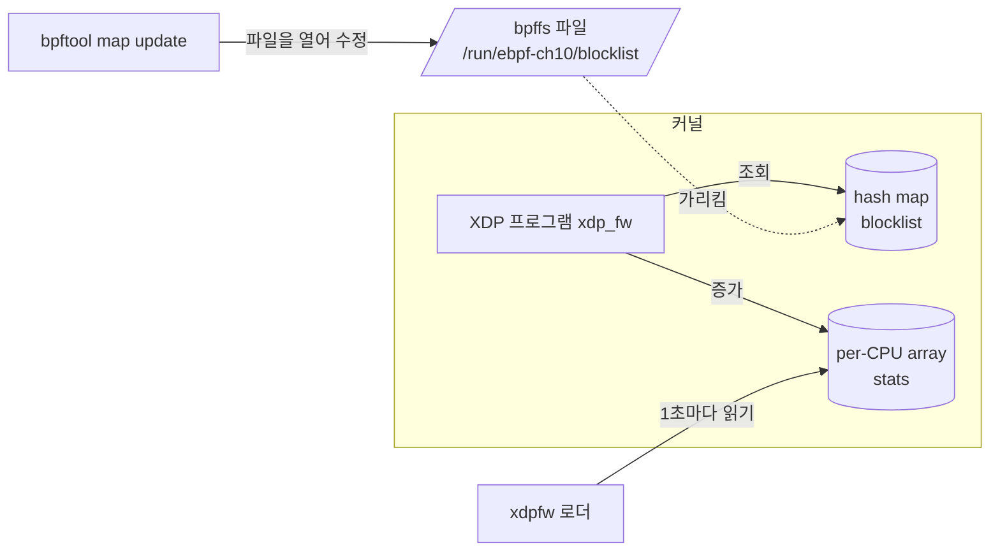
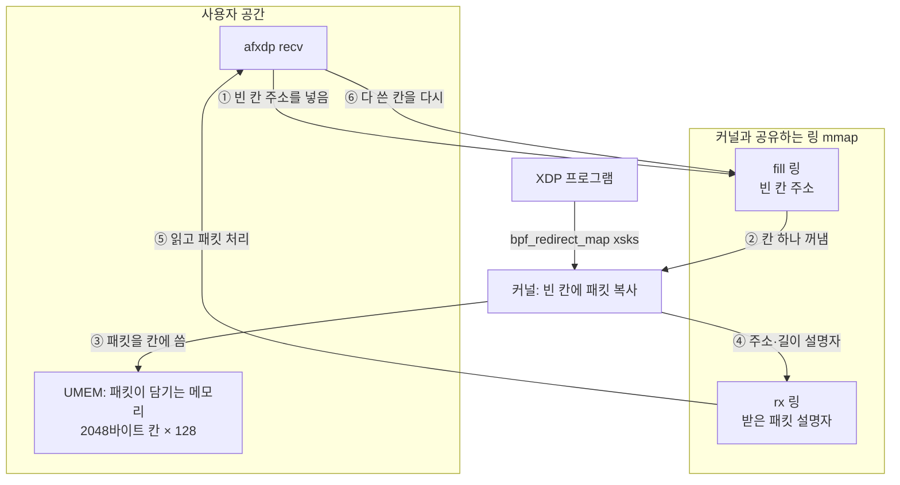

# 10. XDP와 AF_XDP

> **핵심 요약**
> 1. XDP 프로그램은 드라이버가 패킷을 받은 직후에 돌고, 반환값 하나(`DROP`/`PASS`/`TX`/`REDIRECT`)로 패킷의 운명을 정한다. **정책은 코드가 아니라 map에 두면** 프로그램을 다시 올리지 않고도 실행 중에 바꿀 수 있다.
> 2. 예제 1(xdpfw): 출발지 IP 차단 목록을 map으로 만들어 bpffs에 pin하고, `bpftool map update` 한 줄로 차단·해제했다. ping 5개가 전부 사라졌다가 다시 통과했다.
> 3. 예제 2(afxdp): `bpf_redirect_map`으로 UDP :9000 패킷(조각나지 않은 IPv4)만 **AF_XDP 소켓**으로 보내 커널 네트워크 스택을 건너뛰었다. 같은 포트를 연 보통 UDP 소켓은 한 개도 받지 못했고, 나머지(ping)는 평소대로 커널이 처리했다.

## 1. 개념

### 1.1 XDP 반환값

09장에서 본 대로 XDP는 수신 경로의 맨 앞, `sk_buff`를 만들기 전(native 모드 기준)에 돈다. 프로그램이 돌려주는 값에 따라 드라이버가 패킷을 처리한다.

| 반환값 | 값 | 드라이버가 하는 일 | 쓰임 |
|---|---|---|---|
| `XDP_ABORTED` | 0 | 버림 + `xdp:xdp_exception` tracepoint 발생 | 프로그램 오류 표시 |
| `XDP_DROP` | 1 | 그 자리에서 버림 | DDoS 방어, 방화벽 |
| `XDP_PASS` | 2 | 평소대로 커널 스택으로 올림 | 기본 동작 |
| `XDP_TX` | 3 | (프로그램이 고쳤을 수 있는) 현재 프레임을 받은 인터페이스로 내보냄 | 로드밸런서, 반사기 |
| `XDP_REDIRECT` | 4 | redirect helper가 정한 대상으로 보냄: 다른 인터페이스(`bpf_redirect`, DEVMAP), 다른 CPU(CPUMAP), **AF_XDP 소켓**(XSKMAP) | 포워딩, 사용자 공간 처리 |

(값은 커널 UAPI 헤더 `linux/bpf.h`의 `enum xdp_action`)

### 1.2 붙는 모드

| 모드 | 어디서 도나 | 비고 |
|---|---|---|
| native (driver) | 드라이버의 수신 루틴(NAPI) | 드라이버가 지원해야 한다. veth, virtio_net, 주요 서버 NIC 드라이버 대부분이 지원 |
| generic (skb) | `sk_buff`를 만든 뒤 커널 공용 코드 | 어떤 인터페이스에서나 되지만 `sk_buff` 비용을 이미 치른 뒤라 성능 이점이 작다. 기능 시험용 |
| offload | NIC 하드웨어 | 일부 SmartNIC만 |

`link.AttachXDP`에 모드 플래그를 주지 않으면 커널이 고른다(드라이버가 지원하면 native). 실제 모드는 `bpftool net`의 `driver`/`generic` 표시로 확인한다.

### 1.3 정책은 map에, pin으로 공개



- 프로그램은 "출발지 주소가 map에 있으면 DROP"만 안다. **무엇을 막을지는 map의 내용**이다.
- map을 bpffs에 pin하면 파일 경로가 생기고, 다른 프로세스(bpftool, 다른 데몬)가 그 경로로 map을 열어 고칠 수 있다.
- 카운터는 per-CPU array에 둔다. CPU마다 자기 칸만 고치므로 원자적 연산이 필요 없고, 사용자 공간이 CPU별 값을 더한다.

### 1.4 AF_XDP 구조

AF_XDP는 XDP가 `XDP_REDIRECT`한 패킷을 **사용자 공간 메모리로 바로 넘기는** 소켓이다. 커널 스택(IP·UDP 처리, 소켓 큐)을 거치지 않는다.



| 구성 요소 | 역할 |
|---|---|
| UMEM | 사용자가 할당해 커널에 등록(`XDP_UMEM_REG`)한 메모리. 같은 크기의 칸(chunk)으로 나눈다 |
| fill 링 | 사용자 → 커널. "이 칸에 패킷을 받아도 된다" |
| rx 링 | 커널 → 사용자. "이 칸에 이 길이의 패킷을 넣었다" |
| completion·tx 링 | 송신용. 수신만 하더라도 completion 링 크기는 설정해야 bind된다 |
| XSKMAP | XDP 프로그램이 "어느 소켓으로 보낼지"를 고르는 map. key = 수신 큐 번호, value = 소켓 fd |

링은 커널과 사용자가 같은 메모리를 보는 단일 생산자·단일 소비자 링 버퍼다. 시스템 콜 없이 producer/consumer 인덱스만 갱신해 패킷을 주고받는다.

**copy 모드와 zero-copy 모드**: zero-copy는 NIC가 UMEM에 직접 DMA하는 방식으로, 드라이버 지원이 필요하다. veth는 지원하지 않으므로 이 장은 `XDP_COPY`(커널이 칸에 복사)로 bind했다. 구조와 API는 같고 복사 비용만 다르다.

## 2. 예제

| 파일 | 내용 |
|---|---|
| [`code/xdpfw/xdpfw.bpf.c`](code/xdpfw/xdpfw.bpf.c) | 출발지 IPv4가 `blocklist`(hash)에 있으면 `XDP_DROP`. 통과·차단 수를 per-CPU array에 센다 |
| [`code/xdpfw/main.go`](code/xdpfw/main.go) | 로드 → `blocklist`를 bpffs에 pin → XDP attach → 1초마다 통과/차단 수 출력 |
| [`code/afxdp/afxdp.bpf.c`](code/afxdp/afxdp.bpf.c) | 조각나지 않은 IPv4 UDP이고 목적지 포트가 맞으면 `bpf_redirect_map(&xsks, 수신 큐, XDP_PASS)`, 아니면 `XDP_PASS` |
| [`code/afxdp/main.go`](code/afxdp/main.go) | 라이브러리 없이 AF_XDP 소켓·UMEM·링을 직접 만드는 최소 수신기(+ 비교용 보통 UDP 소켓), 송신기 |
| [`code/run.sh`](code/run.sh) | netns 두 개 + veth 샌드박스, 실습 전용 bpffs 마운트, 두 실험 실행 |

```
[netns ebpf10a] veth10a 192.0.2.1 ── veth ── veth10b 192.0.2.2 [netns ebpf10b]
     ping, afxdp send ───────────────────▶ XDP (xdpfw 또는 afxdp recv)
```

호스트 인터페이스에는 아무것도 붙이지 않는다. 같은 이름의 netns나 `/run/ebpf-ch10` 경로가 이미 있으면 남의 것일 수 있으므로 건드리지 않고 멈추며, 끝날 때는 이번 실행에서 만든 것만 지운다.

### 실행

```bash
make build    # root 불필요
make run      # 내부에서 sudo. 결과: out/run.log
```

### 실행 결과 (Linux 6.17 x86_64)

#### 10-1) XDP 방화벽: 차단 목록을 실행 중에 바꾼다

```
ready: veth10b(ifindex 2)에 XDP attach, link id 3558
--- 차단 전
5 packets transmitted, 5 received, 0% packet loss, time 828ms
--- bpftool로 192.0.2.1 차단 (key = IPv4 4바이트, 네트워크 바이트 순서)
$ bpftool map update pinned /run/ebpf-ch10/blocklist key 192 0 2 1 value 1
[{
        "key": 16908480,
        "value": 1
    }
]
5 packets transmitted, 0 received, 100% packet loss, time 831ms
--- 차단 해제
5 packets transmitted, 5 received, 0% packet loss, time 832ms
--- xdpfw 출력 (1초마다 통과/차단 수)
10:37:44  통과 +5  차단 +1  (누적 5 / 1)
10:37:45  통과 +0  차단 +4  (누적 5 / 5)
10:37:46  통과 +2  차단 +0  (누적 7 / 5)
10:37:47  통과 +3  차단 +0  (누적 10 / 5)
10:37:48  통과 +0  차단 +0  (누적 10 / 5)
```

(마지막 0 행 세 줄은 생략)

- 프로그램은 그대로인데 **map 한 칸을 넣고 빼는 것만으로** ping이 100% 손실 → 0% 손실로 바뀌었다.
- 누적값이 **통과 10, 차단 5**다. XDP는 `veth10b`의 수신 쪽에만 붙어 있으므로 ping 세 묶음(각 5개)의 **echo request**만 센다. 응답(echo reply)은 송신 방향이라 보이지 않는다. ARP는 IPv4가 아니라 세지 않고 통과시킨다.
- `bpftool map dump`가 key를 `16908480`(= `0x010200c0`)으로 보여 준다. key는 BTF상 `__u32`이고, 바이트는 네트워크 순서 `c0 00 02 01`(192.0.2.1)로 들어 있다. bpftool이 이 바이트를 x86의 리틀 엔디언 정수로 읽어 숫자가 뒤집혀 보이는 것이다. 사람이 읽는 값과 저장된 바이트를 헷갈리지 말자.

#### 10-2) AF_XDP: UDP :9000 패킷만 사용자 공간으로

```
--- 같은 시간에 ping(ICMP)은 XDP_PASS로 커널 스택이 처리
2 packets transmitted, 2 received, 0% packet loss, time 206ms
#1  umem주소=0x000100 길이=57  192.0.2.1:46652 → 192.0.2.2:9000  "hello AF_XDP #1"
#2  umem주소=0x000900 길이=57  192.0.2.1:46652 → 192.0.2.2:9000  "hello AF_XDP #2"
#3  umem주소=0x001100 길이=57  192.0.2.1:46652 → 192.0.2.2:9000  "hello AF_XDP #3"
#4  umem주소=0x001900 길이=57  192.0.2.1:46652 → 192.0.2.2:9000  "hello AF_XDP #4"
#5  umem주소=0x002100 길이=57  192.0.2.1:46652 → 192.0.2.2:9000  "hello AF_XDP #5"
AF_XDP 소켓이 받은 패킷: 5, 같은 포트의 보통 UDP 소켓이 받은 패킷: 0
```

- **같은 포트(9000)를 연 보통 UDP 소켓은 0개를 받았다.** 패킷이 XDP에서 AF_XDP 소켓으로 빠져나가 IP·UDP 계층에 오지 않았기 때문이다. 반면 ping은 `XDP_PASS`로 커널이 평소대로 응답했다.
- `길이=57`은 이더넷 14 + IPv4 20 + UDP 8 + 페이로드 15바이트(`hello AF_XDP #1`)다. 커널이 아무것도 벗기지 않은 **원본 프레임**을 받는다. 헤더 해석은 사용자 몫이다.
- 주소가 `0x100`, `0x900`, `0x1100`, …으로 0x800(=2048, 칸 크기)씩 늘었다. 칸 0, 1, 2…를 차례로 쓴 것이고, 각 칸 앞의 0x100(256바이트)은 커널이 남겨 두는 headroom(`XDP_PACKET_HEADROOM`)이다. 다 쓴 칸은 `addr &^ (2048-1)`로 칸 시작 주소를 구해 fill 링에 돌려준다.

> **이 장을 만들며 실제로 겪은 일.** 처음에는 차단 목록을 `/sys/fs/bpf/ch10_blocklist`에 pin했다. 그런데 `ip netns exec`로 실행하자 `not on a bpf filesystem` 오류가 났다. `ip netns exec`는 그 netns의 네트워크 장치가 보이도록 **새 마운트 네임스페이스에서 `/sys`를 다시 마운트**한다. 그 결과 `/sys/fs/bpf`에 마운트돼 있던 bpffs가 안에서 보이지 않는다. 그래서 `/run/ebpf-ch10`에 실습 전용 bpffs를 따로 마운트해 썼다(`mount -t bpf ebpf-ch10 /run/ebpf-ch10`). netns 안에서 pin을 다룰 때 흔히 겪는 일이다.

### 코드 해설

#### xdpfw: map 조회 한 번으로 판단

```c
if ((void *)(ip + 1) > end)          // 이더넷+IP 헤더 길이만큼 있는지 먼저 확인
	return XDP_PASS;
if (eth->h_proto != bpf_htons(ETH_P_IP))
	return XDP_PASS;
if (bpf_map_lookup_elem(&blocklist, &ip->saddr)) {   // 패킷 안의 주소를 그대로 key로
	bump(1);
	return XDP_DROP;
}
```

key를 패킷의 바이트 그대로(네트워크 순서) 쓰므로 변환이 필요 없다. 넣는 쪽(bpftool의 `key 192 0 2 1`, Go의 `netip.Addr.As4()`)도 바이트 순서로 넣으면 된다.

#### afxdp: 설정 순서가 중요하다

```
① socket(AF_XDP)
② UMEM mmap → setsockopt(XDP_UMEM_REG)
③ setsockopt로 fill / completion / rx 링 크기 설정
④ getsockopt(XDP_MMAP_OFFSETS)로 링 안의 producer·consumer·설명자 위치를 얻어 mmap
⑤ fill 링에 빈 칸 주소를 채움
⑥ bind(ifindex, 큐 0, XDP_COPY)
⑦ XSKMAP[0] = 소켓 fd
⑧ XDP 프로그램 attach
```

- ⑥ bind 전에 ⑦을 해도 map 갱신 자체는 성공한다. 하지만 bind되지 않은 소켓이나, bind한 인터페이스·큐와 다른 곳에서 온 패킷은 커널이 받지 않고 버린다(커널 v6.17 `net/xdp/xsk.c`의 `xsk_rcv_check`). 그래서 bind를 끝낸 뒤 map에 넣고, 마지막에 XDP를 붙인다.

- 링 주소는 고정값이 아니라 `XDP_MMAP_OFFSETS`로 커널에 물어 얻는다. 커널 버전마다 구조체 배치가 달라질 수 있기 때문이다.
- producer/consumer는 커널이 동시에 읽고 쓴다. Go에서는 `sync/atomic`으로 읽고 쓴다. 설명자를 먼저 쓰고, 그다음 producer를 올려야 한다(순서가 바뀌면 커널이 아직 쓰지 않은 값을 읽는다).
- XDP 쪽에서 `bpf_redirect_map(&xsks, ctx->rx_queue_index, XDP_PASS)`의 세 번째 인자 하위 두 비트는 **map에 대상이 없을 때 돌려줄 값**이다(커널 UAPI 헤더의 helper 설명). 여기서는 소켓이 없는 큐로 온 패킷을 버리지 않고 커널로 보낸다.

- XDP 프로그램은 조각난 IPv4(`frag_off`에 MF 비트나 오프셋이 있음)를 커널로 넘긴다. 두 번째 이후 조각은 IP 헤더 바로 뒤가 UDP 헤더가 아니어서, 포트를 읽으면 엉뚱한 바이트를 보게 된다. 사용자 공간의 `printPacket`도 네트워크에서 온 길이 필드(IHL, UDP length)를 실제 프레임 길이와 맞춰 본 뒤에 자른다. 검사 없이 자르면 이상한 패킷 하나로 수신기가 panic한다.

이 수신기는 구조를 보여 주는 최소 구현이다. 송신(tx 링), `need_wakeup` 플래그, 여러 큐, zero-copy는 다루지 않는다. 실제로 쓸 때는 [libxdp](https://github.com/xdp-project/xdp-tools)의 `xsk` API 같은 검증된 구현을 쓰자.

## 3. 직접 해보기

1. xdpfw에 `192.0.2.0/24` 전체를 막는 기능을 넣어 보자. hash 대신 `BPF_MAP_TYPE_LPM_TRIE`(04장)를 쓰고, key를 `{prefixlen, addr}` 구조체로 바꾸면 된다.
2. xdpfw를 `XDP_DROP` 대신 `XDP_TX`로 바꾸고, 이더넷 주소를 서로 바꿔(`h_source` ↔ `h_dest`) 되돌려 보내 보자. `ip netns exec ebpf10a tcpdump -ni veth10a`로 같은 패킷이 돌아오는 것을 확인하자(ping은 성공하지 않는다. 왜일까?).
3. `afxdp/main.go`에서 XSKMAP에 소켓을 넣는 부분(⑦)을 빼고 실행해 보자. 9000번 패킷이 XDP_PASS 폴백으로 커널에 올라가 보통 UDP 소켓이 받는지 확인하자. (XSKMAP은 사용자 공간에서 조회가 막혀 있어(`EOPNOTSUPP`) `bpftool map dump`로는 내용을 볼 수 없다.)
4. `bpftool prog show`로 xdpfw의 `run_cnt`·`run_time_ns`를 보려면 `sysctl kernel.bpf_stats_enabled=1`이 필요하다. 켜고 패킷 하나당 평균 처리 시간을 구해 보자.

## 4. 자주 하는 실수

- **호스트 인터페이스에 XDP를 바로 붙임** — 조건 하나 틀리면 SSH까지 끊긴다. netns + veth에서 먼저 시험하고, 실제 장비에서는 콘솔 접근을 확보한 뒤 붙이자.
- **물리 NIC에서 AF_XDP를 큐 0에만 bind** — NIC는 RSS로 패킷을 여러 큐에 나눈다. 다른 큐로 온 패킷은 XSKMAP에 소켓이 없어 폴백 동작(이 장은 `XDP_PASS`)으로 간다. `ethtool -L <dev> combined 1`로 큐를 하나로 줄이거나, `ethtool -N`으로 해당 흐름을 그 큐로 보내거나, 큐마다 소켓을 만들자.
- **fill 링을 채우지 않고 bind** — 커널이 쓸 빈 칸이 없어 패킷이 조용히 버려진다(`XDP_STATISTICS`의 `rx_fill_ring_empty_descs`로 보인다).
- **다 쓴 칸을 fill 링에 돌려주지 않음** — 칸이 바닥나면 이후 패킷이 모두 버려진다. 처음 몇십 개만 받고 멈추는 증상이다.
- **pin한 map을 지우지 않음** — pin 파일이 있으면 프로그램이 끝나도 map이 남는다. 다음 실행에서 `file exists`가 나거나, 옛 차단 목록이 그대로 쓰인다. 이 장의 로더는 끝날 때 `Unpin`한다.
- **generic 모드인 줄 모르고 성능 측정** — 09장 참고. `bpftool net`으로 모드를 확인하자.

## 5. 더 읽을거리

| 자료 | 라이선스 | 이 챕터에서의 사용 |
|---|---|---|
| [커널 문서: AF_XDP](https://docs.kernel.org/networking/af_xdp.html) | GPL-2.0 | UMEM·링 구조, copy/zero-copy, 설정 순서 참고(재서술) |
| 커널 소스 v6.17 `net/xdp/xsk.c`, `net/xdp/xskmap.c` | GPL-2.0 | bind 조건(fill·completion 링 필수), 수신 검사(`xsk_rcv_check`) 확인 |
| 커널 UAPI 헤더 `linux/bpf.h` (v6.17), `linux/if_xdp.h` | GPL-2.0 WITH Linux-syscall-note | `enum xdp_action`, `XDP_PACKET_HEADROOM`, `bpf_redirect_map` flags 설명, 소켓 옵션 |
| [ebpf-docs: XDP 프로그램 타입](https://docs.ebpf.io/linux/program-type/BPF_PROG_TYPE_XDP/) | BSD-2-Clause (저장소 [isovalent/ebpf-docs](https://github.com/isovalent/ebpf-docs) 기준) | 반환값·attach 모드 참고(재서술) |
| [커널 문서: Redirect](https://docs.kernel.org/bpf/redirect.html) | GPL-2.0 | `XDP_REDIRECT` 대상(DEVMAP·CPUMAP·XSKMAP, `bpf_redirect`) 정리 참고 |
| [ebpf-docs: XSKMAP](https://docs.ebpf.io/linux/map-type/BPF_MAP_TYPE_XSKMAP/) | BSD-2-Clause | XSKMAP key/value 의미 |
| [xdp-project/xdp-tutorial](https://github.com/xdp-project/xdp-tutorial) | GPL-2.0 / BSD-2-Clause (예제별) | XDP 단계별 실습. 이 장의 다음 단계로 권장 |
| [xdp-project/xdp-tools (libxdp)](https://github.com/xdp-project/xdp-tools) | LGPL-2.1 / BSD-2-Clause | 실무용 AF_XDP(`xsk`) 구현 |
| [RFC 5737 (TEST-NET 주소)](https://www.rfc-editor.org/rfc/rfc5737) | IETF Trust | 실험 주소 대역 선택 근거 |
