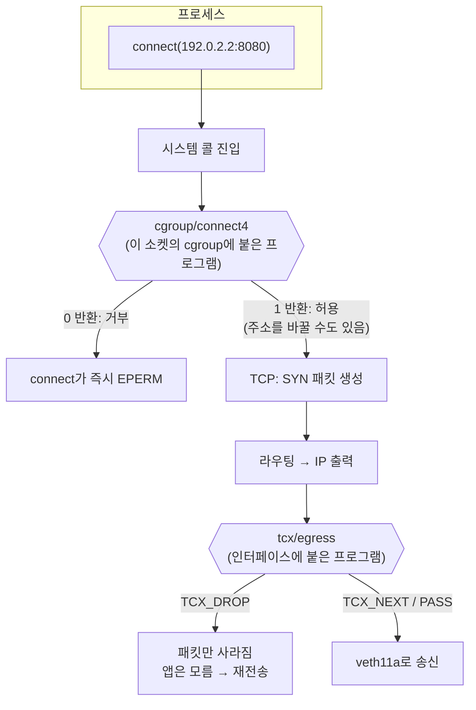

# 11. TC와 cgroup 소켓 hook

> **핵심 요약**
> 1. 나가는 트래픽을 막는 자리는 크게 둘이다. **TC egress**는 인터페이스에서 나가는 **패킷**을 보고, **cgroup 소켓 hook**(`connect4`, `sendmsg4` 등)은 프로세스가 부르는 **시스템 콜**을 본다.
> 2. 같은 정책(TCP :8080 차단)을 두 방식으로 걸었다. TC에서 버리면 앱은 이유를 모른 채 SYN을 재전송하다 **타임아웃**(2.5초)으로 끝났다. cgroup hook에서 거부하면 앱은 **즉시 EPERM**을 받았고, 그 cgroup 밖의 프로세스는 같은 netns에서도 영향을 받지 않았다.
> 3. cgroup hook은 막기만 하는 게 아니라 **목적지를 바꿀 수도** 있다. `connect(192.0.2.2:80)`이 앱 모르게 `:8081`로 연결됐다. Cilium의 소켓 기반 로드밸런싱이 이 원리다.

## 1. 개념

### 1.1 두 자리의 차이



| | TC egress (tcx) | cgroup 소켓 hook (`cgroup/connect4` 등) |
|---|---|---|
| 프로그램 타입 | `BPF_PROG_TYPE_SCHED_CLS` | `BPF_PROG_TYPE_CGROUP_SOCK_ADDR` |
| 붙는 곳 | 네트워크 인터페이스(ingress/egress) | cgroup v2 디렉터리. **하위 cgroup에도 적용** |
| 보는 것 | 패킷(`__sk_buff`): 헤더 바이트 전부, 모든 프로토콜 | 시스템 콜 인자(`bpf_sock_addr`): 목적지 주소·포트, 소켓 타입 |
| 누구에게 적용 | 그 인터페이스로 나가는 **모든** 패킷(포워딩된 것 포함) | 그 cgroup에 속한 프로세스가 만든 소켓만 |
| 막으면 앱이 보는 것 | 아무것도(패킷이 사라짐). TCP는 재전송 후 타임아웃 | 시스템 콜이 `EPERM`으로 즉시 실패 |
| 바꿀 수 있는 것 | 패킷 내용, 다른 인터페이스로 redirect | 목적지 주소·포트(연결 전에) |

### 1.2 cgroup 소켓 hook 종류 (IPv4 기준, IPv6는 `6`)

| SEC 이름 | 불리는 때 |
|---|---|
| `cgroup/connect4` | `connect()` — TCP, 그리고 UDP의 `connect()`도 |
| `cgroup/sendmsg4` | connect하지 않은 UDP 소켓의 `sendto()`/`sendmsg()`마다 |
| `cgroup/recvmsg4` | UDP `recvmsg()`가 돌려줄 출발지 주소를 바꿀 때 |
| `cgroup/bind4` | `bind()` |
| `cgroup/getpeername4`, `cgroup/getsockname4` | 주소 조회 시스템 콜이 돌려줄 값을 바꿀 때 |

반환값은 1 = 허용, 0 = 거부(EPERM)다. 프로그램이 받는 `struct bpf_sock_addr`의 `user_ip4`·`user_port`는 **네트워크 바이트 순서**이고, 쓰면 커널이 바뀐 주소로 진행한다.

**소켓의 cgroup은 소켓을 만들 때 정해진다.** 프로세스를 cgroup에 넣은 뒤 만든 소켓부터 적용된다. 이미 열려 있던 소켓은 프로세스를 옮겨도 예전 cgroup의 정책을 따른다.

### 1.3 tcx 반환값

09장에서 본 tcx(6.6+)는 한 인터페이스에 여러 프로그램을 순서대로 붙일 수 있다. 그래서 "통과"가 두 가지다.

| 값 | 의미 |
|---|---|
| `TCX_NEXT` (-1) | 판단하지 않음. 다음 프로그램에 맡긴다(마지막이면 통과) |
| `TCX_PASS` (0) | 통과로 확정하고 **뒤의 프로그램은 건너뜀** |
| `TCX_DROP` (2) | 버림 |
| `TCX_REDIRECT` (7) | `bpf_redirect*`로 정한 곳으로 |

관심 없는 패킷에는 `TCX_NEXT`를 돌려주자. `TCX_PASS`(= `TC_ACT_OK`)를 돌려주면 같은 인터페이스에 붙은 다른 도구(예: Cilium)의 프로그램이 그 패킷을 못 본다.

## 2. 예제

| 파일 | 내용 |
|---|---|
| [`code/tcegress/tcegress.bpf.c`](code/tcegress/tcegress.bpf.c) | `tcx/egress`. TCP 목적지 포트가 `block_port`면 `TCX_DROP`하고 ring buffer로 알림, 아니면 `TCX_NEXT` |
| [`code/tcegress/main.go`](code/tcegress/main.go) | `link.AttachTCX(... AttachTCXEgress)`, 버린 패킷을 시각과 함께 출력 |
| [`code/cgsock/cgsock.bpf.c`](code/cgsock/cgsock.bpf.c) | `cgroup/connect4`(TCP·UDP 거부, TCP 포트 바꾸기), `cgroup/sendmsg4`(UDP 거부) |
| [`code/cgsock/main.go`](code/cgsock/main.go) | `link.AttachCgroup`으로 두 프로그램을 cgroup에 붙이고 판정을 출력 |
| [`code/probe/main.go`](code/probe/main.go) | 실험용 클라이언트(`connect`, `udp`)와 서버(`serve`). 결과와 걸린 시간을 출력(BPF 없음) |
| [`code/run.sh`](code/run.sh) | netns 두 개 + veth + 임시 cgroup을 만들고 두 실험 실행 |

```
[netns ebpf11a] veth11a 192.0.2.1 ── veth ── veth11b 192.0.2.2 [netns ebpf11b]
  probe connect/udp ──────────────────────────▶ probe serve (TCP :8080, :8081 / UDP :9000)
  (일부는 cgroup /sys/fs/cgroup/ebpf-ch11 안에서)
```

예제의 "정책"은 VLAN 태그 없는 IPv4만 다룬다. TC 쪽은 IPv6·VLAN 패킷을 판단하지 않고 넘기며, cgroup 쪽은 `connect4`/`sendmsg4`만 붙였다(IPv6 소켓은 `connect6`/`sendmsg6`가 따로 필요하다).

호스트 인터페이스에는 아무것도 붙이지 않는다. cgroup 프로그램은 임시로 만든 빈 cgroup `ebpf-ch11`에만 붙고, 그 cgroup에는 실험용 `probe` 프로세스만 들어간다. 같은 이름의 netns나 cgroup이 이미 있으면 시작하지 않고, 끝나면 이번 실행에서 만든 것만 지운다.

### 실행

```bash
make build    # root 불필요
make run      # 내부에서 sudo. 결과: out/run.log
```

### 실행 결과 (Linux 6.17 x86_64)

```
=== 11-1) TC egress(veth11a)에서 TCP :8080 패킷을 버리면
TCP connect 192.0.2.2:8080   실패: 시간 초과, 2.5s
TCP connect 192.0.2.2:8081   성공: 실제 연결된 상대 192.0.2.2:8081, 226.5µs
--- tcegress 출력
+0.000s  버림  192.0.2.1:38708 → 192.0.2.2:8080  [SYN]
+1.022s  버림  192.0.2.1:38708 → 192.0.2.2:8080  [SYN]
+1.527s  버림  192.0.2.1:38708 → 192.0.2.2:8080  [SYN]
+2.030s  버림  192.0.2.1:38708 → 192.0.2.2:8080  [SYN]
TCP 패킷: 다음으로 넘김(TCX_NEXT) 5, 버림 4
--- 서버(ebpf11b)가 받은 것
서버: TCP :8081 ← 192.0.2.1:44510  "hello from pid 2546029"
```

- `:8080` 연결은 **2.5초 제한 시간을 다 쓰고** "시간 초과"로 끝났다. 앱이 받은 정보는 그것뿐이다. 거부된 것인지, 상대가 꺼져 있는 것인지, 중간 경로가 끊긴 것인지 앱 쪽에서는 구별할 수 없다.
- 그동안 커널은 같은 출발지 포트(38708)로 SYN을 네 번 보냈고, 네 번 모두 egress에서 버려졌다. 이 장비(6.17)에서 관찰한 간격은 첫 재전송까지 약 1.0초, 그 뒤로 약 0.5초씩이었다. 재전송 간격과 횟수는 커널 버전과 sysctl(`net.ipv4.tcp_syn_retries`, `tcp_syn_linear_timeouts` 등)에 따라 다르므로, 숫자보다 "앱이 기다리다 실패한다"는 점을 기억하자.
- `:8081` 연결은 TC 프로그램을 그대로 지나갔다(이 실험에서 `:8080` 말고 오간 TCP는 이 연결뿐이므로, `TCX_NEXT` 5개는 이 연결이 보낸 패킷으로 보면 된다). 서버도 `:8081`에서 온 것만 받았다.

```
=== 11-2) cgroup 소켓 hook: /sys/fs/cgroup/ebpf-ch11 안의 프로세스만 TCP :8080·UDP :9000 거부, TCP :80 → :8081
--- cgroup 안의 프로세스
TCP connect 192.0.2.2:8080   실패: operation not permitted (EPERM), 159.4µs
UDP sendto       192.0.2.2:9000   실패: operation not permitted (EPERM), 196.6µs
UDP connect+send 192.0.2.2:9000   실패: operation not permitted (EPERM), 67.8µs
TCP connect 192.0.2.2:80     성공: 실제 연결된 상대 192.0.2.2:8081, 231µs
--- cgroup 밖의 프로세스 (같은 netns, 같은 명령)
TCP connect 192.0.2.2:8080   성공: 실제 연결된 상대 192.0.2.2:8080, 262µs
UDP sendto       192.0.2.2:9000   성공, 127.4µs
TCP connect 192.0.2.2:80     실패: connection refused (ECONNREFUSED), 278.5µs
--- cgsock 출력
HOOK      PROTO VERDICT   PID     COMM     DST
connect4  TCP   DENY      2546506 probe    192.0.2.2:8080
sendmsg4  UDP   DENY      2546514 probe    192.0.2.2:9000
connect4  UDP   DENY      2546522 probe    192.0.2.2:9000
connect4  TCP   REDIRECT  2546533 probe    192.0.2.2:80 → :8081
--- 서버(ebpf11b)가 받은 것
서버: TCP :8081 ← 192.0.2.1:44518  "hello from pid 2546533"
서버: TCP :8080 ← 192.0.2.1:38712  "hello from pid 2546541"
서버: UDP :9000 ← 192.0.2.1:58161  "hello from pid 2546549"
```

- **같은 정책, 다른 결과.** cgroup 안에서 `:8080` connect는 0.2ms 안에 `EPERM`으로 실패했다. 11-1의 2.5초 대기와 비교하자. 앱은 "로컬에서 거부됐다"는 것을 바로 알고 오류 처리에 쓸 수 있다(다만 `EPERM`만으로는 cgroup BPF인지 LSM 등 다른 로컬 정책인지 구별되지 않는다). 패킷은 하나도 만들어지지 않았다.
- **UDP는 쓰는 방식에 따라 검사하는 hook이 다르다.** `sendto`(connect하지 않은 소켓)는 `sendmsg4`에서, `connect+send`는 `connect4`에서 막혔다(cgsock 출력의 HOOK 칸). sendmsg4만 붙였다면 connect한 UDP 소켓은 빠져나갔을 것이다.
- **목적지 바꾸기.** `:80`에 connect한 프로세스는 `:8081`에 연결됐고, Go의 `RemoteAddr()`(Go가 연결 직후 `getpeername()`으로 얻어 둔 값)도 `:8081`을 보여 준다. 서버 쪽 첫 줄이 바로 이 연결이다(같은 pid 2546533). 앱에게 원래 주소를 보여 주려면 `getpeername4` hook이 더 필요하다(직접 해보기 1).
- **cgroup 밖은 영향이 없다.** 같은 netns에서 같은 명령을 돌린 프로세스는 `:8080`·UDP `:9000` 모두 성공했고, `:80`은 바뀌지 않아 그대로 `ECONNREFUSED`(그 포트에 서버 없음)가 됐다. TC egress였다면 이 인터페이스를 지나는 모든 프로세스가 같이 막혔을 것이다.
- 거부된 시도는 서버에 아무것도 남기지 않았다. 서버가 받은 세 줄은 REDIRECT 1건과 cgroup 밖의 성공 2건이다.

## 3. 직접 해보기

1. `cgroup/getpeername4` 프로그램을 더해 `:8081`로 바뀐 연결의 상대 주소를 앱에게 `:80`으로 보여 주자. 바꾼 포트를 기억해야 하므로 socket cookie(`bpf_get_socket_cookie`)를 key로 하는 map이 필요하다. Cilium이 이렇게 한다.
2. cgsock을 `/sys/fs/cgroup/ebpf-ch11`이 아니라 그 하위 cgroup을 하나 더 만들어 붙여 보자. 부모에 붙인 정책이 자식에게도 적용되는지, 자식에 붙인 정책이 부모에는 적용되지 않는지 확인하자.
3. tcegress를 `veth11b`의 **ingress**에 붙여도 결과가 같을까? (힌트: 같은 SYN을 버리는 위치만 다르다.) 그다음 `TCX_NEXT`를 `TCX_PASS`로 바꾸고, 같은 인터페이스에 09장 pktpath의 tcx 프로그램을 **뒤에** 붙여 차이를 보자.
4. 프로세스를 cgroup에 넣기 **전에** 소켓을 만들어 두고, 넣은 뒤 connect해 보자(Go라면 `syscall.Socket` 후 `cgroup.procs`에 쓰고 `syscall.Connect`). 정책이 적용되는가?

## 4. 자주 하는 실수

- **cgroup v1에 붙이려 함** — cgroup BPF는 v2 계층에서 동작한다. `stat -fc %T /sys/fs/cgroup`이 `cgroup2fs`인지 확인하자.
- **`user_port`를 호스트 바이트 순서로 비교** — 하위 16비트에 네트워크 바이트 순서로 들어 있다. `bpf_ntohs((__u16)ctx->user_port)`로 바꿔 비교하고, 쓸 때는 `bpf_htons()`.
- **sendmsg4만 붙이고 UDP를 다 막았다고 믿음** — `connect()`한 UDP 소켓의 `send()`는 sendmsg4를 거치지 않는다. 이 장의 결과처럼 connect4에서도 UDP를 처리해야 한다.
- **TC egress에서 TCP를 버리고 "차단"이라 부름** — 앱은 재전송을 반복하다 타임아웃된다. 상대가 응답하지 않는 것과 구별이 안 되어 장애 분석이 어려워진다. 즉시 실패가 필요하면 cgroup hook을 쓰거나 RST를 보내자.
- **관심 없는 패킷에 `TC_ACT_OK`(= `TCX_PASS`)** — tcx에서는 같은 인터페이스의 다음 프로그램을 건너뛴다. `TCX_NEXT`를 쓰자.
- **루트 cgroup에 실험 정책을 붙임** — 시스템의 모든 프로세스(ssh, systemd 포함)에 적용된다. 이 장처럼 빈 하위 cgroup을 만들어 시험하자.

## 5. 더 읽을거리

| 자료 | 라이선스 | 이 챕터에서의 사용 |
|---|---|---|
| 커널 UAPI 헤더 `linux/bpf.h` (v6.17) | GPL-2.0 WITH Linux-syscall-note | `enum tcx_action_base`, `struct bpf_sock_addr`, cgroup attach type |
| [커널 문서: ip-sysctl `tcp_syn_linear_timeouts`](https://docs.kernel.org/networking/ip-sysctl.html) | GPL-2.0 | SYN 재전송 정책 참고 |
| [ebpf-docs: BPF_PROG_TYPE_CGROUP_SOCK_ADDR](https://docs.ebpf.io/linux/program-type/BPF_PROG_TYPE_CGROUP_SOCK_ADDR/) | BSD-2-Clause (저장소 [isovalent/ebpf-docs](https://github.com/isovalent/ebpf-docs) 기준) | hook 종류·컨텍스트 필드·반환값 참고(재서술) |
| [ebpf-docs: BPF_PROG_TYPE_SCHED_CLS](https://docs.ebpf.io/linux/program-type/BPF_PROG_TYPE_SCHED_CLS/) | BSD-2-Clause | tcx 반환값 참고 |
| [커널 문서: Control Group v2](https://docs.kernel.org/admin-guide/cgroup-v2.html) | GPL-2.0 | cgroup v2 계층과 `cgroup.procs` |
| [Cilium 문서: Kubernetes without kube-proxy (socket LB)](https://docs.cilium.io/en/stable/network/kubernetes/kubeproxy-free/) | Apache-2.0 | connect 단계 주소 변환의 실제 사용 예 |
| [cilium/ebpf `link` 패키지](https://pkg.go.dev/github.com/cilium/ebpf/link) | MIT | `AttachTCX`, `AttachCgroup` |
| [RFC 5737 (TEST-NET 주소)](https://www.rfc-editor.org/rfc/rfc5737) | IETF Trust | 실험 주소 대역 선택 근거 |
