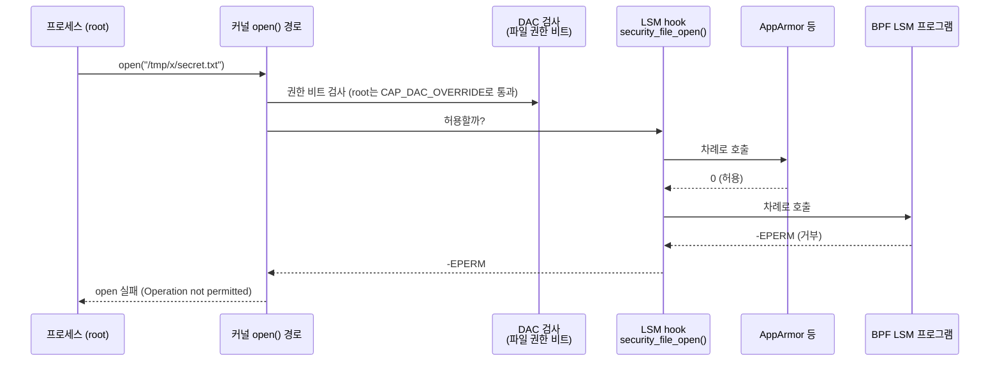

# 12. LSM-BPF

> **핵심 요약**
> 1. **LSM**(Linux Security Modules)은 커널이 "이 작업을 허용할까?"를 묻는 보안 hook 체계다. AppArmor·SELinux도 여기에 붙는다. **LSM-BPF**(BPF LSM, 5.7+)는 같은 hook에 BPF 프로그램을 붙여 **거부(-EPERM 등)를 돌려줄 수 있게** 한다. 관측만 하던 tracing hook과의 결정적 차이다.
> 2. 쓰려면 커널이 `CONFIG_BPF_LSM=y`로 빌드되어 있고, **부팅할 때 LSM 목록에 `bpf`가 있어야** 한다. 이 머신은 빌드 옵션은 켜져 있지만 부팅 인자에 `bpf`가 없다. 그래서 이 장은 **같은 커널을 `lsm=...,bpf`로 부팅한 VM**에서 실습한다(호스트 재부팅 없음).
> 3. 예제는 특정 파일 열기(`file_open`)와 특정 실행 파일 실행(`bprm_check_security`)을 막는다. **root도 막힌다.** 대상을 경로가 아닌 inode로 고르면 하드링크로 우회할 수 없지만, 복사본은 막지 못한다. 정책을 설계할 때의 한계까지 실행 결과로 확인한다.

## 1. 개념

### 1.1 LSM hook은 어디서 불리나



- 커널은 파일 열기, 실행, 소켓 연결, 시그널 보내기 같은 민감한 작업 직전에 `security_*()` 함수를 부른다. 이 함수가 활성화된 LSM의 hook을 **목록 순서대로** 부르고, **하나라도 0이 아닌 값(거부)을 돌려주면** 작업이 실패한다.
- 기존 권한 검사(DAC)는 root가 capability로 통과하지만, **LSM은 그 다음 단계라 root에게도 적용된다.**
- 앞선 LSM이 거부하면 그 자리에서 멈추고 뒤의 LSM은 불리지도 않는다(`security.c`의 `call_int_hook`). 그래서 BPF LSM은 다른 LSM이 거부한 것을 허용으로 뒤집을 수 없다. "더 막는" 방향으로만 작동한다.
- 단, BPF LSM 프로그램 **여러 개**는 BPF LSM이라는 한 자리 안에서 차례로 불린다. 뒤의 프로그램이 마지막 인자 `ret`(앞 프로그램의 결과)을 무시하고 0을 돌려주면 앞 BPF 프로그램의 거부를 지울 수 있다. 그래서 이 장의 예제는 `if (ret) return ret;`로 시작한다. 모든 BPF LSM 프로그램이 이 약속을 지켜야 "더 막는 방향"이 성립한다.

### 1.2 왜 부팅 인자가 필요한가

```
$ cat /sys/kernel/security/lsm            # 이 머신(호스트)
lockdown,capability,landlock,yama,apparmor,ima,evm
$ grep CONFIG_BPF_LSM /boot/config-$(uname -r)
CONFIG_BPF_LSM=y
```

LSM은 부팅 초기에 초기화되고, 활성화 목록은 부팅 인자 `lsm=`(없으면 커널 빌드 옵션 `CONFIG_LSM`)으로 정해진다. `bpf`가 목록에 없으면 BPF LSM이 hook에 등록되지 않는다. **켜려면 부팅 인자에 `lsm=...,bpf`를 넣고 재부팅해야 한다.** Ubuntu라면 `/etc/default/grub`의 `GRUB_CMDLINE_LINUX`에 현재 목록 + `bpf`를 넣고 `update-grub` 후 재부팅한다. 목록을 줄여 쓰면 AppArmor 같은 기존 LSM이 빠지니, 반드시 **현재 목록에 `bpf`를 덧붙인다.**

이 장은 호스트를 바꾸지 않는다. [`tools/vm/run-vm.sh`](../../tools/vm/run-vm.sh)가 **호스트와 같은 커널 이미지**를 KVM VM으로 띄우면서 부팅 인자에 `lsm=lockdown,capability,landlock,yama,apparmor,bpf`만 더한다.

### 1.3 BPF LSM 프로그램

| 항목 | 내용 |
|---|---|
| 프로그램 타입 | `BPF_PROG_TYPE_LSM`, SEC 이름 `lsm/<hook>` (잠들 수 있는 버전은 `lsm.s/<hook>`) |
| 붙는 곳 | 커널의 `bpf_lsm_<hook>` 함수(BTF로 찾는다). 이 커널(6.17)에는 282개가 있다(`bpftool btf dump file /sys/kernel/btf/vmlinux \| grep -c "FUNC 'bpf_lsm_"`) |
| 인자 | hook의 원래 인자 + 마지막에 `int ret`(같은 hook에 먼저 붙은 BPF LSM 프로그램이 돌려준 값) |
| 반환값 | 0 = 허용, 음수 errno = 거부 |
| attach | BPF link(`BPF_LINK_CREATE`). link가 닫히면(프로세스 종료) 정책도 사라진다. 계속 유지하려면 bpffs에 pin |
| 권한·조건 | `CAP_BPF` + `CAP_PERFMON`(또는 root). 라이선스가 GPL 호환이어야 하고, 일부 hook은 BPF에 막혀 있다(`bpf_lsm.c`의 `bpf_lsm_disabled_hooks`) |

## 2. 예제: lsmguard

| 파일 | 내용 |
|---|---|
| [`code/lsmguard/lsmguard.bpf.c`](code/lsmguard/lsmguard.bpf.c) | `lsm/file_open`, `lsm/bprm_check_security` 두 프로그램. 대상은 (장치, inode)로 비교, 이벤트는 ring buffer |
| [`code/lsmguard/main.go`](code/lsmguard/main.go) | 로더(cilium/ebpf): LSM 목록 확인(bpf 없으면 시작 거부) → 대상 파일을 `stat`해 상수로 주입 → `link.AttachLSM` → 이벤트 출력. `-audit`이면 기록만 |
| [`code/run.sh`](code/run.sh) | 정책 없음 / enforce / audit / 종료 후, 네 상황에서 같은 실험을 반복 |
| [`../../tools/vm/`](../../tools/vm/) | `lsm=...,bpf`로 부팅하는 VM (Docker + qemu + virtme-ng). 08장과 공용 |

### 실행

```bash
make build      # root 불필요. CGO_ENABLED=0 정적 바이너리라 VM 안에서 그대로 실행된다
make run        # VM(lsm=...,bpf) 안에서 run.sh 실행. 결과: out/run.log. 호스트 sudo 불필요
make run-host   # (비교용) bpf가 꺼진 호스트에서 같은 실험(-allow-inactive). root 필요
```

### 실행 결과 (Linux 6.17 x86_64, `lsm=...,bpf`로 부팅한 VM)

실험 대상: `secret.txt`(열기 금지), 그 하드링크, `blocked-true`(`/bin/true` 복사본, 실행 금지), 같은 내용의 또 다른 복사본 `copied-true`. 모두 root로 실행했다.

```
=== 0) 활성화된 LSM 목록 (/sys/kernel/security/lsm)
  lockdown,capability,landlock,yama,apparmor,bpf,ima,evm

=== 1) 정책 없이
  [성공] secret.txt 읽기
  [성공] 하드링크(secret-hardlink.txt) 읽기
  [성공] blocked-true 실행
  [성공] 복사본(copied-true) 실행

=== 2) enforce 모드: secret.txt 열기, blocked-true 실행을 막는다
  [실패] secret.txt 읽기 — Operation not permitted
  [실패] 하드링크(secret-hardlink.txt) 읽기 — Operation not permitted
  [실패] blocked-true 실행 — Operation not permitted
  [성공] 복사본(copied-true) 실행
HOOK                 VERDICT PID     UID    COMM         PATH
file_open            DENY    240     0      cat          /tmp/tmp.x5MnTm1t06/secret.txt
file_open            DENY    242     0      cat          /tmp/tmp.x5MnTm1t06/secret-hardlink.txt
bprm_check_security  DENY    244     0      bash         /tmp/tmp.x5MnTm1t06/blocked-true

=== 3) audit 모드: 막지 않고 기록만
  [성공] secret.txt 읽기
  …
HOOK                 VERDICT PID     UID    COMM         PATH
file_open            ALLOW   261     0      cat          /tmp/tmp.x5MnTm1t06/secret.txt
file_open            ALLOW   264     0      cat          /tmp/tmp.x5MnTm1t06/secret-hardlink.txt
bprm_check_security  ALLOW   266     0      bash         /tmp/tmp.x5MnTm1t06/blocked-true

=== 4) 프로그램이 끝난 뒤 (link가 닫혀 정책도 사라진다)
  …(모두 성공)
```

결과에서 읽을 것:

- **UID 0(root)도 막혔다.** 1.1에서 본 대로 LSM은 DAC 검사 뒤에 오고, capability로 건너뛸 수 없다.
- **하드링크도 막혔다.** 경로 문자열이 아니라 inode를 비교하기 때문이다. 이벤트의 PATH는 `bpf_d_path`가 돌려준 **열 때 쓴 이름**이라 `secret-hardlink.txt`로 찍힌다. 경로로 정책을 짰다면 하드링크·심볼릭 링크·bind mount·mount namespace로 우회될 수 있다.
- **복사본은 실행됐다.** 내용이 같아도 다른 inode다. "이 프로그램을 못 돌리게" 하려면 inode 하나로는 부족하다. 실행 파일 해시(IMA, `bpf_ima_file_hash`), 파일 속성(xattr) 레이블, "쓰기 가능한 위치에서는 실행 금지" 같은 규칙과 조합해야 한다.
- **`bprm_check_security`의 COMM이 `bash`다.** 이 hook은 새 프로그램으로 바뀌기 **전에** 불리므로 현재 프로세스 이름은 아직 부모(실행을 요청한 셸)다. 실행될 파일 이름은 `bprm->filename`에서 읽었다.
- **audit 모드**는 같은 지점에서 기록만 하고 0을 돌려준다. 실제 정책을 배포하기 전에 무엇이 걸리는지 먼저 보는 용도다.
- **프로그램이 끝나면 정책도 사라진다.** link가 프로세스의 fd에만 묶여 있기 때문이다. 상시 정책은 link를 bpffs에 pin하거나 데몬으로 유지한다.

### 비교: bpf가 꺼진 호스트에서는?

같은 `run.sh`를 호스트(LSM 목록에 `bpf` 없음)에서 root로 실행했다(`make run-host`).

```
=== 0) 활성화된 LSM 목록 (/sys/kernel/security/lsm)
  lockdown,capability,landlock,yama,apparmor,ima,evm

=== 2) enforce 모드: secret.txt 열기, blocked-true 실행을 막는다
  [성공] secret.txt 읽기
  [성공] 하드링크(secret-hardlink.txt) 읽기
  [성공] blocked-true 실행
  [성공] 복사본(copied-true) 실행
경고: LSM 목록(lockdown,capability,landlock,yama,apparmor,ima,evm)에 bpf가 없다. -allow-inactive로 그대로 실행한다
HOOK                 VERDICT PID     UID    COMM         PATH
(이벤트 없음 — 헤더 다음 줄이 비어 있다)
```

(audit 모드 ③도 똑같이 이벤트가 하나도 없었다.)

**로드도 attach도 오류 없이 성공했는데, 아무것도 막지 못했고 이벤트도 하나 없었다.** BPF 프로그램과 link는 정상적으로 만들어지지만, BPF LSM이 hook에 등록되지 않았으니 프로그램이 불리지 않는다. 이것이 LSM-BPF에서 가장 위험한 실패다. **정책이 적용된 것처럼 보이는데 실제로는 꺼져 있다.**

그래서 이 결과를 보고 로더를 고쳤다. 이제 시작할 때 `/sys/kernel/security/lsm`을 확인하고, `bpf`가 없으면 **시작을 거부한다(fail closed).** 비교 실험(`make run-host`)만 `-allow-inactive`로 이 검사를 푼다.

```
$ ./bin/lsmguard -open /etc/hostname -d 1s      # 호스트에서. 이 검사는 로드 전에 하므로 일반 사용자로도 확인된다
2026/10/27 10:41:49 LSM 목록(lockdown,capability,landlock,yama,apparmor,ima,evm)에 bpf가 없다. attach는 되지만 정책이 적용되지 않으므로 시작하지 않는다 (비교 실험이면 -allow-inactive)
$ echo $?
1
```

### 코드 해설

#### 대상 고르기: (장치, inode)

```c
static __always_inline bool same_file(struct file *f, __u64 ino, __u32 dev)
{
	struct inode *inode = f->f_inode;

	return ino && inode->i_ino == ino && inode->i_sb->s_dev == dev;
}
```

inode 번호는 파일시스템마다 따로 매기므로 장치 번호까지 비교해야 한다. 로더는 `stat(2)` 결과를 넣는데, **사용자 공간의 `st_dev`와 커널의 `s_dev`는 인코딩이 다르다.** 커널 내부 `dev_t`는 `major << 20 | minor`이므로 Go에서 변환해 넣는다.

```go
return st.Ino, unix.Major(st.Dev)<<20 | unix.Minor(st.Dev)
```

`file->f_inode->i_sb->s_dev`처럼 포인터를 여러 번 따라가는 코드를 그대로 쓸 수 있는 것은 LSM 프로그램의 인자가 BTF로 타입이 붙은 포인터이기 때문이다(03장 fentry와 같다). verifier가 각 단계를 안전한 메모리 읽기로 바꿔 준다.

#### 반환값과 `ret`

```c
SEC("lsm/file_open")
int BPF_PROG(guard_open, struct file *file, int ret)
{
	if (ret)
		return ret; // 이미 거부된 요청은 그대로 둔다
	...
	return enforce ? -EPERM : 0;
}
```

마지막 인자 `ret`은 같은 hook에 먼저 붙은 BPF LSM 프로그램의 결과다. 이미 거부됐다면 그 값을 그대로 돌려준다. `enforce`는 로드 전 상수라, audit 모드로 로드하면 verifier가 `-EPERM` 쪽 분기를 지운다.

#### 경로 얻기: `bpf_d_path`

```c
bpf_d_path(&file->f_path, (char *)e->path, sizeof(e->path));
```

`struct path`를 문자열로 바꾸는 helper다. 아무 데서나 쓸 수 있는 것이 아니라 커널이 허용한 일부 함수(hook)에서만 쓸 수 있다. `file_open`은 허용 목록에 있다. 경로는 **보여 주는 용도**로만 쓰고 판단에는 쓰지 않았다(위의 우회 문제).

## 3. 직접 해보기

1. `run.sh`에 `ln -s "$D/secret.txt" "$D/link.txt"`를 추가하고 심볼릭 링크로 열어 보자. 이벤트의 PATH는 무엇으로 찍힐까?
2. `lsm/file_open` 대신 `lsm/inode_unlink`로 "이 파일 삭제 금지" 정책을 만들어 보자. hook의 인자 목록은 커널 소스 `include/linux/lsm_hook_defs.h`에서 찾는다.
3. 같은 프로그램을 두 번 동시에 띄우면(하나는 enforce, 하나는 audit) audit 쪽의 이벤트에 무엇이 찍힐까? `ret` 인자와 attach 순서를 생각해 보자.
4. `lsm/bpf` hook으로 "이 프로세스 외에는 BPF 프로그램 로드 금지"를 만들 수 있다. 정책 자체를 지키는 데 왜 이것이 중요한지 생각해 보자.

## 4. 자주 하는 실수

- **부팅 인자에 `lsm=bpf`만 넣음** — 목록을 통째로 바꾸므로 AppArmor 등 기존 LSM이 꺼진다. 현재 목록(`/sys/kernel/security/lsm`)에 `bpf`를 덧붙이자.
- **bpf가 LSM 목록에 없는데 attach 성공을 믿음** — 오류 없이 붙지만 아무것도 막지 않는다(위 호스트 비교). 로더에서 `/sys/kernel/security/lsm`을 확인하고, 없으면 시작을 거부하자.
- **자기 자신을 잠금** — `/bin/sh`나 `sudo` 실행을 막는 정책을 시험하다가 시스템을 못 쓰게 될 수 있다. 실행 시간 제한(`-d`), audit 모드, VM에서 먼저 시험하기를 습관으로 하자.
- **경로 문자열로 정책 판단** — 링크·mount namespace·bind mount로 같은 파일에 다른 이름이 생긴다. 객체(inode)나 레이블로 판단하자.
- **`st_dev`를 그대로 비교** — 사용자 공간과 커널의 장치 번호 인코딩이 달라 절대 일치하지 않는다(코드 해설 참고).
- **잠들 수 있는 helper를 `lsm/`에서 호출** — `bpf_ima_file_hash`, `bpf_copy_from_user` 같은 helper는 `lsm.s/`(sleepable) 프로그램에서만 쓸 수 있다.

## 5. 더 읽을거리

| 자료 | 라이선스 | 이 챕터에서의 사용 |
|---|---|---|
| [커널 문서: LSM BPF Programs](https://docs.kernel.org/bpf/prog_lsm.html) | GPL-2.0 | 프로그램 형식·`ret` 인자·활성화 조건 참고(재서술) |
| 커널 소스 v6.17 `kernel/bpf/syscall.c`, `kernel/bpf/bpf_lsm.c`, `security/security.c` | GPL-2.0 | 필요 권한, GPL 라이선스 조건, hook 호출 중단 규칙 확인 |
| [커널 문서: Linux Security Module Development](https://docs.kernel.org/security/lsm-development.html) | GPL-2.0 | hook 목록 위치(`lsm_hook_defs.h`) |
| [ebpf-docs: BPF_PROG_TYPE_LSM](https://docs.ebpf.io/linux/program-type/BPF_PROG_TYPE_LSM/) | BSD-2-Clause (저장소 [isovalent/ebpf-docs](https://github.com/isovalent/ebpf-docs) 기준) | sleepable 여부, helper 제약 참고 |
| [LWN: KRSI — the other BPF security module](https://lwn.net/Articles/808048/) | LWN 저작물 — 링크만 | BPF LSM이 들어온 배경 |
| [virtme-ng](https://github.com/arighi/virtme-ng) | GPL-2.0 | 실습 VM (도구로만 사용) |
