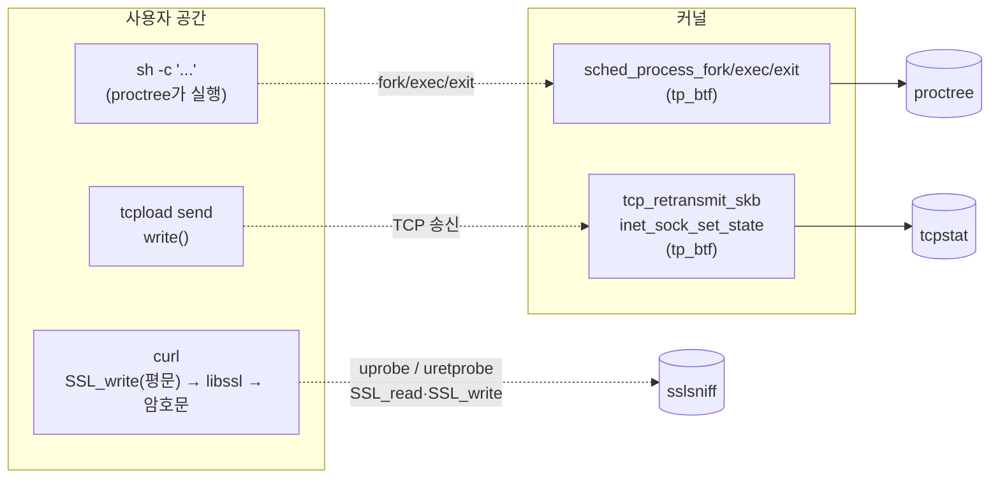
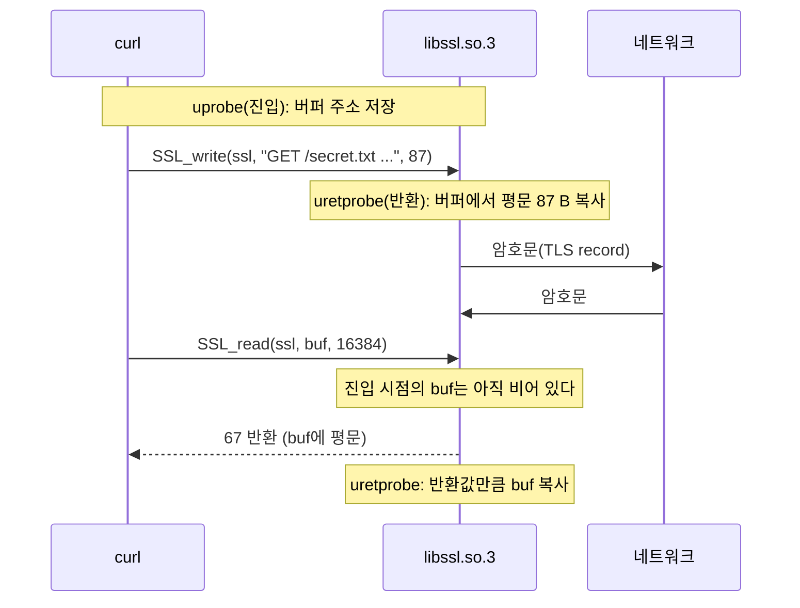

# 13. 관측 실전 패턴

> **핵심 요약**
> 1. 운영에서 자주 쓰는 관측 도구 세 가지를 직접 만든다. **프로세스 트리**(fork/exec/exit tracepoint), **TCP RTT·재전송**(커널이 이미 계산한 `tcp_sock` 통계 읽기), **TLS 평문 보기**(OpenSSL 함수에 uprobe).
> 2. 공통 패턴은 **"커널 안에서 거르고, 필요한 것만 올린다"**다. 자손 프로세스 판정, network namespace 필터, 연결 종료 시점 집계를 모두 BPF 쪽에서 해서 사용자 공간으로는 몇 줄만 올라온다.
> 3. 관측 지점을 고를 때는 **그 지점을 지나지 않는 경로**를 함께 생각해야 한다. 같은 libssl을 쓰는 `openssl s_server -WWW`는 `SSL_read`/`SSL_write`를 부르지 않아서 서버 쪽 평문은 잡히지 않았다. 09장의 `ip_rcv`와 같은 교훈이다.

## 1. 개념

### 1.1 세 도구가 붙는 곳



| 도구 | hook | 무엇을 읽나 | 거르는 곳 |
|---|---|---|---|
| `proctree` | `tp_btf/sched_process_fork`, `_exec`, `_exit` | `task_struct`의 pid·부모·comm·`exit_code`, exec한 파일 이름 | BPF: "부모가 추적 목록에 있으면 자식도 넣는다" |
| `tcpstat` | `tp_btf/tcp_retransmit_skb`, `tp_btf/inet_sock_set_state` | `tcp_sock`의 `srtt_us`·`total_retrans`·`bytes_acked` 등 | BPF: 소켓이 속한 netns의 inode 번호 |
| `sslsniff` | libssl의 `SSL_read`/`SSL_write`/`SSL_read_ex`/`SSL_write_ex`에 uprobe + uretprobe | 함수에 넘긴 평문 버퍼 | BPF: 현재 프로세스의 netns inode 번호 |

세 도구 모두 `tp_btf`(BTF 기반 tracepoint, 03장)나 uprobe에 붙고, 결과는 ring buffer(04장)로 올린다. `tp_btf`는 tracepoint 인자를 `task_struct *`, `sock *`처럼 **커널 타입 그대로** 받는다. 그래서 tracepoint 형식 파일(`format`)에 없는 필드도 `BPF_CORE_READ`로 읽을 수 있다.

### 1.2 프로세스 트리: 커널 안에서 자손 판정하기

"이 명령이 띄운 프로세스 전부"를 보려면 pid 목록을 미리 알 수 없다. 그래서 **fork 때마다 커널 안에서 판정**한다.

```
tracked = {시작 pid}
fork(parent → child): parent ∈ tracked 이면 tracked += child, 이벤트 보냄
exec(p):              p ∈ tracked 이면 이벤트 보냄
exit(p):              p ∈ tracked 이면 tracked -= p, 이벤트 보냄
```

여기에 걸리는 함정이 두 가지 있다.

- **스레드도 fork tracepoint를 지난다.** `pthread_create`(`clone(CLONE_THREAD)`)도 `sched_process_fork`를 부른다. 새 프로세스만 보려면 `child->pid == child->tgid`인지 확인한다. exit도 스레드마다 불리므로, 인자 `group_dead`(스레드 그룹의 마지막)가 참일 때만 프로세스 종료로 친다.
- **시작 pid를 넣기 전에 자식이 fork하면 놓친다.** 그래서 `proctree`는 명령을 바로 실행하지 않는다. `sh -c 'read _ && exec "$@"'`로 띄워 한 줄을 읽을 때까지 멈춰 두고, 그 pid를 map에 넣은 다음 한 줄을 써서 문을 연다(시작 게이트).

종료 코드는 `task_struct.exit_code`에 `wait()` 상태 형식으로 들어 있다. 하위 7비트가 0이 아니면 그 시그널로 죽은 것이고, 아니면 `(exit_code >> 8) & 0xff`가 `exit()`에 넘긴 값이다. v6.17 `kernel/exit.c`의 `do_exit()`는 `tsk->exit_code = code`를 쓴 **다음에** `trace_sched_process_exit()`를 부르므로 tracepoint 시점에 값이 들어 있다.

### 1.3 TCP RTT·재전송: 패킷 대신 커널의 계산 결과를 읽는다

RTT를 재려고 패킷마다 시각을 찍을 필요는 없다. TCP는 재전송 타이머(RTO)를 정하려고 이미 RTT를 추적한다(RFC 6298). `struct tcp_sock`에 다음 값이 있다.

| 필드 | 뜻 |
|---|---|
| `srtt_us` | 평활 RTT(smoothed RTT). **8배 한 값**으로 저장되어 있어 `>> 3`해야 µs다 |
| `total_retrans` | 이 연결에서 재전송한 **세그먼트** 수(누적) |
| `data_segs_out` | 보낸 데이터 세그먼트 수(재전송 포함) |
| `bytes_acked` / `bytes_received` | 상대가 ACK한 바이트 / 받은 바이트. SYN·FIN도 순서 번호 1을 쓰므로 1씩 더해진다 |

`tcpstat`은 이 값을 두 시점에 읽는다.

- **`tcp_retransmit_skb`**: 재전송할 때마다. v6.17 `net/ipv4/tcp_output.c`에서 이 tracepoint는 `__tcp_retransmit_skb()`의 끝(`out:` 레이블)에서 불린다. `total_retrans`는 그 전에 `tcp_skb_pcount(skb)`만큼 늘어난다. 재전송 큐의 skb에는 MSS 여러 개가 들어 있을 수 있어서 누적값이 한 번에 2 이상 늘기도 한다. 조기 실패 경로에서도 불리므로 인자 `err`가 0이 아니면 "재전송 시도 실패"로 따로 표시한다. 일부 실패 경로는 `total_retrans`를 늘리는 곳을 건너뛰므로, 실패한 시도는 누적값에 들어 있지 않을 수 있다.
- **`inet_sock_set_state`**에서 새 상태가 `TCP_CLOSE`일 때: 연결의 최종 통계를 한 줄로 낸다. 연결 유지 시간을 재려고 `ESTABLISHED`가 될 때 시각을 소켓 주소를 key로 map에 넣어 둔다. 이때 **로컬 포트도 같이 기록해 둔다.** 처음에는 닫히는 시점에 `skc_num`을 읽었는데 0이 나왔다. v6.17 `net/ipv4/tcp.c`의 `tcp_set_state()`는 `TCP_CLOSE`일 때 `inet_put_port()`로 포트를 먼저 반납하고, 맨 마지막에 상태를 바꾼다(`inet_sk_state_store()`). 상태가 바뀌었다는 알림을 받을 때는 이미 포트가 지워져 있는 것이다.

필터는 netns의 inode 번호로 한다. `ip netns add`가 만든 `/run/netns/이름` 파일의 inode 번호가 커널의 `net->ns.inum`과 같다(`ls -iL /run/netns/이름`). BPF에서는 `sk->__sk_common.skc_net.net->ns.inum`과 비교한다.

### 1.4 TLS 평문: 암호화 전에 가로채기



- TLS는 소켓 아래에서는 암호문이다. 평문은 사용자 공간(앱 버퍼, TLS 라이브러리 내부)에만 있다. 그래서 커널 hook이 아니라 사용자 공간 함수에 붙는 uprobe를 쓴다. 이 예제는 그중 OpenSSL **공개 API의 인자**에서 평문을 읽는다.
- `SSL_read`의 버퍼는 함수가 **끝나야** 채워진다. 진입(uprobe)에서 버퍼 주소를 스레드 id를 key로 map에 저장하고, 반환(uretprobe)에서 반환값만큼 읽는다. `SSL_write`도 같은 방식으로 반환값(실제로 쓴 양)을 확인하고 읽는다.
- OpenSSL 1.1.1부터 있는 `SSL_read_ex(ssl, buf, num, &readbytes)`는 반환값이 성공 여부(1)다. 읽은 양은 네 번째 인자가 가리키는 곳에 있으므로 그 포인터도 저장해 두었다가 반환 시점에 읽는다.
- uprobe는 **파일(inode)+오프셋**에 붙는다. 이 libssl을 매핑한 모든 프로세스에 걸리므로, 예제는 netns로 걸러 실험용 netns 밖의 TLS 통신은 내보내지 않는다. 다만 걸러도 다른 프로세스의 SSL 호출마다 probe 진입 비용은 든다(14장).

## 2. 예제

| 파일 | 내용 |
|---|---|
| [`code/proctree/proctree.bpf.c`](code/proctree/proctree.bpf.c) | fork/exec/exit `tp_btf` 3개, 추적 목록 hash map, 종료 코드 디코딩 |
| [`code/proctree/main.go`](code/proctree/main.go) | 시작 게이트로 명령 실행, 시간순 출력, 끝나면 트리로 정리 |
| [`code/tcpstat/tcpstat.bpf.c`](code/tcpstat/tcpstat.bpf.c) | 재전송·연결 종료 시 `tcp_sock` 통계, netns 필터 |
| [`code/tcpstat/main.go`](code/tcpstat/main.go) | `-netns /run/netns/이름` → inode 번호를 `const volatile`로 넣고 로드 |
| [`code/sslsniff/sslsniff.bpf.c`](code/sslsniff/sslsniff.bpf.c) | 진입 uprobe 4개 + 공용 uretprobe 1개, netns 필터 |
| [`code/sslsniff/main.go`](code/sslsniff/main.go) | `link.OpenExecutable(libssl).Uprobe/Uretprobe`, 없는 심볼은 건너뜀 |
| [`code/tcpload/main.go`](code/tcpload/main.go) | 실험용 TCP 송수신기(BPF 없음) |
| [`code/run.sh`](code/run.sh) | 13-1은 호스트에서 셸 명령 하나, 13-2·13-3은 netns 두 개 + veth 안에서 |

```
[netns ebpf13a] veth13a 192.0.2.1 ── veth ── veth13b 192.0.2.2 [netns ebpf13b]
  13-2: tcpload send ───(netem: 20ms 지연, 2% 손실)──▶ tcpload serve :5000
  13-3: curl https://…:4433/secret.txt ─────────────▶ openssl s_server -WWW :4433
```

- 13-2는 veth13a 송신 쪽에 netem qdisc로 20ms 지연과 2% 손실을 넣는다. TSO/GSO를 끄고 보낸다. 큰 묶음으로 보내면 netem이 묶음 단위로 버려서 재전송 양상이 달라지기 때문이다.
- 13-3은 실행할 때마다 1일짜리 자체 서명 인증서를 임시 디렉터리에 만들고, 끝나면 지운다. 서버가 주는 파일 내용 `demo-password=hunter2`는 실험용 문자열이다.
- 같은 이름의 netns가 이미 있으면 시작하지 않고, 끝나면 이번 실행에서 만든 것만 지운다. 호스트 인터페이스에는 아무것도 붙이지 않는다. `ip`·`tc`·`ss`(iproute2)와 `ping` 외에 `openssl`, `curl`(OpenSSL 백엔드), `tcpdump`, `ethtool`이 필요하다. 아래 결과는 Ubuntu 24.04의 OpenSSL 3.0.13, curl 8.5.0에서 얻은 것이다.

### 실행

```bash
make build    # root 불필요
make run      # 내부에서 sudo. 결과: out/run.log
```

### 실행 결과 (Linux 6.17 x86_64)

```
=== 13-1) 프로세스 트리: 셸 명령 하나와 그 자손의 fork/exec/exit
ready: 시작 pid 542493
+  0.084ms  exec  542493   /usr/bin/sh
+  0.952ms  exec  542493   /usr/bin/sh
+  1.512ms  fork  542493 → 542494 sh
+  1.636ms  exit  542494   종료 코드 0
+  1.667ms  fork  542493 → 542495 sh
+  3.362ms  exec  542495   /usr/bin/tr
HI
+  3.955ms  exit  542495   종료 코드 0
+  4.315ms  fork  542493 → 542496 sh
+  4.492ms  fork  542496 → 542497 sh
+  4.853ms  exec  542497   /usr/bin/sleep
+105.682ms  exit  542497   종료 코드 0
+106.199ms  exit  542496   종료 코드 3
+106.448ms  fork  542493 → 542527 sh
+106.764ms  exec  542527   /usr/bin/sh
+107.245ms  exit  542527   시그널 15(SIGTERM)로 끝남
Terminated
+107.510ms  fork  542493 → 542528 sh
+107.668ms  fork  542528 → 542529 sh
+107.722ms  exit  542528   종료 코드 0
+107.836ms  exit  542493   종료 코드 0
+108.194ms  exec  542529   /usr/bin/sleep
+408.876ms  exit  542529   종료 코드 0
--- 트리 (pid 이름 [종료 상태, 살아 있던 시간])
542493 /usr/bin/sh [종료 코드 0, 107.8ms]
├─ 542494 sh [종료 코드 0, 0.1ms]
├─ 542495 /usr/bin/tr [종료 코드 0, 2.3ms]
├─ 542496 sh [종료 코드 3, 101.9ms]
│  └─ 542497 /usr/bin/sleep [종료 코드 0, 101.2ms]
├─ 542527 /usr/bin/sh [시그널 15(SIGTERM)로 끝남, 0.8ms]
└─ 542528 sh [종료 코드 0, 0.2ms]
   └─ 542529 /usr/bin/sleep [종료 코드 0, 301.2ms]
```

- 시작 pid(542493)는 처음에 게이트 셸이다. exec가 두 번 찍혔다. 첫 줄(+0.084ms)은 Go가 게이트 셸 `sh`를 실행한 것이고, 두 번째(+0.952ms)는 게이트가 열린 뒤 `exec "$@"`로 본래 명령 `sh -c '...'`이 된 것이다. 첫 줄은 타이밍에 따라 안 보일 수 있다. Go의 `cmd.Start()`는 exec가 성공했다는 신호를 받으면 돌아오는데, 그 신호가 exec tracepoint보다 먼저 올 수 있다. 같은 커널의 VM에서는 두 번째 줄만 찍혔다.
- 셸 문법이 그대로 프로세스 구조로 보인다. 파이프 `echo hi | tr` → 자식 둘(542494는 내장 명령 `echo`라 exec가 없다), `( ... ; exit 3)` → 서브셸 542496이 `sleep`을 낳고 종료 코드 3, `kill -TERM $$` → 자기 자신에게 SIGTERM.
- 마지막 `(sleep 0.3 &)`의 `sleep`(542529)은 부모 542528과 시작 셸 542493이 끝난 **뒤에도** 300ms를 더 살았다. 시작 명령만 기다렸다면 이 exit는 놓쳤다. `proctree`는 추적 목록이 빌 때까지 기다리므로 잡혔다. 트리에서는 fork한 부모 아래에 둔다(실제로는 부모가 끝난 뒤 init이나 subreaper에게 입양된다).

```
=== 13-2) TCP RTT·재전송: veth13a 송신에 netem으로 지연(·손실)을 넣고 1 MiB 보내기
--- netem: delay 20ms
클라이언트: 1048576 B 보냄, 0.24s (34.6 Mbit/s)
+0.000s  닫힘    192.0.2.1:44734 → 192.0.2.2:5000  srtt=20.1ms  재전송 0/730 세그먼트  보냄(ACK 받음) 1048578 B  받음 1 B  연결 유지 0.22s
--- netem: delay 20ms loss 2%
클라이언트: 1048576 B 보냄, 1.63s (5.1 Mbit/s)
+0.000s  재전송  192.0.2.1:44750 → 192.0.2.2:5000  ESTABLISHED  1448 B  srtt=20.1ms  누적 재전송 1 세그먼트
+0.000s  재전송  192.0.2.1:44750 → 192.0.2.2:5000  ESTABLISHED  1448 B  srtt=20.1ms  누적 재전송 2 세그먼트
+0.321s  재전송  192.0.2.1:44750 → 192.0.2.2:5000  ESTABLISHED  1448 B  srtt=20.1ms  누적 재전송 3 세그먼트
+0.321s  재전송  192.0.2.1:44750 → 192.0.2.2:5000  ESTABLISHED  1448 B  srtt=20.1ms  누적 재전송 4 세그먼트
+0.462s  재전송  192.0.2.1:44750 → 192.0.2.2:5000  ESTABLISHED  1448 B  srtt=21.0ms  누적 재전송 5 세그먼트
+0.683s  재전송  192.0.2.1:44750 → 192.0.2.2:5000  ESTABLISHED  1448 B  srtt=20.1ms  누적 재전송 6 세그먼트
+0.704s  재전송  192.0.2.1:44750 → 192.0.2.2:5000  ESTABLISHED  1448 B  srtt=20.3ms  누적 재전송 7 세그먼트
+1.127s  재전송  192.0.2.1:44750 → 192.0.2.2:5000  ESTABLISHED  1448 B  srtt=20.1ms  누적 재전송 8 세그먼트
+1.128s  재전송  192.0.2.1:44750 → 192.0.2.2:5000  ESTABLISHED  1448 B  srtt=20.2ms  누적 재전송 9 세그먼트
+1.207s  재전송  192.0.2.1:44750 → 192.0.2.2:5000  ESTABLISHED  1448 B  srtt=20.1ms  누적 재전송 10 세그먼트
+1.207s  재전송  192.0.2.1:44750 → 192.0.2.2:5000  ESTABLISHED  1448 B  srtt=20.1ms  누적 재전송 11 세그먼트
+1.330s  재전송  192.0.2.1:44750 → 192.0.2.2:5000  FIN_WAIT1    1448 B  srtt=20.1ms  누적 재전송 12 세그먼트
+1.450s  재전송  192.0.2.1:44750 → 192.0.2.2:5000  FIN_WAIT1    1448 B  srtt=20.6ms  누적 재전송 13 세그먼트
+1.470s  재전송  192.0.2.1:44750 → 192.0.2.2:5000  FIN_WAIT1    1448 B  srtt=20.6ms  누적 재전송 14 세그먼트
+1.591s  닫힘    192.0.2.1:44750 → 192.0.2.2:5000  srtt=20.2ms  재전송 14/739 세그먼트  보냄(ACK 받음) 1048578 B  받음 1 B  연결 유지 1.61s
서버: 192.0.2.1:44734 에서 1048576 B 받음
서버: 192.0.2.1:44750 에서 1048576 B 받음
```

- **RTT.** 지연만 넣었을 때 `srtt=20.1ms`. netem이 veth13a 송신에 넣은 20ms가 그대로 측정됐다. 패킷 시각을 하나도 찍지 않고 커널이 이미 계산해 둔 값을 연결이 닫힐 때 한 번 읽은 것이다.
- **재전송.** 2% 손실을 넣자 재전송이 14세그먼트(739개 중 약 1.9%) 생겼고, 같은 1 MiB를 보내는 데 0.24초 → 1.63초가 걸렸다(34.6 → 5.1 Mbit/s). 손실이 2%뿐인데 처리량이 크게 떨어졌다. 손실을 복구하는 동안 혼잡 제어가 혼잡 윈도를 줄이고, 꼬리 손실은 타이머(RTO 등)를 기다려야 복구되기 때문이다. 이 로그만으로는 둘 중 어느 쪽이 얼마나 컸는지 나눌 수 없다. `tcp_sock`의 `snd_cwnd`를 같이 출력하면 볼 수 있다.
- 재전송 상태 칸이 마지막 세 줄에서 `FIN_WAIT1`로 바뀌었다. 앱은 이미 다 쓰고 `CloseWrite()`(FIN)까지 했지만, 커널 송신 버퍼에 남은 데이터를 계속 보내고 다시 보내는 중이었다. **앱의 `write()`가 끝났다고 전송이 끝난 것은 아니다.** 같은 커널의 VM에서는 앱이 더 빨리 다 써서 재전송이 모두 `FIN_WAIT1`에서 일어났다.
- `보냄(ACK 받음) 1048578 B`는 1 MiB에 SYN과 FIN이 쓰는 순서 번호 1씩을 더한 값이고, `받음 1 B`는 서버의 FIN이다.
- 손실은 무작위라 실행할 때마다 재전송 수와 시각이 달라진다. VM에서는 한 번에 2~4세그먼트(2896·5792 B)를 묶어 재전송한 줄도 나왔다(1.3절).

```
=== 13-3) TLS 평문: curl(ebpf13a) → openssl s_server(ebpf13b), libssl에 uprobe
libssl: /lib/x86_64-linux-gnu/libssl.so.3
--- curl이 받은 응답
demo-password=hunter2
--- sslsniff 출력
--- curl 543784 SSL_write    87 B
    GET /secret.txt HTTP/1.1\r\n
    Host: 192.0.2.2:4433\r\n
    User-Agent: curl/8.5.0\r\n
    Accept: */*\r\n
    \r\n
--- curl 543784 SSL_read     67 B
    HTTP/1.0 200 ok\r\n
    Content-type: text/plain\r\n
    \r\n
    demo-password=hunter2\n
--- 같은 통신을 tcpdump로 잡은 파일에서 평문 찾기
pcap 크기: 3700 B, 'hunter2' 등장 횟수: 0
```

- curl이 `SSL_write`에 넘긴 HTTP 요청과 `SSL_read`로 받은 응답이 **평문 그대로** 보인다. 같은 통신을 veth13b에서 tcpdump로 잡은 3700 B에는 `hunter2`가 한 번도 나오지 않는다. 선 위에서는 암호문이다.
- **서버(openssl s_server) 쪽은 하나도 잡히지 않았다.** 같은 `libssl.so.3`을 쓰고 netns 필터에도 들어 있는데 그렇다. OpenSSL 3.0.13 `apps/s_server.c`의 `-WWW` 처리(`www_body`)는 SSL 연결을 `BIO_f_ssl()`로 감싸 `BIO_gets`/`BIO_write`로 읽고 쓴다. `ssl/bio_ssl.c`의 BIO 구현은 `SSL_read`/`SSL_write`가 아니라 내부 함수 `ssl_read_internal`/`ssl_write_internal`을 바로 부른다. 내부 함수는 동적 심볼로 공개되지 않아 이름으로 붙일 수도 없다. **"TLS 평문은 SSL_read/SSL_write에 붙이면 다 보인다"는 틀렸다.** 대상 프로그램이 실제로 어느 함수를 거치는지 확인해야 한다(직접 해보기 3).

## 3. 직접 해보기

1. `proctree`에 `-threads` 옵션을 더해 스레드 생성도 보이게 하자. `child->pid != child->tgid`인 fork를 따로 표시하고, Go 프로그램(`proctree -- ./bin/tcpload serve`)을 돌려 Go 런타임이 만드는 스레드 수를 세어 보자.
2. `tcpstat`의 netem을 `delay 20ms 10ms`(지터)로 바꿔 `srtt`와 함께 `mdev_us`(RTT 변동)도 출력해 보자. `srtt_us`처럼 배율을 곱해 저장하므로 `net/ipv4/tcp_input.c`의 `tcp_rtt_estimator()`에서 단위를 먼저 확인하자. RFC 6298의 RTO는 `SRTT + 4·RTTVAR`다.
3. 13-3의 서버를 `-WWW` 없이 띄우자(`openssl s_server -accept 4433 ...`, 받은 내용을 그대로 출력하는 모드). 이번에는 서버 쪽 `SSL_read`가 잡히는가? `apps/s_server.c`에서 두 모드가 각각 무엇을 부르는지 비교하자.
4. Go로 만든 HTTPS 클라이언트(`crypto/tls`)는 libssl을 쓰지 않는다. `sslsniff`로 잡히지 않는 것을 확인하자. Go 바이너리에서 평문을 보려면 어디에 uprobe를 붙여야 할까? (힌트: `crypto/tls.(*Conn).Write`. Go 함수의 uretprobe는 고루틴 스택 이동 때문에 위험하다.)

## 4. 자주 하는 실수

- **fork tracepoint로 스레드까지 "프로세스"로 셈** — `pid == tgid`인지 확인하자. exit도 스레드마다 오므로 `group_dead`를 보자.
- **pid를 map에 넣기 전에 대상 프로세스를 출발시킴** — 그사이에 일어난 fork를 놓친다. 멈춘 상태로 만들고(게이트, `SIGSTOP`, `ptrace` 등) 등록한 뒤 출발시키자.
- **시작 명령이 끝나면 추적도 끝냄** — 백그라운드로 남은 자손의 exit를 놓친다. 13-1의 `(sleep 0.3 &)`가 그 예다. `proctree`는 추적 목록이 빌 때까지(최대 `-wait`) 기다린다.
- **`srtt_us`를 그대로 µs로 씀** — 8배 값이다. `>> 3`하자.
- **`total_retrans`를 "재전송 이벤트 횟수"로 읽음** — 세그먼트 수다. 재전송 한 번에 세그먼트 여러 개가 나갈 수 있다.
- **연결이 닫힐 때 로컬 포트를 읽음** — `TCP_CLOSE` 시점에는 0이다. 연결될 때 기록해 두자.
- **`SSL_read` 진입 시점에 버퍼를 읽음** — 아직 비어 있다. uretprobe에서 반환값만큼 읽자.
- **libssl의 `SSL_read`/`SSL_write`만 보면 TLS 평문을 다 본다고 믿음** — BIO 경로(`BIO_f_ssl`)는 내부 함수를 바로 부른다. 정적 링크, BoringSSL·GnuTLS·NSS, Go·Rust의 자체 TLS 구현은 다른 함수다. 대상 프로그램이 실제로 어떤 함수를 부르는지 먼저 확인하자.
- **진입·반환 사이 상태를 스레드당 한 칸에 저장** — 이 예제의 `calls` map이 그렇다. 같은 스레드가 콜백 안에서 SSL 함수를 다시 부르면(재진입) 바깥 호출의 값이 덮어써진다. 재진입 가능한 함수라면 깊이별로 저장하자.
- **필터 없이 TLS 평문을 수집** — 다른 사용자의 비밀번호·토큰이 그대로 보인다. 운영에서는 대상 프로세스를 좁히고, 수집한 평문의 저장·접근을 엄격히 관리하자.

## 5. 더 읽을거리

| 자료 | 라이선스 | 이 챕터에서의 사용 |
|---|---|---|
| 커널 소스 v6.17 `kernel/exit.c`, `include/trace/events/sched.h` | GPL-2.0 | `exit_code` 기록과 `sched_process_exit` 호출 순서, `group_dead` 의미 확인 |
| 커널 소스 v6.17 `net/ipv4/tcp_output.c`, `net/ipv4/tcp.c`, `include/linux/tcp.h` | GPL-2.0 | `tcp_retransmit_skb` tracepoint 위치, `tcp_set_state()`의 포트 반납 순서, `total_retrans`·`srtt_us`(8배) |
| [RFC 6298: Computing TCP's Retransmission Timer](https://www.rfc-editor.org/rfc/rfc6298) | IETF Trust | SRTT·RTTVAR·RTO 정의 |
| OpenSSL 3.0.13 [`ssl/bio_ssl.c`](https://github.com/openssl/openssl/blob/openssl-3.0.13/ssl/bio_ssl.c), [`apps/s_server.c`](https://github.com/openssl/openssl/blob/openssl-3.0.13/apps/s_server.c) | Apache-2.0 | `-WWW` 모드가 `ssl_read_internal`을 직접 부르는 것 확인 |
| [OpenSSL 문서: SSL_read](https://docs.openssl.org/3.0/man3/SSL_read/) | Apache-2.0 | `SSL_read_ex` 반환값 규칙 |
| [BCC tools: execsnoop, tcpretrans, tcplife, sslsniff](https://github.com/iovisor/bcc/tree/master/tools) | Apache-2.0 | 같은 문제를 푸는 대표 도구. 설계 비교용(코드는 가져오지 않음) |
| [ebpf-docs: BPF_PROG_TYPE_TRACING (tp_btf)](https://docs.ebpf.io/linux/program-type/BPF_PROG_TYPE_TRACING/) | BSD-2-Clause | `tp_btf` 인자 형식 참고 |
| [cilium/ebpf `link` 패키지](https://pkg.go.dev/github.com/cilium/ebpf/link) | MIT | `AttachTracing`, `OpenExecutable().Uprobe/Uretprobe` |
| [tc-netem(8)](https://man7.org/linux/man-pages/man8/tc-netem.8.html) | GPL-2.0 (iproute2) | 지연·손실 주입 |
