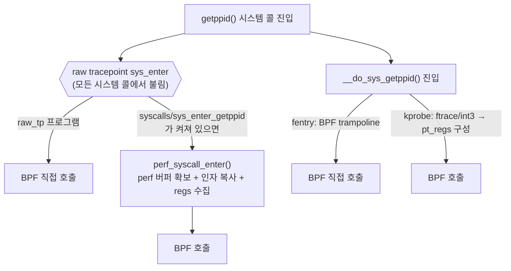

# 14. 디버깅과 성능

> **핵심 요약**
> 1. 실행 중인 BPF 프로그램은 `bpftool`로 거의 다 들여다볼 수 있다. 어디에 붙었는지(`link show`), map에 무엇이 들었는지(`map dump`), verifier가 고친 뒤의 명령어(`prog dump xlated`), 얼마나 자주·오래 도는지(`run_cnt`, `run_time_ns`)까지 확인한다. 이 장은 호스트의 다른 프로그램이 섞이지 않게 **항상 id를 지정해서** 본다.
> 2. `bpf_printk`는 가장 빠른 디버깅 수단이지만 출력이 **시스템 전체가 함께 쓰는 trace 버퍼**로 간다. 개발할 때만 쓰고, 배포 전에는 지운다.
> 3. 같은 시스템 콜에 hook 종류만 바꿔 붙였더니 추가 비용이 몇 배씩 차이 났다. 이 장비에서는 fentry가 가장 쌌고, syscalls tracepoint가 가장 비쌌다. hook은 기능만 보고 고르지 말고 **그 hook에 이르는 커널 경로의 비용**도 보고 골라야 한다. 이벤트를 매번 사용자 공간으로 보내면 소비자가 따라가지 못해 **대부분이 버려질 수 있다.**

## 1. 개념

### 1.1 디버깅 도구 지도

| 알고 싶은 것 | 도구 | 비고 |
|---|---|---|
| 어떤 프로그램이 떠 있나 | `bpftool prog show [id N]` | 이름, 타입, tag(명령어 해시), 쓰는 map id, BTF id |
| 어디에 붙었나 | `bpftool link show [id N]`, `bpftool net show`, `bpftool cgroup tree`, `bpftool perf` | BPF link로 붙인 것은 `link show`에 나온다(지원하는 attach 종류는 커널 버전마다 다르다). 옛 방식으로 붙인 것은 `net`·`cgroup`·`perf` 쪽에서 본다 |
| map 안에 뭐가 있나 | `bpftool map dump id N`, `map lookup/update/delete` | BTF가 있으면 필드 이름까지 보여 준다. per-CPU map은 CPU별로 |
| 커널이 실행하는 코드 | `bpftool prog dump xlated id N`, `prog dump jited id N` | xlated는 verifier가 고친 뒤의 BPF 명령어(소스 줄 주석 `; ...`이 붙는다). JIT가 켜져 있으면 CPU가 실제로 실행하는 것은 jited 기계어다 |
| 왜 로드가 안 되나 | verifier 로그 | 05장. cilium/ebpf는 `ebpf.VerifierError`로 돌려준다 |
| 값 몇 개 찍어 보기 | `bpf_printk` → `/sys/kernel/tracing/trace` | 1.2절 |
| 얼마나 자주·오래 도나 | `run_cnt`·`run_time_ns`(`prog show`) | 통계가 켜져 있을 때만 쌓인다(1.3절) |
| 어떤 기능을 쓸 수 있나 | `bpftool feature probe` | 커널이 지원하는 프로그램·map 타입·helper 목록 |

`prog dump jited`(JIT가 만든 기계어)는 bpftool이 디스어셈블러(LLVM이나 libbfd)와 함께 빌드되어야 한다. 이 머신의 bpftool은 `Error: No JIT disassembly support`를 냈다. 대신 `prog show`의 `jited 133B` 같은 크기로 JIT가 됐는지 확인할 수 있다.

### 1.2 bpf_printk

```c
bpf_printk("ebpf14: getppid pid=%d n=%llu", target_tgid, *v);
```

- 출력은 ftrace의 **전역 trace 버퍼**(`/sys/kernel/tracing/trace`)로 간다. 다른 printk 프로그램과 ftrace 사용자도 같은 버퍼를 쓴다. 그래서 출력에 고유한 접두사를 붙이고 grep으로 고르자.
- `trace`는 읽어도 내용이 지워지지 않는다. `trace_pipe`(그리고 그것을 읽는 `bpftool prog tracelog`)는 **읽는 순간 비운다.** 다른 사람이 보고 있던 내용을 가로챌 수 있다.
- 인자는 3개까지가 기본(`bpf_trace_printk`)이다. 그보다 많으면 `bpf_printk` 매크로가 `bpf_trace_vprintk`(5.16+)를 쓴다. 형식 문자열은 프로그램의 `.rodata`에 들어간다. 14-1의 `.rodata` map에 `tp_printk.____fmt`가 보이는 이유다.
- 호출마다 형식화와 버퍼 기록을 하므로 느리다. 뜨거운 경로에 두면 성능을 재는 의미가 없어지고 버퍼가 금방 넘친다.

### 1.3 hook 종류별 비용: 경로가 다르다

같은 `getppid()` 진입을 네 가지 방법으로 잡을 수 있다. BPF 프로그램 본문은 모두 같다("내 프로세스면 per-CPU 카운터 +1"). 다른 것은 **BPF 프로그램까지 가는 경로**다.



- **syscalls tracepoint**(`tracepoint/syscalls/sys_enter_*`): v6.17 `kernel/trace/trace_syscalls.c`의 `perf_syscall_enter()`는 perf 버퍼를 확보하고(`perf_trace_buf_alloc`), 인자를 복사하고, 호출자 레지스터를 모은 뒤 BPF를 부른다. 편하지만 할 일이 많다.
- **raw tracepoint**(`raw_tracepoint/sys_enter`): 가공 없이 바로 BPF를 부른다. 대신 **모든 시스템 콜**에서 불리므로 번호로 직접 걸러야 하고, 다른 프로세스의 시스템 콜에도 비용을 더한다.
- **kprobe**: 함수 진입에 끼어들어 `pt_regs`를 만들고 BPF를 부른다.
- **fentry**: BPF trampoline이 함수 진입에서 BPF를 거의 일반 함수 호출처럼 부른다(03장).

실행 시간 통계(`run_cnt`, `run_time_ns`)는 기본으로 꺼져 있다. 켜는 방법은 두 가지다.

| 방법 | 범위 | 끄는 법 |
|---|---|---|
| `sysctl kernel.bpf_stats_enabled=1` | 시스템 전체 | 직접 0으로 되돌려야 한다 |
| `BPF_ENABLE_STATS` 시스템 콜(cilium/ebpf `ebpf.EnableStats`) | **이것도 시스템 전체** | 돌려받은 fd를 닫으면(프로세스가 죽어도) 꺼진다 |

이 장은 두 번째를 쓴다. 다만 두 방법 모두 켜져 있는 동안 **호스트의 모든 BPF 프로그램**이 실행마다 시각을 두 번 읽는다. 그래서 측정에 필요한 짧은 구간에만 켠다. 꺼도 쌓인 값은 남는다.

### 1.4 운영 배포 전에 확인할 것

| 영역 | 확인할 것 |
|---|---|
| 커널 호환 | BTF가 있는가(`/sys/kernel/btf/vmlinux`), 쓰는 기능이 그 버전에 있는가(부록 A), CO-RE로 구조체 차이를 흡수했는가(06장). 없을 때의 대안(fallback)을 정해 두자. |
| 붙는 지점의 안정성 | tracepoint는 비교적 오래 유지되는 편이지만 ABI로 보장되지는 않는다. kprobe·fentry 대상 함수는 **이름이 바뀌거나 inline되어 사라질 수 있다.** 예: 이 머신에서 `__x64_sys_getppid`는 kallsyms에는 있지만 BTF에는 없어 fentry를 붙일 수 없다. 본체 `__do_sys_getppid`는 BTF에 있다. |
| 권한 | `CAP_BPF`+`CAP_PERFMON`(추적), `CAP_NET_ADMIN`(네트워크)로 root보다 좁힐 수 있다(5.8+). 비특권 BPF(`kernel.unprivileged_bpf_disabled`)는 대부분 배포판에서 꺼져 있다. |
| 메모리 | hash map은 기본으로 `max_entries`만큼 미리 할당한다(`BPF_F_NO_PREALLOC`로 끌 수 있다). 5.11+는 memlock rlimit 대신 memcg로 계산한다. 가득 찼을 때 동작을 정하자(LRU, 덮어쓰기, 버리고 세기). |
| 이벤트 유실 | ring buffer reserve 실패를 **반드시 센다.** 14-3에서는 보낸 이벤트 대부분이 버려졌다. 가능하면 커널 안에서 집계하고(hash/per-CPU map), 사용자 공간으로는 요약만 보낸다. |
| 비용 | 뜨거운 경로(모든 패킷, 모든 시스템 콜)는 fentry/raw_tp를 쓰고, 필터를 가장 먼저 둔다. 배포 전후로 `run_time_ns`를 잠깐 재 보자. |
| 수명 | 로더 프로세스가 죽으면 link가 닫혀 프로그램이 떨어진다. 계속 붙어 있어야 하면 link를 bpffs에 pin하고(10장), 업그레이드는 `link update`로 원자적으로 교체한다. |
| 다른 도구와 공존 | 같은 hook에 여러 도구가 붙는다. tcx는 `TCX_NEXT`(11장), XDP는 인터페이스당 하나라 libxdp dispatcher 같은 조정이 필요하다. |
| 디버깅 흔적 | `bpf_printk`는 지운다. printk를 쓰는 프로그램을 로드하면 커널이 trace 이벤트 `bpf_trace/bpf_trace_printk`를 켠다. 누가 꺼 두었어도 다시 켠다(v6.17 `kernel/trace/bpf_trace.c`의 `__set_printk_clr_event()`). 남의 장비의 trace 설정을 바꾸는 셈이다. |

## 2. 예제

| 파일 | 내용 |
|---|---|
| [`code/dbg/dbg.bpf.c`](code/dbg/dbg.bpf.c) | 같은 본문의 프로그램 5개(tracepoint, raw_tp, kprobe, fentry, fentry+ring buffer), `bpf_printk` 프로그램, 유실 카운터 |
| [`code/dbg/main.go`](code/dbg/main.go) | `hold`: fentry를 붙이고 id 출력 / `printk` / `bench`: 모드를 번갈아 돌리는 벤치마크 |
| [`code/run.sh`](code/run.sh) | 14-1 bpftool, 14-2 printk, 14-3 bench |

벤치마크 방법은 이렇다.

- `getppid`는 커널에서 하는 일이 거의 없는 시스템 콜이라 hook 비용이 잘 드러난다.
- 측정 스레드를 CPU 하나에 고정한다. 라운드마다 6개 모드(BPF 없음 포함)를 **번갈아** 붙였다 떼며 100만 번씩 호출하고, 라운드 값의 중앙값을 쓴다. 한 모드를 몰아서 재면 CPU 클럭 변화 같은 시간에 따른 차이가 hook 차이처럼 보일 수 있기 때문이다.
- 프로그램 1회 실행 시간(`BPF 1회 평균`)은 통계를 켠 별도 라운드에서 잰다. 통계 수집이 매 실행에 시각 읽기를 더하므로 `ns/호출` 측정과 섞지 않는다.
- 모든 모드에서 카운터가 정확히 호출 수만큼 늘었는지 확인한다. 하나라도 놓쳤으면 실패로 끝난다.

### 실행

```bash
make build    # root 불필요
make run      # 내부에서 sudo. 결과: out/run.log
```

### 실행 결과 (Linux 6.17 x86_64)

```
=== 14-1) bpftool로 실행 중인 프로그램 들여다보기
$ bpftool prog show id <PROG>
666410: tracing  name fe_getppid  tag 9f68e08d56a3b882  gpl run_time_ns 891 run_cnt 3
	loaded_at 2026-10-27T14:17:19+0900  uid 0
	xlated 216B  jited 133B  memlock 4096B  map_ids 7613,7614
	btf_id 13058
$ bpftool link show id <LINK>
4760: tracing  prog 666410  
	prog_type tracing  attach_type trace_fentry  
	target_obj_id 1  target_btf_id 84606  
(종료 코드 255)
$ bpftool map dump id <MAP>
[{
        "key": 0,
        "values": [{
                "cpu": 0,
                "value": 0
            },{
                "cpu": 1,
                "value": 0
            },{
                "cpu": 2,
                "value": 0
            },{
                "cpu": 3,
                "value": 0
            },{
                "cpu": 4,
                "value": 0
            },{
                "cpu": 5,
                "value": 0
            },{
                "cpu": 6,
                "value": 0
            },{
                "cpu": 7,
                "value": 0
            },{
                "cpu": 8,
                "value": 0
            },{
                "cpu": 9,
                "value": 0
            },{
                "cpu": 10,
                "value": 3
            },{
                "cpu": 11,
                "value": 0
            },{
                "cpu": 12,
                "value": 0
            },{
                "cpu": 13,
                "value": 0
            },{
                "cpu": 14,
                "value": 0
            },{
                "cpu": 15,
                "value": 0
            }
        ]
    }
]
$ bpftool prog dump xlated id <PROG>
int fe_getppid(unsigned long long * ctx):
; return (bpf_get_current_pid_tgid() >> 32) == target_tgid;
   0: (85) call bpf_get_current_pid_tgid#298416
; return (bpf_get_current_pid_tgid() >> 32) == target_tgid;
   1: (18) r1 = map[id:7613][0]+0
   3: (61) r1 = *(u32 *)(r1 +0)
; return (bpf_get_current_pid_tgid() >> 32) == target_tgid;
   4: (77) r0 >>= 32
; if (mine())
   5: (5d) if r0 != r1 goto pc+19
   6: (b7) r1 = 0
; __u32 k = 0;
   7: (63) *(u32 *)(r10 -4) = r1
   8: (bf) r2 = r10
; 
   9: (07) r2 += -4
; __u64 *v = bpf_map_lookup_elem(&hits, &k);
  10: (18) r1 = map[id:7614]
  12: (07) r1 += 264
  13: (61) r0 = *(u32 *)(r2 +0)
  14: (35) if r0 >= 0x1 goto pc+5
  15: (67) r0 <<= 3
  16: (0f) r0 += r1
  17: (79) r0 = *(u64 *)(r0 +0)
  18: (bf) r0 = &(void __percpu *)(r0)
  19: (05) goto pc+1
  20: (b7) r0 = 0
; if (v)
  21: (15) if r0 == 0x0 goto pc+3
; (*v)++; // per-CPU라 원자적 연산이 필요 없다
  22: (79) r1 = *(u64 *)(r0 +0)
  23: (07) r1 += 1
  24: (7b) *(u64 *)(r0 +0) = r1
; int BPF_PROG(fe_getppid)
  25: (b7) r0 = 0
  26: (95) exit
```

- `prog show`: 이름·타입(`tracing` = fentry/fexit 계열)·`tag`(명령어 해시, 같은 코드면 같은 값)와 함께, 통계를 잠깐 켠 동안 3번 실행되어 891ns를 썼다는 것이 보인다. `map_ids`의 두 map 중 7613은 상수(`target_tgid` 등)가 든 `.rodata`, 7614는 카운터 `hits`다.
- `link show`: 이 프로그램이 `trace_fentry`로 붙었고 대상은 `target_btf_id 84606`이다. 이 번호는 커널 BTF에서 `__do_sys_getppid` 함수다(`bpftool btf dump file /sys/kernel/btf/vmlinux | grep '^\[84606\]'`). 출력은 정상인데 종료 코드가 255다(4절).
- `map dump`: per-CPU map이라 CPU 16개의 값이 따로 나온다. 3번의 호출이 모두 CPU 10에서 일어났다. 합계가 필요하면 사용자 공간에서 더해야 한다.
- `prog dump xlated`: verifier를 통과한 뒤의 BPF 명령어다. JIT가 이것을 기계어(`jited 133B`)로 바꿔 실행한다. C 소스와 비교하면 두 가지가 눈에 띈다.
  - `const volatile` 변수 `target_tgid`는 `.rodata` map에서 읽는다(1~3번 명령).
  - `bpf_map_lookup_elem` 호출이 사라지고(10~20번), 커널이 per-CPU array 조회를 명령어로 직접 펼쳤다(인라인). 그래서 helper 호출 비용이 없다.

```
=== 14-2) bpf_printk: 출력은 커널 trace 버퍼로 간다
getppid 3번 호출, pid=839026
--- /sys/kernel/tracing/trace 에서 'ebpf14: getppid pid=839026' 줄
             dbg-839028  [012] ...21 12018312.175991: bpf_trace_printk: ebpf14: getppid pid=839026 n=1
             dbg-839028  [012] ...21 12018312.175995: bpf_trace_printk: ebpf14: getppid pid=839026 n=2
             dbg-839028  [012] ...21 12018312.175997: bpf_trace_printk: ebpf14: getppid pid=839026 n=3
```

- 형식 문자열이 그대로 찍혔다. 줄 앞의 `dbg-839028`은 출력한 **스레드**의 comm-tid이고, `pid=839026`은 프로그램이 찍은 tgid다. Go 프로그램이라 시스템 콜을 부른 스레드가 메인 스레드가 아니다. `[012]`는 CPU 번호, `...21`은 인터럽트·선점 상태 플래그, 그 뒤는 부팅 후 초다.

```
=== 14-3) 같은 시스템 콜에 hook 종류만 바꿔 붙였을 때 비용
getppid 1000000회 × 5라운드(모드를 번갈아), CPU 1 고정. ns/호출은 라운드 중앙값
hook                                   ns/호출     추가 ns    BPF 실행 수*    BPF 1회 평균*
BPF 없음                                 271.6         -            -             -
tracepoint sys_enter_getppid           580.3    +308.7      1000003       99.8 ns
raw_tp sys_enter(모든 시스템 콜)             440.4    +168.7      1162452      106.4 ns
kprobe __do_sys_getppid                506.0    +234.4      1000004       91.0 ns
fentry __do_sys_getppid                403.4    +131.8      1000002       91.5 ns
fentry + ring buffer 전송                471.5    +199.9      1000004      159.0 ns
* 통계를 켜고 모드마다 따로 돌린 한 라운드(getppid 1000000 회) 동안의 값. 그 시간에 다른 프로세스가 같은 hook을 지난 실행도 포함된다
ring buffer: 보내려던 이벤트 6500000, 받은 것 970749, 가득 차서 버린 것 5529251
```

- **이 실행에서 관측된 순서.** 같은 본문을 붙였는데 호출 1회에 더해지는 비용은 fentry(+132ns) < raw_tp(+169ns) < fentry+ring buffer(+200ns) < kprobe(+234ns) < syscalls tracepoint(+309ns)였다. 같은 커널의 VM에서도 순서는 같았다(VM에서는 값이 모두 더 작았다: 기준 141ns, fentry +31, raw_tp +67, kprobe +96, tracepoint +121). 절대값은 장비와 실행 환경에 따라 크게 다르다. 또 라운드 안의 모드 순서가 매번 같고 반복 횟수도 적어서, 차이가 작은 쌍(예: raw_tp와 fentry+ring buffer)의 순서는 바뀔 수 있다. 큰 차이(fentry와 tracepoint)만 결론으로 삼자.
- **syscalls tracepoint가 가장 비쌌다.** 1.3절의 perf 경로(버퍼 확보, 인자 복사) 때문이다. "tracepoint는 가볍다"는 일반론이 시스템 콜 tracepoint에는 맞지 않았다.
- **raw_tp는 모든 시스템 콜에서 돈다.** `BPF 실행 수`가 1,162,452로 getppid 호출 100만 번보다 16만 번 많다. 같은 시간에 호스트의 다른 프로세스, 그리고 이 Go 프로세스의 다른 스레드(런타임, ring buffer 소비자)가 부른 시스템 콜에서도 이 프로그램이 돌았다는 뜻이다. 우리 측정에는 +169ns로 보이지만, 그 비용은 **호스트 전체가 나눠 낸다.** 다른 모드에서 실행 수가 2~4번 많은 것도 측정 스레드 밖에서 불린 getppid다.
- `BPF 1회 평균`은 프로그램 본문이 도는 구간만 잰 값이다. hook에 이르는 경로(perf 버퍼 확보, trampoline, pt_regs 구성)는 들어 있지 않다. 그래서 hook 비용 비교에는 `추가 ns`를 쓰고, 이 값은 본문 비용을 보는 데 쓴다. 본문이 같은 네 모드는 91~106ns로 비슷했고, ring buffer에 쓰는 모드만 159ns로 컸다(통계 수집 자체의 비용도 들어 있다).
- **ring buffer: 보내려던 650만 개 중 553만 개(85%)를 버렸다.** 한 번에 하나씩 읽는 Go 소비자는 수백 ns마다 생기는 이벤트를 따라가지 못한다. 버리는 경로(reserve 실패)가 성공 경로보다 싸다는 점도 기억하자. 소비자가 빨라지면 이 모드의 비용은 더 오른다. 운영 도구라면 유실을 세서 드러내고, 커널 안에서 집계해 보낼 양 자체를 줄여야 한다(직접 해보기 2).

## 3. 직접 해보기

1. `bpftool prog show id <PROG> --json | jq`로 같은 정보를 JSON으로 받아 보자. 운영 스크립트에서는 이쪽이 파싱하기 쉽다.
2. 14-3의 ring buffer 소비자가 따라가지 못하는 이유를 줄여 보자. 커널 안에서 64개씩 모아 한 번에 보내면 유실이 얼마나 줄어드는가? 깨우기를 줄이는 `BPF_RB_NO_WAKEUP`도 시도해 보자. 단, 깨우기를 모두 끄면 `Read()`에서 잠든 소비자가 깨어나지 못한다. 일정 개수마다 `BPF_RB_FORCE_WAKEUP`을 섞거나 소비자가 주기적으로 확인하게 해야 한다.
3. `kernel.bpf_stats_enabled`를 켠 채 14-3을 돌려 `ns/호출`이 얼마나 늘어나는지 재 보자. 측정 도구가 측정 대상을 바꾸는 예다(끝나면 0으로 되돌리자).
4. 프로그램 본문에 `bpf_printk`를 넣은 모드를 벤치마크에 더해 보자. 단, trace 버퍼가 수백만 줄로 덮이므로 **자기 VM에서만** 하자(`tools/vm/run-vm.sh`).

## 4. 자주 하는 실수

- **`bpftool prog show`를 id 없이 돌려 결과를 공유** — 그 호스트의 모든 BPF 프로그램(보안 에이전트, 모니터링 도구 등)이 함께 나온다. 공유할 때는 id를 지정하자.
- **`bpftool prog tracelog`나 `cat trace_pipe`로 printk를 봄** — 읽은 줄이 버퍼에서 사라져 같은 버퍼를 보는 다른 사람·도구가 못 본다. 공용 장비에서는 `trace` 파일을 grep하자.
- **종료 코드만 보고 bpftool 실패로 판단** — 이 머신의 bpftool(v7.7.0)에서 `link show id N`은 출력이 정상이어도 종료 코드 255를 돌려줬다. v6.17 `tools/bpf/bpftool/link.c`의 `do_show()`는 마지막에 `errno == ENOENT ? 0 : -1`로 성공을 판단하는데, id 하나를 지정한 경로에서는 그 앞에서 errno가 ENOENT로 설정되지 않아 성공해도 -1이 될 수 있다. 스크립트에서 이 명령을 쓴다면 이 버전의 알려진 동작으로 보고, `--json` 출력이 온전한지와 stderr의 오류 메시지를 함께 확인하자.
- **통계를 켜 둔 채 성능을 잼** — `run_time_ns`를 모으는 비용이 결과에 섞인다. 켜는 구간과 재는 구간을 나누자.
- **"tracepoint가 kprobe보다 가볍다"를 그대로 믿음** — 일반적으로는 맞는 말이지만, syscalls tracepoint는 perf 경로를 거쳐 이 실험에서 가장 비쌌다. 뜨거운 경로라면 직접 재 보자.
- **raw_tp `sys_enter`의 비용을 그 시스템 콜에만 매김** — 모든 프로세스의 모든 시스템 콜에서 돈다. 측정한 `BPF 실행 수`가 호출 수보다 많은 것이 그 흔적이다.
- **ring buffer 유실을 세지 않음** — 소비자가 느리면 소리 없이 버려진다. reserve 실패를 세는 카운터를 두자.

## 5. 더 읽을거리

| 자료 | 라이선스 | 이 챕터에서의 사용 |
|---|---|---|
| [bpftool 문서(man 페이지)](https://docs.kernel.org/bpf/bpftool.html) ·  커널 소스 v6.17 `tools/bpf/bpftool/link.c` | GPL-2.0 | 명령 사용법, `link show`의 종료 코드 판단 |
| 커널 소스 v6.17 `kernel/trace/trace_syscalls.c` | GPL-2.0 | syscalls tracepoint가 BPF를 부르는 경로(`perf_syscall_enter`) |
| 커널 소스 v6.17 `kernel/trace/bpf_trace.c` | GPL-2.0 | printk 프로그램 로드 시 `bpf_trace_printk` 이벤트를 켜는 동작 |
| [커널 문서: BPF 시스템 콜 `BPF_ENABLE_STATS`](https://docs.kernel.org/userspace-api/ebpf/syscall.html) | GPL-2.0 | 통계 켜기·끄기 |
| [커널 문서: ftrace (trace, trace_pipe)](https://docs.kernel.org/trace/ftrace.html) | GPL-2.0 | trace 버퍼와 trace_pipe의 차이 |
| [ebpf-docs: bpf_trace_printk / bpf_trace_vprintk](https://docs.ebpf.io/linux/helper-function/bpf_trace_printk/) | BSD-2-Clause | printk 인자 제한 |
| [cilium/ebpf: EnableStats, Program.Stats](https://pkg.go.dev/github.com/cilium/ebpf) | MIT | 통계 API |
| [Cilium 문서: BPF and XDP Reference Guide — 개발 도구](https://docs.cilium.io/en/stable/reference-guides/bpf/) | Apache-2.0 | bpftool·디버깅 흐름 참고(재서술) |
