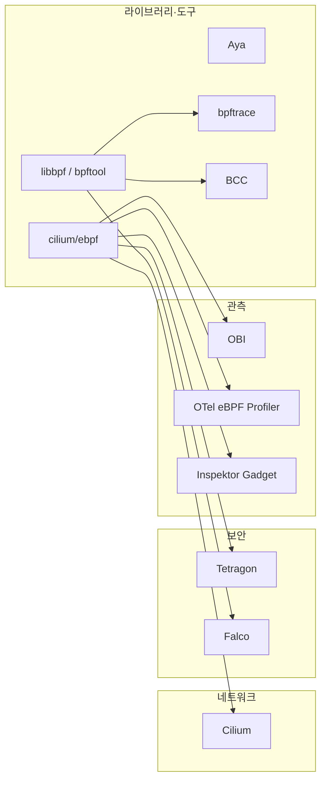

# 15. 다음 단계

> **핵심 요약**
> 1. 지금까지 만든 예제는 모두 실제 오픈소스 프로젝트의 축소판이다. 07장 Go 로더는 cilium/ebpf, 11장 소켓 hook은 Cilium의 소켓 LB, 12장 LSM은 Tetragon, 13장 TLS uprobe는 OBI(OpenTelemetry eBPF Instrumentation)에 해당한다. **장마다 대응하는 프로젝트를 하나 골라 코드를 읽는 것**이 가장 빠른 다음 단계다.
> 2. 기여는 두 갈래다. **GitHub 프로젝트**(Cilium, Tetragon, bpftrace 등)는 이슈·PR로 한다. **커널 BPF·libbpf·bpftool**은 `bpf@vger.kernel.org` 메일링 리스트에 패치를 보낸다. 커널 쪽은 제목 접두사(`[PATCH bpf-next]`), 충분한 테스트, 상세한 커밋 메시지가 필수이고, verifier 동작 변경 등에는 selftest 추가가 요구된다.
> 3. 배운 것을 글이나 발표로 남길 때는 이 저장소처럼 **직접 돌린 결과와 버전을 붙이자.** "이 커널, 이 도구 버전에서 이렇게 나왔다"가 있는 글은 오래 쓸모 있고, 틀렸을 때 고치기도 쉽다.

이 장은 실행 예제 없이 문서만 있다. 아래 표의 라이선스·라벨 이름·기여 절차는 2026-10-27에 각 저장소와 공식 문서에서 확인한 값이다. 바뀔 수 있으니 기여 전에 다시 확인하자.

## 1. 오픈소스 지도: 이 저장소의 장과 이어지는 프로젝트

(화살표는 "주로 이 라이브러리로 BPF를 다룬다"는 뜻이다. 각 프로젝트는 여러 라이브러리를 함께 쓰기도 한다.)

| 프로젝트 | 무엇 | 이 저장소에서 이어지는 장 | 라이선스(저장소 기준) | 입문용 이슈 라벨 |
|---|---|---|---|---|
| [libbpf/libbpf](https://github.com/libbpf/libbpf) | C 로더 라이브러리. 커널 트리 `tools/lib/bpf`가 원본이고 GitHub는 미러 | 06 | LGPL-2.1-only OR BSD-2-Clause | `good first issue` |
| [libbpf/bpftool](https://github.com/libbpf/bpftool) | bpftool 미러. 원본은 커널 트리 `tools/bpf/bpftool` | 00, 14 | GPL-2.0-only OR BSD-2-Clause | — |
| [cilium/ebpf](https://github.com/cilium/ebpf) | 순수 Go BPF 라이브러리 | 07, 09~14 | MIT | `good first issue`, `help wanted` |
| [aya-rs/aya](https://github.com/aya-rs/aya) | Rust BPF 라이브러리 | 08 | MIT OR Apache-2.0 | `good first issue`, `help wanted` |
| [bpftrace/bpftrace](https://github.com/bpftrace/bpftrace) | 고수준 추적 언어 | 02 | Apache-2.0 | `good first issue`, `difficulty: easy` |
| [iovisor/bcc](https://github.com/iovisor/bcc) | 추적 도구 모음(`execsnoop`, `tcpretrans`, `sslsniff` 등) | 03, 13 | Apache-2.0 | `good first issue` |
| [cilium/cilium](https://github.com/cilium/cilium) | 쿠버네티스 네트워킹·보안. XDP·tcx·소켓 LB | 09~11 | Apache-2.0 | `good-first-issue`(하이픈), `help-wanted` |
| [cilium/tetragon](https://github.com/cilium/tetragon) | 보안 관측과 런타임 차단(kprobe, LSM 등) | 03, 12 | Apache-2.0 | `good first issue` |
| [falcosecurity/falco](https://github.com/falcosecurity/falco), [falcosecurity/libs](https://github.com/falcosecurity/libs) | 시스템 콜 기반 런타임 보안. 드라이버(커널 모듈, modern eBPF probe)는 `libs`에 있다 | 03, 12 | Apache-2.0 (`libs/driver`에는 `GPL2.txt`·`MIT.txt`가 따로 있다) | `good first issue` |
| [open-telemetry/opentelemetry-ebpf-instrumentation](https://github.com/open-telemetry/opentelemetry-ebpf-instrumentation) (OBI) | 코드 수정 없이 HTTP·gRPC 등을 uprobe·kprobe로 계측. 아직 v0(개발 중) | 13 | Apache-2.0 | `good first issue` |
| [open-telemetry/opentelemetry-ebpf-profiler](https://github.com/open-telemetry/opentelemetry-ebpf-profiler) | 전체 시스템 CPU 프로파일러 | 03, 14 | Apache-2.0 | `good first issue` |
| [inspektor-gadget/inspektor-gadget](https://github.com/inspektor-gadget/inspektor-gadget) | 쿠버네티스·리눅스용 BPF "가젯" 모음 | 07, 13 | Apache-2.0 | `good first issue`(확인 시점에 열린 이슈가 가장 많았다) |
| [isovalent/ebpf-docs](https://github.com/isovalent/ebpf-docs) | docs.ebpf.io 원본. helper·프로그램 타입 문서 | 전체 | BSD-2-Clause | — |

> **라이선스 주의.** 저장소 전체 라이선스와 BPF C 코드의 라이선스가 다른 경우가 많다. 커널은 GPL 호환 라이선스를 선언한 프로그램에만 GPL 전용 helper를 허용하므로(01장), BPF 코드 디렉터리에는 GPL이나 이중 라이선스가 따로 붙어 있곤 하다. 기여하거나 코드를 가져올 때는 **파일 머리의 SPDX 표기**를 확인하자.

### 1.1 어디부터 읽을까 — 장별 추천 경로

| 이 장을 했다면 | 읽어 볼 곳 | 볼 것 |
|---|---|---|
| 07 Go 로더 | cilium/ebpf의 `examples/` | `kprobe`, `ringbuffer`, `tracepoint_in_c` 등 이 저장소와 같은 구조의 예제. `tcx`(11장), `tcprtt`(13장)도 있다 |
| 06 CO-RE | libbpf-bootstrap(`libbpf/libbpf-bootstrap`, BSD-3-Clause) | skeleton 기반 최소 예제와 빌드 구성 |
| 11 cgroup 소켓 hook | Cilium의 `bpf/bpf_sock.c`(소켓 LB) | `connect4`에서 서비스 주소를 백엔드로 바꾸고 `getpeername4`로 되돌리는 흐름(11장 직접 해보기 1의 완성판) |
| 12 LSM-BPF | Tetragon의 정책(TracingPolicy) 문서와 BPF 코드 | 정책이 어떤 hook과 map 값으로 바뀌는지 |
| 13 관측 | BCC `tools/`, OBI | 13장 도구와 같은 문제를 어떻게 더 넓게 풀었는지(TLS 라이브러리 여러 종, Go 런타임 등) |
| 14 성능 | 각 프로젝트의 벤치마크·성능 문서 | 운영 규모에서 무엇을 재고 어떻게 줄이는지 |

## 2. 기여하는 법

### 2.1 GitHub 프로젝트

1. **CONTRIBUTING 문서부터 읽는다.** cilium/cilium, cilium/tetragon, cilium/ebpf, aya-rs/aya, bpftrace, inspektor-gadget, OBI는 저장소 최상위에 `CONTRIBUTING.md`가 있다. Falco는 조직 공통 저장소(`falcosecurity/.github`)의 `CONTRIBUTING.md`를 쓴다. 커밋 서명(DCO `Signed-off-by`), 커밋 메시지 형식, 테스트 방법이 여기 있다.
2. **작게 시작한다.** 문서 오타, 예제 추가, 에러 메시지 개선, 테스트 보강이 좋다. 위 표의 라벨로 검색하자. 라벨 이름이 프로젝트마다 다르다(Cilium은 `good-first-issue`).
3. **이슈에서 먼저 말한다.** "이 이슈를 해 보겠다, 이런 방향으로"라고 남기면 중복 작업과 방향 차이로 인한 거절을 줄인다.
4. **재현 정보를 붙인다.** 이 저장소에서 해 온 것과 같다. 커널 버전(`uname -r`), BTF 유무, 도구 버전, 실행 로그를 붙이자. BPF 문제는 커널 버전에 따라 결과가 다른 경우가 많다.

### 2.2 커널 BPF, libbpf, bpftool

커널 문서 [BPF Development Q&A](https://docs.kernel.org/bpf/bpf_devel_QA.html)에 절차가 있다. 요점을 재서술하면 다음과 같다.

| 항목 | 내용 |
|---|---|
| 어디로 | 패치와 버그 보고 모두 `bpf@vger.kernel.org`. 다른 서브시스템을 건드리면 그쪽 메일링 리스트·관리자도 Cc. **bugzilla에 올리지 말 것** |
| 어느 트리 | 버그 수정은 `bpf`, 기능·개선은 `bpf-next`. 제목 접두사로 표시: `git format-patch --subject-prefix='PATCH bpf-next'`. 다시 보낼 때는 `PATCH bpf-next v2` |
| 필수 | 충분한 테스트(문서는 "hard requirement"라고 쓴다), 비어 있지 않은 상세한 커밋 메시지(왜 바꾸는지, 사용 사례). 수정 패치는 `Fixes:` 태그. 2개 이상이면 cover letter |
| 테스트 | verifier 동작을 바꾸면 BPF selftests에 테스트 추가. 보내기 전에 GitHub [kernel-patches/bpf](https://github.com/kernel-patches/bpf)에 fork → `bpf-next_base` 대상 PR로 BPF CI를 돌려 볼 수 있다 |
| 진행 확인 | [patchwork netdevbpf](https://patchwork.kernel.org/project/netdevbpf/list/)에서 상태(`Accepted`, `Changes Requested`)를 본다. 보통 영업일 2~3일 안에 피드백 |
| 시기 | merge window(약 2주) 동안은 `bpf-next`를 처리하지 않는다. `-rc1`이 나온 뒤 다시 보낸다 |
| libbpf·bpftool | GitHub 저장소는 미러다. 코드 변경은 커널 트리 기준으로 같은 메일링 리스트에 보낸다(libbpf README) |

처음이라면 커널 패치보다 **selftest·문서·샘플 개선**이나, libbpf/bpftool GitHub 이슈에서 재현 정보를 정리해 주는 일부터 하는 것이 부담이 적다. 메일링 리스트 아카이브([lore.kernel.org/bpf](https://lore.kernel.org/bpf/))에서 최근 패치와 리뷰가 오가는 방식을 몇 주 읽어 보는 것도 좋다.

## 3. 글과 발표

### 3.1 기술 블로그

이 저장소의 장 형식이 그대로 좋은 글의 뼈대다.

1. **요약 3줄**: 독자가 이 글에서 얻을 결론.
2. **실행한 환경**: 커널 버전, 배포판, 도구 버전. "6.17에서 이렇게 나왔다"가 있어야 다른 버전의 독자가 차이를 이해한다.
3. **실제 출력**: 손으로 고친 출력 대신 로그를 붙이고, 숫자는 로그와 맞춰 둔다.
4. **겪은 일**: 09장의 `ip_rcv`, 13장의 `-WWW` 경로처럼 예상과 달랐던 것. 가장 많이 읽히는 부분이다.
5. **출처와 라이선스**: 번역·인용한 원문, 가져온 코드의 라이선스.

공개 글이니 **회사 코드·내부 경로·고객 정보·호스트 이름**을 빼자. 이 저장소처럼 netns·RFC 5737 주소(192.0.2.0/24 등)·VM으로 재현 환경을 따로 만들면 이런 걱정이 없다.

### 3.2 발표와 CFP

| 자리 | 성격 |
|---|---|
| [eBPF Summit](https://ebpf.io/summit-2025/) | eBPF 전용 온라인 행사. 해마다 형식이 다르다(2025년은 발표 대신 온라인 해커톤 형식) |
| [CiliumCon](https://events.linuxfoundation.org/kubecon-cloudnativecon-north-america/co-located-events/ciliumcon/) | KubeCon과 함께 열리는 행사(예전 이름 Cilium + eBPF Day). eBPF 기반 네트워킹·보안·관측 |
| [Linux Plumbers Conference](https://lpc.events/) | 커널 개발자 중심. BPF·네트워킹 관련 트랙에서 설계 논의 |
| [LSF/MM/BPF](https://events.linuxfoundation.org/lsfmmbpf/) | 초청 기반의 커널 관리자·개발자 모임 |
| 국내 커뮤니티 밋업·컨퍼런스 | 리눅스·클라우드 네이티브·관측 관련 모임. 짧은 라이트닝 토크로 시작하기 좋다 |

CFP(발표 제안서)를 쓸 때는 다음을 챙기자.

- **제목은 결과로.** "eBPF 소개"보다 "같은 차단 정책을 tc와 cgroup hook에 걸었더니 앱이 본 오류가 달랐다"가 뽑힌다(11장).
- **청중이 가져갈 것 2~3개**를 초록에 적는다.
- **데모는 재현 가능하게.** 발표장 네트워크와 권한을 믿지 말자. VM·녹화본·로그를 준비한다(이 저장소의 `tools/vm/run-vm.sh` 같은 방식).
- **한계를 말한다.** 측정 조건, 버전, 안 되는 경우. 14장처럼 "이 장비에서 관측한 순서"라고 범위를 밝히면 질문에서 무너지지 않는다.

## 4. 직접 해보기

1. 1.1의 표에서 하나를 골라, 이 저장소의 해당 장 예제와 그 프로젝트 코드의 **같은 부분**을 찾아 비교하는 짧은 글을 써 보자. (예: 11장 `cgsock.bpf.c`의 `connect4` ↔ Cilium 소켓 LB의 `connect4`)
2. 관심 있는 프로젝트 하나의 `good first issue`를 3개 골라, 각각 재현해 보고 필요한 수정 범위를 이슈 댓글 초안으로 정리해 보자(실제로 올리기 전에 CONTRIBUTING을 다시 확인).
3. 이 저장소의 예제 하나를 다른 커널 버전(VM으로 다른 커널 이미지)에서 돌려 보고 결과 차이를 기록하자. 차이가 있으면 그 자체가 좋은 글감이자 이 저장소에 대한 기여다.

## 5. 자주 하는 실수

- **큰 기능 PR부터 보냄** — 리뷰 부담이 커서 오래 머문다. 작은 PR로 신뢰를 먼저 쌓자.
- **커널 패치를 GitHub 미러에 PR로 보냄** — libbpf·bpftool의 코드는 메일링 리스트로 간다. GitHub 미러의 안내를 읽자.
- **버전 없이 "eBPF로는 안 된다"고 씀** — 대부분의 기능은 "몇 버전부터"의 문제다(부록 A).
- **라이선스 확인 없이 코드를 복사** — 특히 BPF C 코드와 사용자 공간 코드의 라이선스가 다른 프로젝트가 많다.
- **사내 환경의 로그를 그대로 공개** — 호스트 이름, 내부 IP, 다른 BPF 프로그램 목록(14장 `bpftool prog show`를 id 없이 돌린 결과)이 섞여 나간다.

## 6. 더 읽을거리

| 자료 | 라이선스 | 이 챕터에서의 사용 |
|---|---|---|
| [커널 문서: BPF Development Q&A](https://docs.kernel.org/bpf/bpf_devel_QA.html) | GPL-2.0 | 패치 제출 절차 요약(재서술) |
| [커널 문서: Submitting patches](https://docs.kernel.org/process/submitting-patches.html) | GPL-2.0 | 커널 패치 일반 규칙 |
| [ebpf.io: Applications / Infrastructure](https://ebpf.io/applications/) | CC BY 4.0 (사이트 하단 표기) | 프로젝트 지도 참고 |
| 각 프로젝트 저장소(1절 표) | 표에 적은 대로 | 라이선스·라벨·CONTRIBUTING 확인(GitHub API, 2026-10-27) |
| [libbpf README](https://github.com/libbpf/libbpf) | LGPL-2.1 OR BSD-2-Clause | 미러 구조와 기여 경로 |
| [docs.ebpf.io](https://docs.ebpf.io/) | BSD-2-Clause | 앞으로 계속 볼 레퍼런스 |
